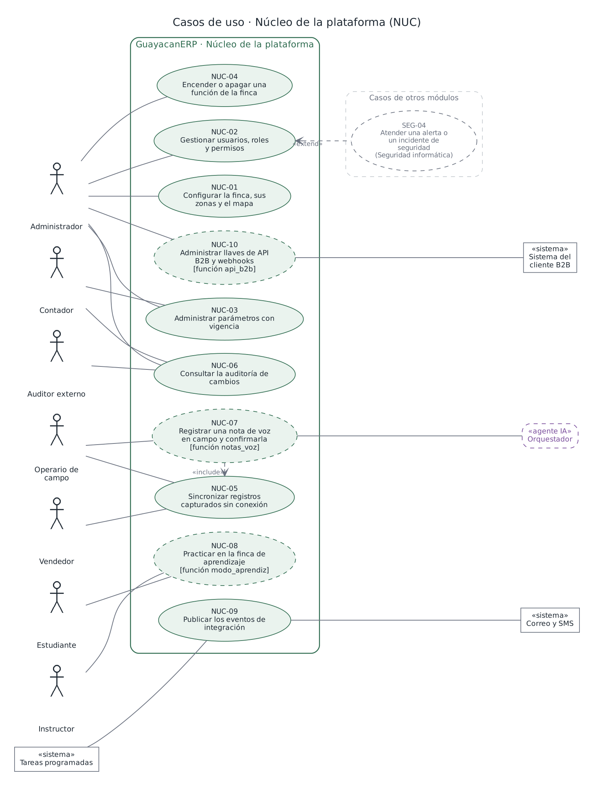
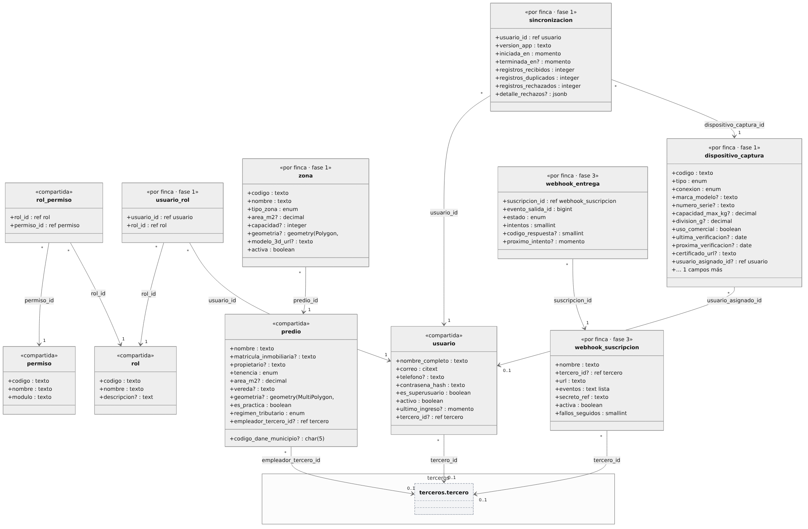
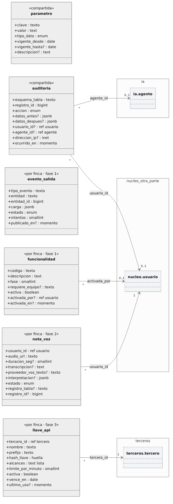
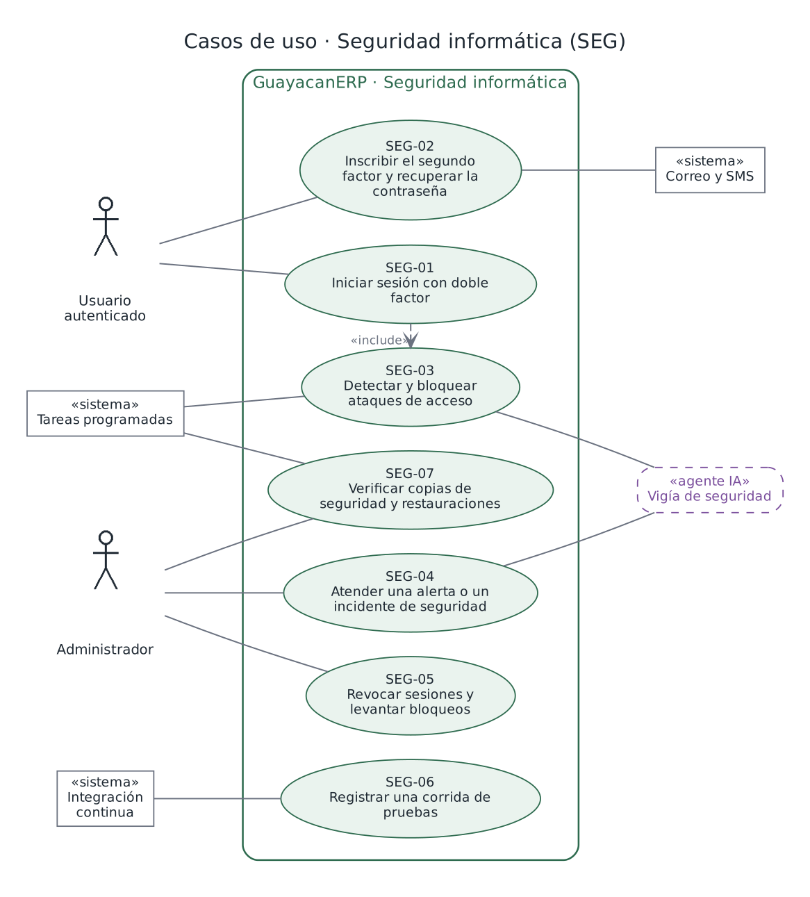
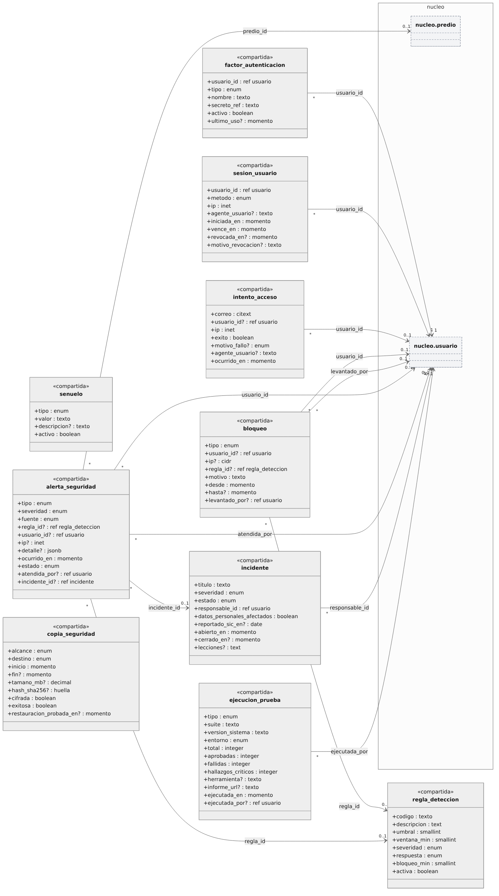
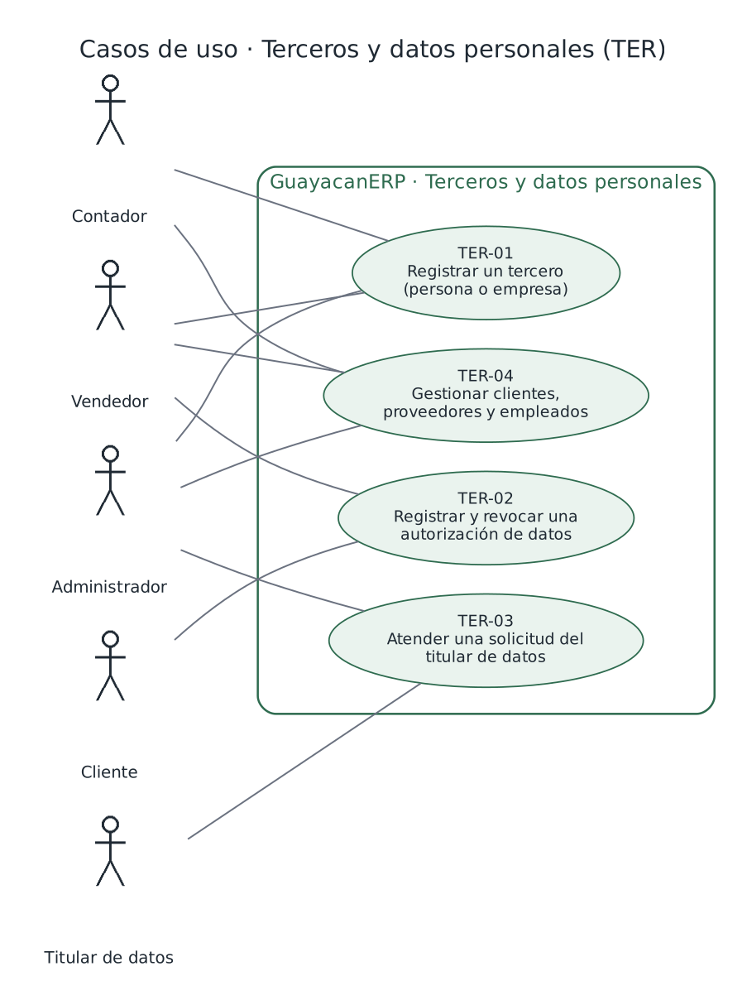
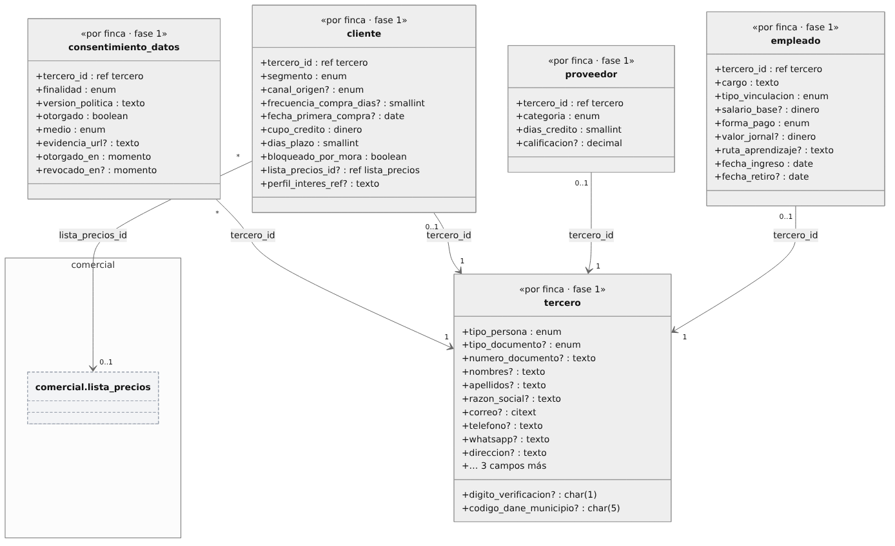
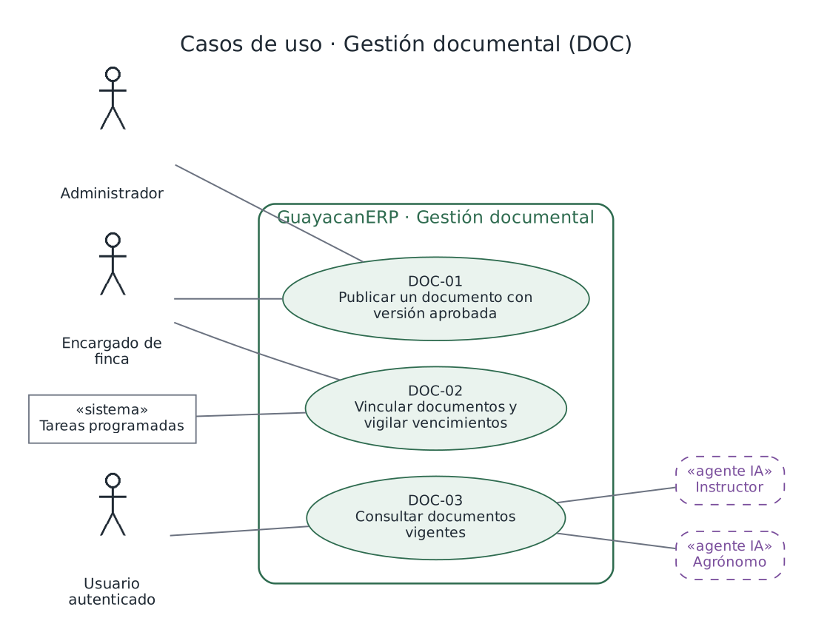
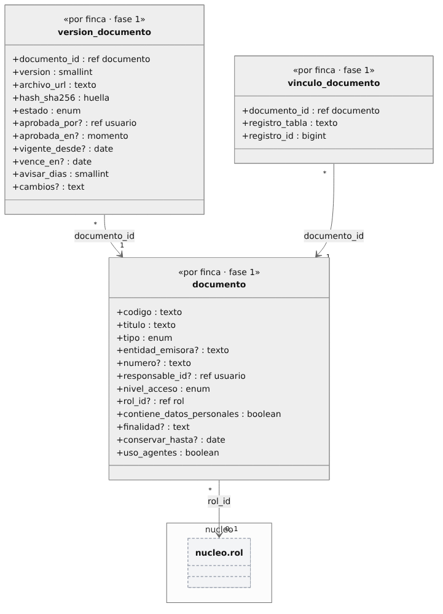

# Casos de uso 1 · Plataforma y seguridad

Especificación completa de los casos de uso del núcleo, la seguridad informática, los terceros con sus datos personales y la gestión documental. Cada módulo trae su diagrama de casos de uso, su diagrama de clases y la ficha de cada caso.

## Núcleo de la plataforma (NUC)

El núcleo sostiene a todos los demás módulos: la finca y sus zonas, los usuarios con sus roles por finca, los parámetros con vigencia, las funciones por finca, la sincronización sin conexión, la auditoría y los eventos de integración. Es lo primero que se construye.

### NUC-01 · Configurar la finca, sus zonas y el mapa

| Campo | Detalle |
| --- | --- |
| Objetivo | Dejar registrada la finca con sus zonas georreferenciadas (galpón, aprisco, estanques, lotes, bodega, ronda hídrica) para que todo registro se ubique en una zona |
| Disparador | Instalación del sistema o cambio en el uso de una zona |
| Precondiciones | El administrador inició sesión con doble factor; la finca existe en `nucleo.predio` |
| Postcondiciones | Zonas activas con su polígono en MAGNA-SIRGAS (EPSG 9377) visibles en el mapa; cambios auditados |
| Actores | Primario: Administrador. Secundarios: ninguno |
| Fase y función | Fase 1 · siempre activa |
| Relaciones | ninguna |
| Reglas en la base | `nucleo.predio_actual()` (RLS por finca), llave compuesta `(predio_id, id)` |
| Datos | `nucleo.predio`, `nucleo.zona` |
| API | `GET /api/v1/nucleo/zonas/?formato=geojson`; CRUD `/api/v1/nucleo/zonas/` y `/api/v1/nucleo/predios/` |
| Pruebas | v4 RLS, v4 Llave compuesta |
| Requerimientos | RF-04 lotes y cultivos georreferenciados, RF-22 mapa de la finca, RNF-01 crecimiento modular |

**Flujo principal**

1. El administrador abre Configuración › Finca y revisa nombre, municipio, vereda y empleador.
2. Abre el mapa y dibuja o importa (GeoJSON, KML) el polígono de una zona.
3. Indica código, nombre y tipo de zona.
4. El sistema valida el polígono y guarda la zona en la finca de la sesión.
5. El mapa muestra la zona; las pantallas de producción, riego e inventario ya la ofrecen.

**Flujos alternos y excepciones**

- 2a. Sin polígono: la zona se guarda sin geometría y queda marcada para dibujarla después.
- 4a. Código repetido en la finca: 409 por la llave única.
- 4b. Intento de escribir en otra finca: la base rechaza por RLS («new row violates row-level security policy»).
- 5a. Zona en desuso: se desactiva, no se borra, porque tiene historia.

### NUC-02 · Gestionar usuarios, roles y permisos

| Campo | Detalle |
| --- | --- |
| Objetivo | Dar a cada persona acceso solo a lo que necesita, en cada finca donde trabaja |
| Disparador | Ingresa, cambia de cargo o se retira una persona |
| Precondiciones | Administrador con doble factor; la persona está registrada como tercero (si aplica) |
| Postcondiciones | Usuario activo con roles por finca; los cambios de privilegios quedan auditados y alertados |
| Actores | Primario: Administrador. Secundarios: ninguno |
| Fase y función | Fase 1 · siempre activa |
| Relaciones | lo extiende SEG-04 (alerta por escalada de privilegios) |
| Reglas en la base | `seguridad.vigilar_privilegios()`, `nucleo.tiene_permiso()` |
| Datos | `nucleo.usuario`, `nucleo.rol`, `nucleo.permiso`, `nucleo.usuario_rol`, `nucleo.rol_permiso` |
| API | CRUD `/api/v1/nucleo/usuarios/`, `/api/v1/nucleo/usuarios/{id}/roles/`, `/api/v1/nucleo/roles/{id}/permisos/` |
| Pruebas | v5 Seguridad |
| Requerimientos | RF-01 registro e inicio de sesión, RF-02 gestión basada en roles |

**Flujo principal**

1. El administrador crea el usuario con nombre, correo y tercero asociado.
2. El sistema envía el enlace para fijar contraseña (guardada con Argon2).
3. El administrador asigna uno o más roles en la finca.
4. El sistema aplica los permisos del rol en el siguiente inicio de sesión.

**Flujos alternos y excepciones**

- 1a. Correo ya registrado: se reutiliza el usuario y solo se agrega el rol en esta finca.
- 3a. Rol administrador, contador o superusuario: la base crea una alerta de escalada de privilegios (SEG-04) y el usuario tendrá que inscribir doble factor (SEG-02).
- 3b. Cambio de permisos de un rol: alerta «cambio\_permisos».
- 4a. Retiro: el usuario se desactiva (`activo = false`) y se revocan sus sesiones; nunca se borra.

### NUC-03 · Administrar parámetros con vigencia

| Campo | Detalle |
| --- | --- |
| Objetivo | Cambiar valores del negocio (salario mínimo, IVA, recargos, topes, tasas) sin tocar el código y sin perder el historial |
| Disparador | Cambio de ley, de tarifa o de política de la finca |
| Precondiciones | Administrador o contador; el parámetro existe en el catálogo |
| Postcondiciones | Nuevo valor con `vigente_desde`; el anterior queda con `vigente_hasta`; los cálculos de fechas pasadas no cambian |
| Actores | Primario: Administrador, Contador. Secundarios: ninguno |
| Fase y función | Fase 1 · siempre activa |
| Relaciones | ninguna |
| Reglas en la base | `nucleo.parametro_valor()`, `nucleo.parametro_texto()`: primero el valor de la finca, si no el nacional |
| Datos | `nucleo.parametro` |
| API | CRUD `/api/v1/nucleo/parametros/` |
| Pruebas | v5 Nómina (aportes y provisiones leídos de parámetros) |
| Requerimientos | RNF-01 crecimiento modular |

**Flujo principal**

1. El usuario busca el parámetro (por ejemplo `jornada_maxima_semanal_horas`).
2. Ve el valor vigente y su historial.
3. Registra el nuevo valor y la fecha desde la que rige.
4. El sistema cierra la vigencia anterior el día previo y guarda el nuevo.

**Flujos alternos y excepciones**

- 3a. Valor solo para esta finca: se guarda con `predio_id`; el nacional sigue para las demás.
- 3b. Fecha en el pasado con periodos ya cerrados (nómina o contabilidad): se advierte que los cierres no se recalculan.

### NUC-04 · Encender o apagar una función de la finca

| Campo | Detalle |
| --- | --- |
| Objetivo | Activar lo que ya está construido cuando llega el equipo, el trámite o la decisión (crédito, permuta, dron, nómina electrónica) |
| Disparador | Se compra un equipo, se obtiene un permiso o la familia decide |
| Precondiciones | Administrador con doble factor |
| Postcondiciones | La función queda activa o inactiva con quién y cuándo; los casos de uso que la exigen se habilitan o se bloquean |
| Actores | Primario: Administrador. Secundarios: ninguno |
| Fase y función | Fase 1 · siempre activa |
| Relaciones | ninguna |
| Reglas en la base | `nucleo.exigir_funcion()`, `nucleo.funcion_activa()`, `nucleo.registrar_activacion()` |
| Datos | `nucleo.funcionalidad` (30 funciones) |
| API | `GET /api/v1/nucleo/funcionalidades/`; `PATCH /api/v1/nucleo/funcionalidades/{codigo}/` |
| Pruebas | v4 Funciones, v4 Listo para crecer, y una prueba por función en v5 |
| Requerimientos | RNF-01 crecimiento modular |

**Flujo principal**

1. El administrador abre Configuración › Funciones y ve cada función con su fase y lo que requiere.
2. Enciende una función.
3. El sistema registra quién y cuándo, y desde ese momento las reglas que llaman `exigir_funcion` la dejan pasar.
4. El frontend vuelve a pedir la lista y muestra los menús de la función.

**Flujos alternos y excepciones**

- 2a. Apagar una función con datos: los datos se conservan; solo se impide crear registros nuevos.
- 3a. Una pantalla llama una función apagada: la base responde «La función X no está activa en esta finca» (422).

### NUC-05 · Sincronizar registros capturados sin conexión

| Campo | Detalle |
| --- | --- |
| Objetivo | Que lo registrado en campo sin señal llegue al servidor una sola vez y que los rechazos se puedan corregir |
| Disparador | Vuelve la señal (Android en segundo plano) o se abre la app (iPhone) |
| Precondiciones | Dispositivo registrado en `nucleo.dispositivo_captura`; token vigente o renovable |
| Postcondiciones | Registros aceptados en sus tablas; una fila en `nucleo.sincronizacion` con subidos, duplicados y rechazados |
| Actores | Primario: Operario de campo, Vendedor. Secundarios: ninguno |
| Fase y función | Fase 1 · siempre activa |
| Relaciones | incluido por todos los casos de captura en campo |
| Reglas en la base | `INSERT … ON CONFLICT (predio_id, id_cliente) DO NOTHING`; cada tabla aplica sus propias reglas |
| Datos | `nucleo.sincronizacion`, `nucleo.dispositivo_captura` y las 35 tablas con captura sin conexión |
| API | `POST /api/v1/sincronizacion/lote/` |
| Pruebas | v4 Sin conexión |
| Requerimientos | RNF-03 operación sin conexión, RF-12 punto de venta móvil sin conexión |

**Flujo principal**

1. La PWA guarda cada registro en IndexedDB con `id_cliente` (UUIDv7) y `capturado_en`.
2. Al haber señal, el service worker envía los pendientes en lotes de hasta 200, ordenados por `capturado_en`.
3. El servidor inserta cada registro dentro de su propio punto de guardado (savepoint).
4. El servidor responde por registro: aceptado, duplicado o rechazado con el mensaje de la regla.
5. La PWA borra aceptados y duplicados y muestra los rechazados para corregir.

**Flujos alternos y excepciones**

- 3a. Un registro rechazado no tumba el lote: solo se revierte su savepoint.
- 3b. El mismo registro llega dos veces: se cuenta una vez (duplicado).
- 4a. Token vencido: la PWA renueva con el token de refresco y reintenta; si no puede, pide iniciar sesión sin perder los pendientes.
- 5a. Dos personas registraron el mismo hecho (misma postura del día): el segundo se rechaza por la llave única y se resuelve en la app.

### NUC-06 · Consultar la auditoría de cambios

| Campo | Detalle |
| --- | --- |
| Objetivo | Saber quién (persona o agente) cambió qué, cuándo y cómo estaba antes |
| Disparador | Revisión de rutina, reclamo, auditoría o incidente |
| Precondiciones | Rol administrador, contador o auditor con acceso de solo lectura |
| Postcondiciones | Ninguna escritura; la consulta queda registrada si se exporta (vigilancia de exportaciones) |
| Actores | Primario: Administrador, Contador, Auditor externo. Secundarios: ninguno |
| Fase y función | Fase 1 · siempre activa |
| Relaciones | ninguna |
| Reglas en la base | `nucleo.auditar()` en 102 tablas; la API no puede borrar la auditoría ni leer las particiones directamente |
| Datos | `nucleo.auditoria` (particionada por mes) |
| API | `GET /api/v1/nucleo/auditoria/?tabla=&registro=&desde=&hasta=` |
| Pruebas | v4 Auditoría, v4 Particiones |
| Requerimientos | RNF-04 Ley 1581, RNF-13 reportes para el Fondo Emprender |

**Flujo principal**

1. El usuario filtra por tabla, registro, persona o fechas.
2. El sistema muestra cada cambio con los campos que cambiaron, antes y después, y si lo hizo una persona o un agente.
3. El usuario abre el registro afectado o exporta el resultado.

**Flujos alternos y excepciones**

- 3a. Exportación de más de 20 conjuntos en una hora: alerta de exportación masiva (SEG-03).
- 2a. El auditor externo ve solo la finca para la que se le dio acceso.

### NUC-07 · Registrar una nota de voz en campo y confirmarla

| Campo | Detalle |
| --- | --- |
| Objetivo | Registrar con la voz cuando las manos están ocupadas, sin que la IA cree registros por su cuenta |
| Disparador | El operario graba «recogí 96 huevos en el galpón 1, 3 rotos» |
| Precondiciones | Función `notas_voz` encendida; permiso de micrófono en el celular |
| Postcondiciones | La nota pasa a confirmada y crea el registro propuesto, o queda descartada |
| Actores | Primario: Operario de campo. Secundarios: Orquestador (IA) |
| Fase y función | Fase 2 · función `notas_voz` (apagada al instalar) |
| Relaciones | incluye NUC-05 |
| Reglas en la base | Estados pendiente → interpretada → confirmada o descartada; el registro solo se crea al confirmar una persona |
| Datos | `nucleo.nota_voz` y la tabla destino (por ejemplo `produccion.registro_postura`) |
| API | `POST /api/v1/nucleo/notas-voz/`; `POST /api/v1/nucleo/notas-voz/{id}/confirmar/` |
| Pruebas | pendiente: escribir la prueba al construir |
| Requerimientos | RNF-03 operación sin conexión, RNF-07 interfaz para campo |

**Flujo principal**

1. El operario graba la nota sin conexión; el audio queda en el celular.
2. Al sincronizar, el audio sube a MinIO y la nota queda pendiente.
3. El servicio de agentes transcribe e interpreta y propone el registro (tabla y valores).
4. El operario ve la propuesta y la confirma o corrige.
5. El sistema crea el registro con el `id_cliente` de la nota.

**Flujos alternos y excepciones**

- 3a. No se entiende la nota: queda interpretada sin propuesta y el operario la registra a mano.
- 4a. El operario la descarta: estado descartada, sin registro.
- 5a. El registro viola una regla (más rotos que recogidos): se rechaza y la nota vuelve a interpretada.

### NUC-08 · Practicar en la finca de aprendizaje

| Campo | Detalle |
| --- | --- |
| Objetivo | Que estudiantes y operarios nuevos practiquen con datos de ejemplo sin tocar la finca real |
| Disparador | Clase, inducción o prueba de una función nueva |
| Precondiciones | Función `modo_aprendiz` encendida; el usuario tiene rol en la finca de práctica |
| Postcondiciones | Lo registrado queda solo en la finca de práctica |
| Actores | Primario: Estudiante, Instructor. Secundarios: ninguno |
| Fase y función | Fase 1 · función `modo_aprendiz` (encendida al instalar) |
| Relaciones | ninguna |
| Reglas en la base | `nucleo.predios_del_usuario()`; RLS separa por completo las dos fincas |
| Datos | `nucleo.predio`, `nucleo.funcionalidad` |
| API | `GET /api/v1/nucleo/mis-fincas/`; cabecera `X-Predio` para cambiar de finca |
| Pruebas | v4 Práctica |
| Requerimientos | RNF-11 código documentado y enseñable |

**Flujo principal**

1. El usuario abre el selector de finca y elige «Finca de práctica».
2. La app muestra una franja de color que avisa que está en práctica.
3. El usuario sigue el tutorial y registra datos.
4. El instructor revisa lo hecho por cada estudiante.

**Flujos alternos y excepciones**

- 1a. El usuario no tiene rol en la finca de práctica: el selector no la muestra.
- 3a. El instructor reinicia la finca de práctica cargando de nuevo los datos de ejemplo.

### NUC-09 · Publicar los eventos de integración

| Campo | Detalle |
| --- | --- |
| Objetivo | Avisar a los agentes, a MongoDB y a quien corresponda de cada hecho de negocio sin perder ninguno |
| Disparador | Una transacción escribió en `nucleo.evento_salida` (pedido confirmado, lote bloqueado) |
| Precondiciones | Celery y Redis en marcha |
| Postcondiciones | Evento publicado en Redis Streams y marcado publicado; avisos enviados |
| Actores | Primario: Tareas programadas. Secundarios: Correo y SMS |
| Fase y función | Fase 1 · siempre activa |
| Relaciones | ninguna |
| Reglas en la base | Patrón outbox: el evento se escribe en la misma transacción del hecho |
| Datos | `nucleo.evento_salida` |
| API | sin endpoint público (tarea Celery) |
| Pruebas | v4 Frío (eventos lote.bloqueado y temperatura.fuera\_de\_rango) |
| Requerimientos | RF-20 notificaciones automáticas |

**Flujo principal**

1. Cada 10 segundos Celery toma hasta 100 eventos pendientes con `FOR UPDATE SKIP LOCKED`.
2. Publica cada uno en Redis Streams con su tipo y su carga.
3. Lo marca publicado con la fecha.
4. Los consumidores (agentes, correo, push) actúan según el tipo.

**Flujos alternos y excepciones**

- 2a. Redis no responde: el evento sigue pendiente y se reintenta; tras 5 intentos pasa a fallido y alerta al administrador.
- 4a. Un consumidor recibe un evento repetido: los consumidores son idempotentes por id del evento.

### NUC-10 · Administrar llaves de API B2B y webhooks

| Campo | Detalle |
| --- | --- |
| Objetivo | Que un hotel o restaurante consulte catálogo y pida por API, y que sistemas externos reciban eventos firmados |
| Disparador | Un cliente HORECA pide integración |
| Precondiciones | Función `api_b2b` (y `webhooks_salientes` para eventos) encendida; el tercero es cliente |
| Postcondiciones | Llave activa con alcance, límite y vencimiento; la base solo guarda su huella |
| Actores | Primario: Administrador. Secundarios: Sistema del cliente B2B |
| Fase y función | Fase 3 · función `api_b2b` (apagada al instalar) |
| Relaciones | ninguna |
| Reglas en la base | `nucleo.validar_llave_api()`, `nucleo.autenticar_llave_api()` (la llave señuelo bloquea la IP), `nucleo.validar_webhook()` (solo https) |
| Datos | `nucleo.llave_api`, `nucleo.webhook_suscripcion`, `nucleo.webhook_entrega` |
| API | `GET /api/b2b/v1/catalogo/`; `POST /api/b2b/v1/pedidos/`; CRUD `/api/v1/nucleo/llaves-api/` y `/api/v1/nucleo/webhooks-suscripcion/` |
| Pruebas | v5 Integración |
| Requerimientos | RQ-43 integraciones externas |

**Flujo principal**

1. El administrador crea la llave para el cliente con alcances (catálogo, pedidos), límite por minuto y vencimiento.
2. El sistema muestra la llave completa una sola vez y guarda su prefijo y su huella.
3. El cliente llama la API con la llave; Nginx limita la frecuencia y el ERP la autentica.
4. Los pedidos del cliente entran en borrador para que un vendedor los confirme.

**Flujos alternos y excepciones**

- 1a. El tercero no es cliente: «Solo un cliente tiene llave».
- 3a. Llave vencida o revocada: 401.
- 3b. Alguien usa la llave señuelo: no hay acceso, la IP queda bloqueada y se crea alerta crítica.
- 4b. Webhook: cada evento se firma con el secreto del suscriptor y se reintenta con espera creciente; tras el límite queda fallido.

## Seguridad informática (SEG)

La seguridad vive en la base para que funcione igual desde la API, la PWA o un agente: doble factor obligatorio para administrador y contador, detector de ataques con bloqueo automático, señuelos, alertas inalterables, registro de pruebas y vigilancia de copias.

### SEG-01 · Iniciar sesión con doble factor

| Campo | Detalle |
| --- | --- |
| Objetivo | Entrar al sistema con una identidad verificada y una sesión limitada en el tiempo |
| Disparador | El usuario abre la PWA o el panel |
| Precondiciones | Usuario activo; si su rol lo exige, factor inscrito (SEG-02) |
| Postcondiciones | Intento registrado; sesión creada con método, IP y vencimiento; JWT de acceso y de refresco entregados |
| Actores | Primario: Usuario autenticado. Secundarios: ninguno |
| Fase y función | Fase 1 · siempre activa |
| Relaciones | incluye SEG-03 |
| Reglas en la base | `seguridad.registrar_intento()`, `seguridad.requiere_doble_factor()`, `seguridad.validar_sesion()` |
| Datos | `seguridad.intento_acceso`, `seguridad.sesion_usuario`, `seguridad.factor_autenticacion` |
| API | `POST /api/v1/auth/token/`; `POST /api/v1/auth/doble-factor/verificar/`; `POST /api/v1/auth/token/refrescar/` |
| Pruebas | v5 Seguridad |
| Requerimientos | RF-01 inicio de sesión, RF-03 autenticación segura, RQ-35 seguridad informática |

**Flujo principal**

1. El usuario escribe correo y contraseña.
2. El sistema verifica el hash Argon2 y llama `registrar_intento` con correo, IP, resultado y agente de usuario.
3. Si el usuario es administrador, contador o superusuario en cualquier finca, pide el segundo factor (TOTP o llave de acceso).
4. El usuario ingresa el código o toca su llave.
5. El sistema crea la sesión (método `doble_factor`, máximo 12 horas) y entrega los tokens.

**Flujos alternos y excepciones**

- 2a. Contraseña incorrecta: 401 con mensaje genérico; el intento cuenta para el detector.
- 2b. Cuenta o IP bloqueada, o cuenta señuelo: 401 genérico; nunca se dice por qué.
- 3a. Rol sin doble factor obligatorio: sesión con método `contrasena`.
- 4a. Código inválido tres veces: se registra como intento fallido.
- 5a. Sesión pedida por más de 12 horas: «Una sesión dura como máximo 12 horas».

### SEG-02 · Inscribir el segundo factor y recuperar la contraseña

| Campo | Detalle |
| --- | --- |
| Objetivo | Tener un segundo factor de respaldo y recuperar el acceso sin ayuda del soporte |
| Disparador | Primer ingreso con rol que lo exige, cambio de celular u olvido de contraseña |
| Precondiciones | Correo verificado |
| Postcondiciones | Factor activo con su secreto cifrado; códigos de respaldo de un solo uso; contraseña nueva y sesiones anteriores revocadas |
| Actores | Primario: Usuario autenticado. Secundarios: Correo y SMS |
| Fase y función | Fase 1 · siempre activa |
| Relaciones | ninguna |
| Reglas en la base | Solo la huella o el secreto cifrado se guarda; revocar sesiones al cambiar contraseña (`seguridad.revocar_sesiones()`) |
| Datos | `seguridad.factor_autenticacion` |
| API | `POST /api/v1/auth/doble-factor/inscribir/`; `POST /api/v1/auth/recuperar/`; `POST /api/v1/auth/recuperar/confirmar/` |
| Pruebas | v5 Seguridad |
| Requerimientos | RF-03 recuperación de contraseña, RQ-35 seguridad informática |

**Flujo principal**

1. El sistema muestra un código QR TOTP o pide registrar una llave de acceso (WebAuthn).
2. El usuario confirma con un primer código válido.
3. El sistema guarda el factor y entrega 10 códigos de respaldo.
4. Para recuperar la contraseña, el usuario pide el enlace; llega al correo con vigencia de 30 minutos.
5. El usuario fija la nueva contraseña; se revocan todas sus sesiones.

**Flujos alternos y excepciones**

- 2a. Código inválido: se repite el paso; el reloj del celular puede estar desfasado.
- 4a. Correo inexistente: la respuesta es igual a la de un correo válido (no revela cuentas).
- 5a. Pérdida del celular con doble factor: el administrador revoca el factor y la persona inscribe uno nuevo.

### SEG-03 · Detectar y bloquear ataques de acceso

| Campo | Detalle |
| --- | --- |
| Objetivo | Frenar fuerza bruta, relleno de credenciales, intrusos y fugas de datos sin esperar a una persona |
| Disparador | Cada intento de acceso, cada exportación y cada cambio de privilegios |
| Precondiciones | Reglas de detección y señuelos cargados (datos iniciales) |
| Postcondiciones | Bloqueo de cuenta o IP con vencimiento; alerta con severidad; evento para el Vigía de seguridad |
| Actores | Primario: Tareas programadas (proceso automático). Secundarios: Vigía de seguridad (IA) |
| Fase y función | Fase 1 · siempre activa |
| Relaciones | incluido por SEG-01 |
| Reglas en la base | `seguridad.registrar_intento()`, `seguridad.vigilar_exportaciones()`, `seguridad.vigilar_privilegios()`, `seguridad.ip_bloqueada()`, `seguridad.cuenta_bloqueada()` |
| Datos | `seguridad.regla_deteccion`, `seguridad.bloqueo`, `seguridad.senuelo`, `seguridad.alerta_seguridad` |
| API | sin endpoint público; se ejecuta dentro de SEG-01 y de los disparadores |
| Pruebas | v5 Seguridad, v5 Integración |
| Requerimientos | RQ-35 detector de ataques |

**Flujo principal**

1. Cada intento se guarda en `intento_acceso` (solo inserción).
2. La función cuenta fallos en la ventana de cada regla.
3. Con 5 fallos en 15 minutos contra una cuenta, la bloquea 30 minutos (regla `fuerza_bruta_cuenta`).
4. Con 10 cuentas distintas fallidas desde una IP en 10 minutos, bloquea la IP 60 minutos (`relleno_credenciales`).
5. Crea la alerta con su severidad y la publica para el tablero.

**Flujos alternos y excepciones**

- 2a. Se toca una cuenta o llave señuelo: alerta crítica y bloqueo de la IP por 24 horas al primer intento.
- 2b. 20 exportaciones de un usuario en una hora: alerta alta y se cierran sus sesiones (`exportacion_masiva`).
- 2c. Se da rol de administrador o contador, se cambian permisos o alguien se vuelve superusuario: alerta de escalada.
- 5a. El Vigía de seguridad resume, pero no puede bloquear ni desbloquear.

### SEG-04 · Atender una alerta o un incidente de seguridad

| Campo | Detalle |
| --- | --- |
| Objetivo | Analizar cada alerta, contener el daño y, si hubo datos personales comprometidos, reportarlo |
| Disparador | Alerta nueva en el tablero o aviso push |
| Precondiciones | Administrador con permiso `seguridad.atender_alerta` |
| Postcondiciones | Alerta con estado y quién la atendió; incidente abierto, contenido, erradicado y cerrado con lecciones |
| Actores | Primario: Administrador. Secundarios: Vigía de seguridad (IA) |
| Fase y función | Fase 1 · siempre activa |
| Relaciones | extiende NUC-02 |
| Reglas en la base | `seguridad.proteger_alerta()`: la API no cambia severidad ni borra; solo actualiza estado, atención e incidente |
| Datos | `seguridad.alerta_seguridad`, `seguridad.incidente` |
| API | `GET /api/v1/seguridad/tablero/`; `PATCH /api/v1/seguridad/alertas-seguridad/{id}/`; CRUD `/api/v1/seguridad/incidentes/` |
| Pruebas | v5 Seguridad |
| Requerimientos | RQ-35 monitoreo, RNF-04 Ley 1581 |

**Flujo principal**

1. El administrador abre el tablero (alertas de 24 horas, bloqueos activos, fallos, copias, pruebas).
2. Toma una alerta: pasa a en análisis con su nombre.
3. Decide: contenida (con acción), falso positivo o abre un incidente.
4. En el incidente registra responsable, severidad y si hubo datos personales.
5. Cierra con lecciones aprendidas.

**Flujos alternos y excepciones**

- 3a. Intento de rebajar la severidad desde la API: «permission denied».
- 4a. Datos personales comprometidos: el sistema exige la fecha de reporte a la SIC antes de cerrar.

### SEG-05 · Revocar sesiones y levantar bloqueos

| Campo | Detalle |
| --- | --- |
| Objetivo | Cortar el acceso de inmediato o devolverlo cuando el bloqueo fue legítimo pero ya no aplica |
| Disparador | Robo de celular, retiro de una persona, alerta atendida |
| Precondiciones | Administrador con doble factor |
| Postcondiciones | Sesiones revocadas con motivo; bloqueo levantado con quién y cuándo |
| Actores | Primario: Administrador. Secundarios: ninguno |
| Fase y función | Fase 1 · siempre activa |
| Relaciones | ninguna |
| Reglas en la base | `seguridad.revocar_sesiones()`; bloqueos y sesiones no se borran |
| Datos | `seguridad.sesion_usuario`, `seguridad.bloqueo` |
| API | `POST /api/v1/seguridad/sesiones/{id}/revocar/`; `POST /api/v1/seguridad/bloqueos/{id}/levantar/` |
| Pruebas | v5 Seguridad |
| Requerimientos | RQ-35 seguridad informática |

**Flujo principal**

1. El administrador busca al usuario y ve sus sesiones abiertas (dispositivo, IP, hora).
2. Revoca una o todas, con motivo.
3. El siguiente uso del token devuelve 401 y la PWA pide iniciar sesión.
4. Para un bloqueo, lo revisa en el tablero y lo levanta con motivo.

**Flujos alternos y excepciones**

- 4a. El bloqueo vence solo: no hace falta levantarlo; queda en el historial.

### SEG-06 · Registrar una corrida de pruebas

| Campo | Detalle |
| --- | --- |
| Objetivo | Dejar constancia de cada corrida de pruebas (reglas SQL, unitarias, extremo a extremo, dependencias, análisis de código, penetración) |
| Disparador | Termina un job de GitHub Actions o una prueba manual |
| Precondiciones | El CI tiene su llave de servicio con alcance solo de escritura de pruebas |
| Postcondiciones | Corrida registrada, inmutable, visible en el tablero |
| Actores | Primario: Integración continua. Secundarios: ninguno |
| Fase y función | Fase 1 · siempre activa |
| Relaciones | ninguna |
| Reglas en la base | Solo inserción |
| Datos | `seguridad.ejecucion_prueba` |
| API | `POST /api/v1/seguridad/ejecuciones-prueba/` |
| Pruebas | v5 Seguridad |
| Requerimientos | RNF-11 código documentado, RQ-35 módulo de pruebas |

**Flujo principal**

1. El job de CI termina y envía tipo, suite, versión, entorno, total, aprobadas, fallidas y herramienta.
2. El sistema guarda la corrida.
3. El tablero muestra la última corrida por tipo y alerta si alguna falló.

**Flujos alternos y excepciones**

- 1a. Corrida con fallas en `main`: alerta media para el líder técnico.

### SEG-07 · Verificar copias de seguridad y restauraciones

| Campo | Detalle |
| --- | --- |
| Objetivo | Garantizar copias cifradas diarias y probar cada mes que se pueden restaurar |
| Disparador | Tarea diaria; prueba de restauración mensual |
| Precondiciones | Destino de copias configurado (3-2-1: tres copias, dos medios, una fuera del servidor) |
| Postcondiciones | Copia registrada con tamaño, huella y resultado; alertas si falta copia o prueba |
| Actores | Primario: Tareas programadas, Administrador. Secundarios: ninguno |
| Fase y función | Fase 1 · siempre activa |
| Relaciones | ninguna |
| Reglas en la base | `seguridad.revisar_copias()`; toda copia debe estar cifrada (CHECK) |
| Datos | `seguridad.copia_seguridad` |
| API | CRUD de solo lectura `/api/v1/seguridad/copias-seguridad/` |
| Pruebas | v5 Seguridad |
| Requerimientos | RNF-06 copias diarias, RNF-05 cifrado en reposo |

**Flujo principal**

1. El script de copia (pgBackRest o pg\_dump cifrado) termina y registra la copia.
2. Cada noche `revisar_copias` busca una copia exitosa en las últimas 26 horas y una restauración probada en el último mes.
3. Si falta alguna, crea la alerta.
4. Una vez al mes, el administrador restaura en el entorno de pruebas y registra el resultado.

**Flujos alternos y excepciones**

- 1a. Copia sin cifrar: la base la rechaza.
- 4a. La restauración falla: incidente alto hasta que una copia se restaure con éxito.

## Terceros y datos personales (TER)

Un tercero es cualquier persona o empresa: el mismo registro puede ser cliente, proveedor y empleado. Aquí vive la autorización de datos personales por finalidad (Ley 1581 de 2012), que consultan el CRM, los canales y los agentes antes de personalizar o escribir.

### TER-01 · Registrar un tercero (persona o empresa)

| Campo | Detalle |
| --- | --- |
| Objetivo | Tener una sola ficha por persona o empresa, sin duplicados |
| Disparador | Primer pedido, primera compra, contratación o conversión de un prospecto |
| Precondiciones | Usuario con permiso sobre terceros en la finca |
| Postcondiciones | Tercero creado; listo para tener roles de cliente, proveedor o empleado |
| Actores | Primario: Vendedor, Contador, Administrador. Secundarios: ninguno |
| Fase y función | Fase 1 · siempre activa |
| Relaciones | incluido por CRM-05 |
| Reglas en la base | Tipo de persona natural o jurídica; documento único por finca; dígito de verificación del NIT |
| Datos | `terceros.tercero` |
| API | CRUD `/api/v1/terceros/terceros/`; `GET /api/v1/terceros/terceros/?documento=` |
| Pruebas | v4 RLS |
| Requerimientos | RF-10 pedidos de clientes |

**Flujo principal**

1. El usuario busca por documento o nombre.
2. Si no existe, elige persona natural o jurídica y llena los datos mínimos.
3. El sistema valida el documento y el dígito de verificación.
4. Guarda el tercero y ofrece asignarle un rol (cliente, proveedor, empleado).

**Flujos alternos y excepciones**

- 1a. Ya existe: se abre la ficha existente; no se crea otra.
- 2a. Persona con datos de contacto sin autorización: se guarda sin teléfono ni correo hasta registrar la autorización (TER-02).

### TER-02 · Registrar y revocar una autorización de datos

| Campo | Detalle |
| --- | --- |
| Objetivo | Saber para qué autorizó cada persona el uso de sus datos y respetarlo en cada envío |
| Disparador | Formulario, check-in, compra, solicitud del titular |
| Precondiciones | Política de tratamiento publicada con su versión |
| Postcondiciones | Autorización por finalidad (publicidad, personalización, imagen, biometría) con medio y fecha; revocación con fecha |
| Actores | Primario: Cliente, Vendedor. Secundarios: ninguno |
| Fase y función | Fase 1 · siempre activa |
| Relaciones | ninguna |
| Reglas en la base | `crm.consentimiento_vigente()`; `redes.verificar_envio()` bloquea plantillas de mercadeo sin autorización de publicidad; biometría exige su propia autorización expresa |
| Datos | `terceros.consentimiento_datos` |
| API | CRUD `/api/v1/terceros/consentimientos/`; `POST /api/v1/terceros/consentimientos/{id}/revocar/` |
| Pruebas | v4 WhatsApp, v4 Biometría, v5 CRM |
| Requerimientos | RNF-04 Ley 1581 |

**Flujo principal**

1. La persona lee la política y marca cada finalidad que autoriza.
2. El sistema guarda una autorización por finalidad con versión de política, medio y fecha.
3. Los canales, el CRM y los agentes consultan la autorización vigente antes de actuar.
4. Si la persona revoca, se registra la fecha y deja de usarse desde ese momento.

**Flujos alternos y excepciones**

- 3a. Sin autorización de publicidad: el mensaje de mercadeo se bloquea; los mensajes de servicio (pedido, entrega) sí salen.
- 4a. Revocación de imagen o biometría: las piezas sin aprobar se bloquean y el acceso facial se apaga; el PIN sigue.

### TER-03 · Atender una solicitud del titular de datos

| Campo | Detalle |
| --- | --- |
| Objetivo | Responder consultas, rectificaciones y supresiones dentro de los plazos de la Ley 1581 |
| Disparador | El titular escribe al correo o al canal oficial de datos personales |
| Precondiciones | Identidad del titular verificada |
| Postcondiciones | Respuesta registrada; datos rectificados o suprimidos salvo los que la ley obliga a conservar |
| Actores | Primario: Titular de datos. Secundarios: Administrador |
| Fase y función | Fase 1 · siempre activa |
| Relaciones | ninguna |
| Reglas en la base | Facturas, nómina y contabilidad se conservan por obligación legal; se anonimiza lo demás |
| Datos | `terceros.tercero`, `terceros.consentimiento_datos` y tablas que lo referencian |
| API | `GET /api/v1/terceros/terceros/{id}/datos-personales/`; `POST /api/v1/terceros/terceros/{id}/anonimizar/` |
| Pruebas | pendiente: escribir la prueba al construir |
| Requerimientos | RNF-04 Ley 1581 |

**Flujo principal**

1. El administrador registra la solicitud con su tipo y la fecha de recibo.
2. Genera el informe de datos del titular (fichas, autorizaciones, conversaciones referenciadas).
3. Rectifica o anonimiza según lo pedido.
4. Responde al titular y cierra la solicitud.

**Flujos alternos y excepciones**

- 3a. Hay obligaciones legales de conservación: se explica al titular qué se conserva y por qué.
- 3b. La supresión incluye MongoDB: el servicio de agentes borra conversaciones y perfiles del tercero por su id.

### TER-04 · Gestionar clientes, proveedores y empleados

| Campo | Detalle |
| --- | --- |
| Objetivo | Dar a un tercero sus datos comerciales, de compra o laborales |
| Disparador | Se acuerda venta, compra o vinculación laboral |
| Precondiciones | El tercero existe |
| Postcondiciones | Cliente con lista de precios, cupo y plazo; proveedor con categoría; empleado con cargo, forma de pago y salario o jornal |
| Actores | Primario: Administrador, Contador, Vendedor. Secundarios: ninguno |
| Fase y función | Fase 1 · siempre activa |
| Relaciones | ninguna |
| Reglas en la base | El bloqueo por mora lo pone y lo quita la cartera; la forma de pago del empleado decide cómo liquida la nómina |
| Datos | `terceros.cliente`, `terceros.proveedor`, `terceros.empleado` |
| API | CRUD `/api/v1/terceros/clientes/`, `/api/v1/terceros/proveedores/`, `/api/v1/terceros/empleados/` |
| Pruebas | v4 Crédito, v5 Nómina |
| Requerimientos | RF-10 pedidos, RQ-29 nómina con salario, jornal y destajo |

**Flujo principal**

1. Desde la ficha del tercero, el usuario agrega el rol.
2. Llena los datos del rol (por ejemplo, para un empleado: cargo, tipo de vinculación, forma de pago salario, jornal, destajo o mixto, fecha de ingreso).
3. El sistema guarda y habilita el tercero en pedidos, compras o tareas.

**Flujos alternos y excepciones**

- 2a. Cliente a crédito con la función `venta_credito` apagada: el cupo se guarda pero no se usa.
- 3a. Retiro de un empleado: se registra la fecha de retiro; deja de estar disponible para tareas y turnos desde el día siguiente.

## Gestión documental (DOC)

Protocolos, planes, contratos y certificados con una sola versión aprobada y vigente. El cumplimiento toma de aquí su evidencia y los agentes solo leen lo aprobado y autorizado.

### DOC-01 · Publicar un documento con versión aprobada

| Campo | Detalle |
| --- | --- |
| Objetivo | Que todos trabajen con la versión vigente de cada protocolo o plan |
| Disparador | Se escribe o actualiza un protocolo (bioseguridad, plan sanitario) |
| Precondiciones | Encargado o administrador; archivo listo en PDF |
| Postcondiciones | Versión aprobada con su huella SHA-256; la anterior pasa a obsoleta |
| Actores | Primario: Encargado de finca, Administrador. Secundarios: ninguno |
| Fase y función | Fase 1 · siempre activa |
| Relaciones | ninguna |
| Reglas en la base | `documental.validar_version()` (una aprobada no cambia su archivo; un agente no aprueba), `documental.obsoletar_anteriores()` |
| Datos | `documental.documento`, `documental.version_documento` |
| API | CRUD `/api/v1/documental/documentos/` y `/api/v1/documental/documentos/{id}/versiones/` |
| Pruebas | v5 Documental |
| Requerimientos | RQ-32 gestión documental |

**Flujo principal**

1. El usuario crea el documento con código, título, tipo y vencimiento.
2. Sube la versión; el sistema la guarda en MinIO y calcula la huella.
3. La envía a revisión; otra persona la aprueba.
4. El sistema vuelve obsoletas las anteriores.

**Flujos alternos y excepciones**

- 1a. Documento con datos personales: exige finalidad y tiempo de conservación (Ley 1581).
- 3a. Intento de cambiar el archivo de una versión aprobada: «no cambia su archivo»; se sube una versión nueva.

### DOC-02 · Vincular documentos y vigilar vencimientos

| Campo | Detalle |
| --- | --- |
| Objetivo | Que cada documento esté ligado a lo que soporta y que nada se venza sin aviso |
| Disparador | Se carga un certificado, una póliza o un registro; tarea diaria |
| Precondiciones | El documento existe |
| Postcondiciones | Vínculo con el registro (zona, activo, expediente, empleado); aviso antes del vencimiento |
| Actores | Primario: Tareas programadas, Encargado de finca. Secundarios: ninguno |
| Fase y función | Fase 1 · siempre activa |
| Relaciones | ninguna |
| Reglas en la base | Vista `documental.v_vigentes` con días para vencer |
| Datos | `documental.vinculo_documento`, `documental.documento` |
| API | `GET /api/v1/documental/vigentes/`; CRUD `/api/v1/documental/vinculos-documento/` |
| Pruebas | v5 Documental |
| Requerimientos | RQ-32 gestión documental, RQ-33 cumplimiento |

**Flujo principal**

1. El usuario vincula el documento a uno o más registros.
2. Cada noche la tarea revisa vencimientos a 30, 15 y 1 día.
3. Avisa al responsable y marca el documento en el tablero.

**Flujos alternos y excepciones**

- 3a. Documento vencido que soporta un requisito: el expediente pasa ese requisito a no cumple (CUM-03).

### DOC-03 · Consultar documentos vigentes

| Campo | Detalle |
| --- | --- |
| Objetivo | Encontrar rápido el protocolo vigente, también desde el campo |
| Disparador | Una persona o un agente necesita un procedimiento |
| Precondiciones | Usuario autenticado; para agentes, documento autorizado con `uso_agentes` |
| Postcondiciones | Ninguna escritura |
| Actores | Primario: Usuario autenticado. Secundarios: Instructor (IA), Agrónomo (IA) |
| Fase y función | Fase 1 · siempre activa |
| Relaciones | incluido por FOR-09 |
| Reglas en la base | `documental.documento_para_agente()`: solo la versión aprobada, vigente y autorizada |
| Datos | `documental.version_documento` |
| API | `GET /api/v1/documental/vigentes/?uso_agentes=true` |
| Pruebas | v5 Documental |
| Requerimientos | RQ-32 gestión documental, RQ-23 agentes con límites |

**Flujo principal**

1. El usuario busca por código, título o tipo.
2. El sistema muestra la versión vigente y su enlace de descarga temporal.
3. La PWA guarda copia para consultar sin conexión.

**Flujos alternos y excepciones**

- 1a. Un agente pide un documento no autorizado: «no autorizado para agentes».
