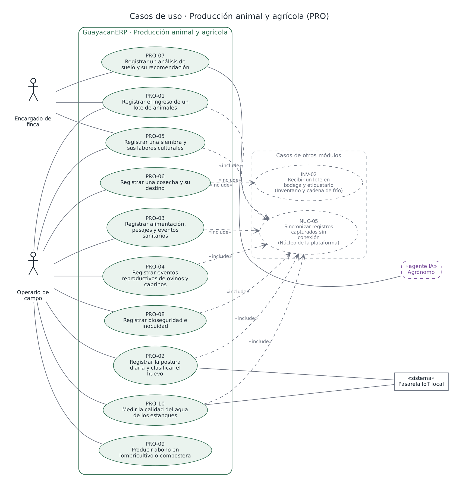
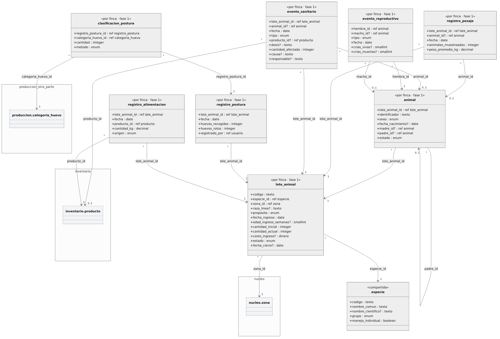
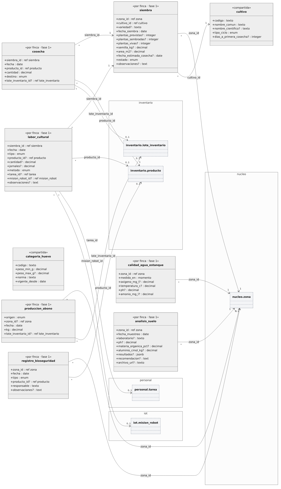
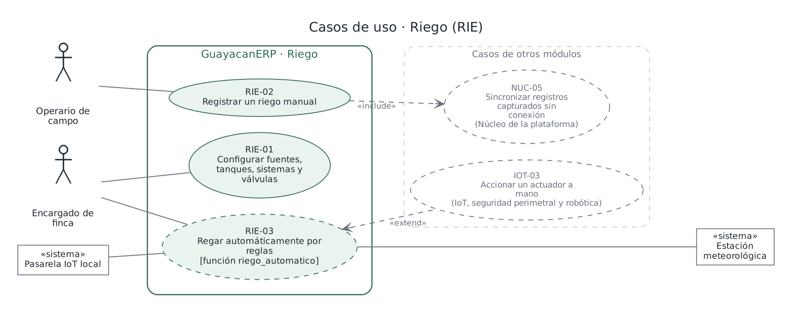
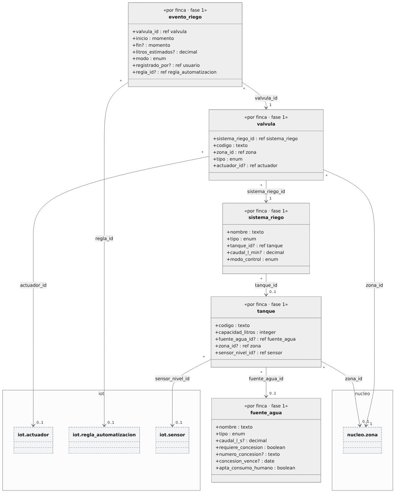
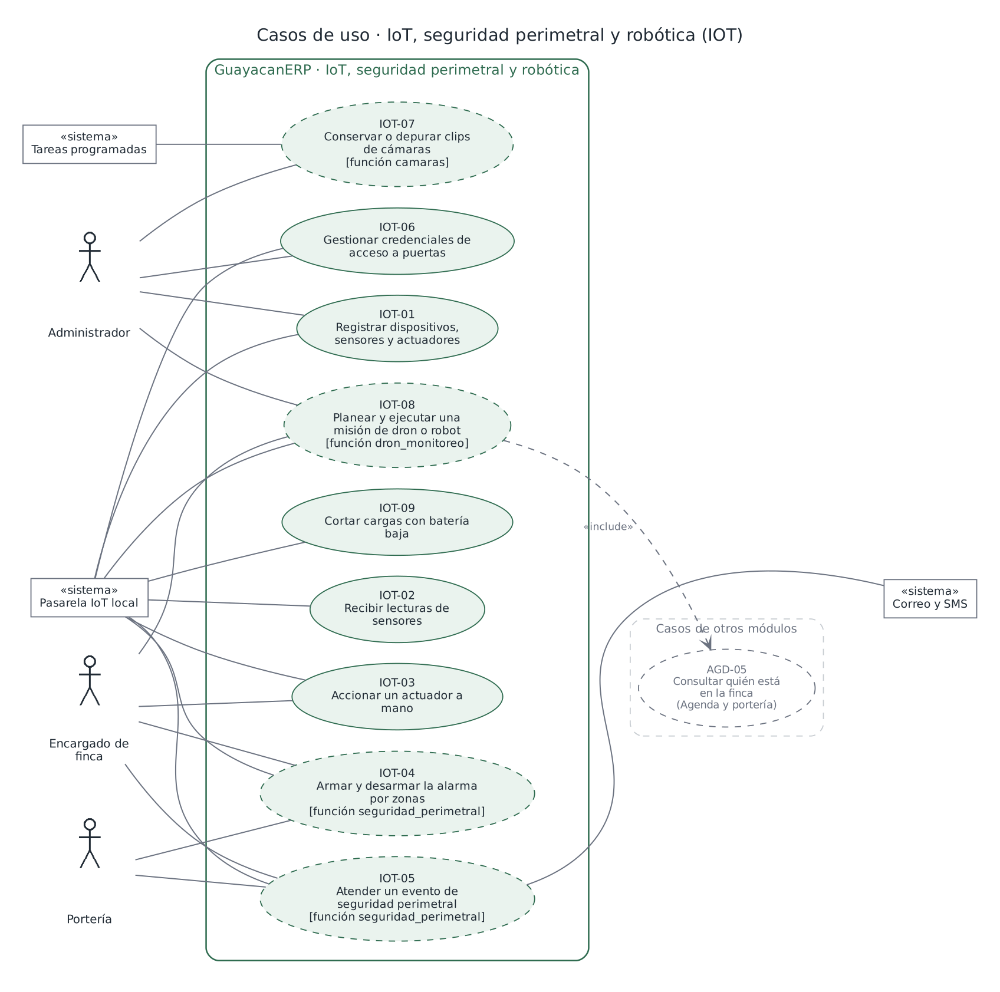
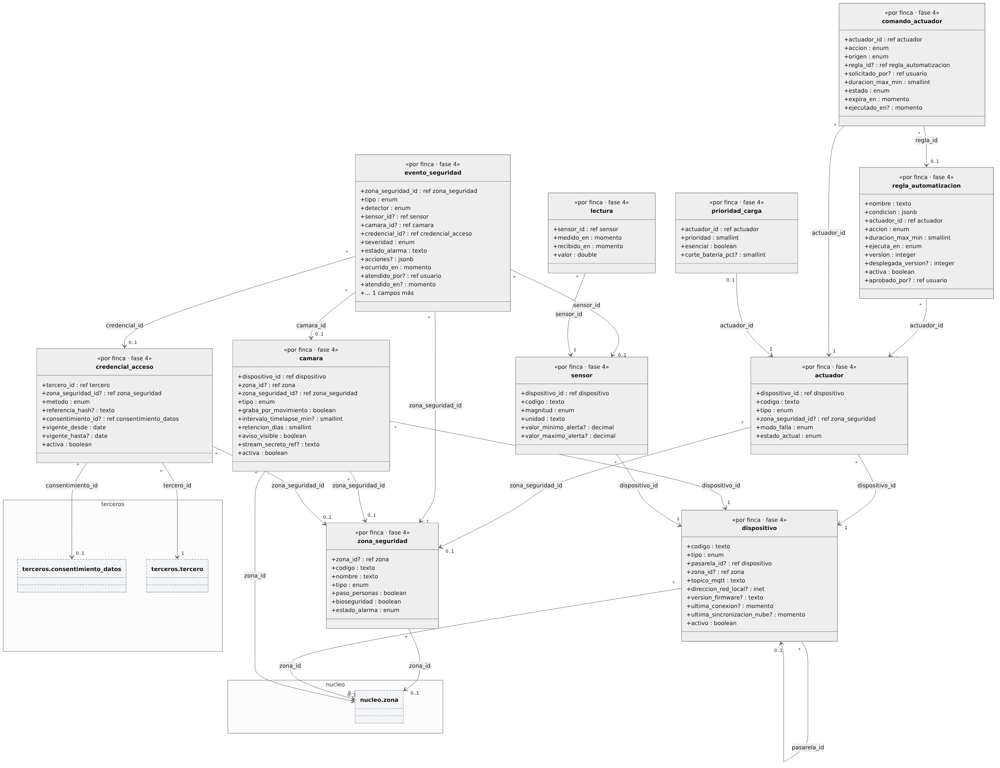
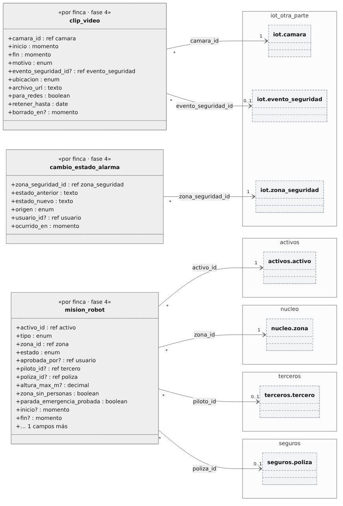
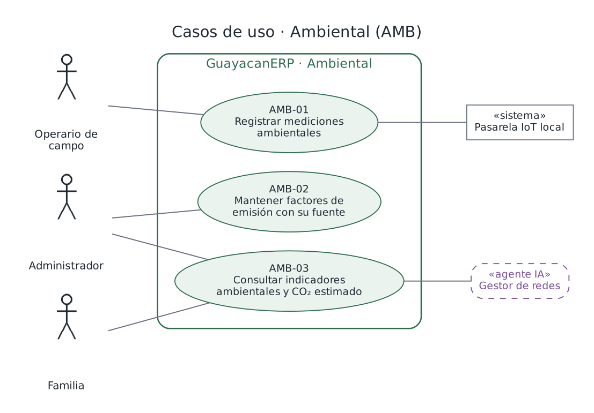
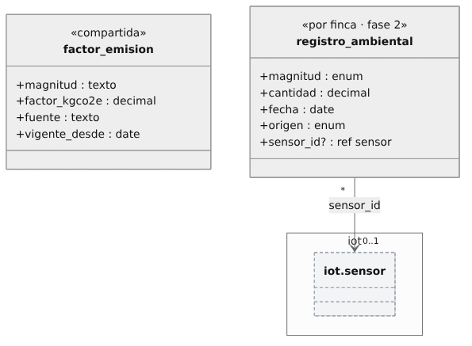

# Casos de uso 2 · Producción y campo

Especificación completa de los casos de uso de producción animal y agrícola, riego, IoT con seguridad perimetral y robótica, y ambiental. Cada módulo trae su diagrama de casos de uso, su diagrama de clases y la ficha de cada caso.

## Producción animal y agrícola (PRO)

Lo que pasa en el galpón, el aprisco, los estanques y los lotes de cultivo se registra como hechos desde la PWA, casi siempre sin señal. Donde la base no tiene disparador (por ejemplo, la cosecha que crea un lote de inventario), la regla vive en el servicio de Django y se indica así.

### PRO-01 · Registrar el ingreso de un lote de animales

| Campo | Detalle |
| --- | --- |
| Objetivo | Abrir un lote (gallinas, alevinos, rebaño) para medir su producción, costo y sanidad desde el primer día |
| Disparador | Llegan animales comprados, nacen o se separa un grupo |
| Precondiciones | La zona existe; la especie está en el catálogo |
| Postcondiciones | Lote activo con cantidad inicial y actual; animales individuales para ovinos y caprinos |
| Actores | Primario: Encargado de finca, Operario de campo. Secundarios: ninguno |
| Fase y función | Fase 1 · siempre activa |
| Relaciones | incluye NUC-05 |
| Reglas en la base | `cumplimiento.v_granja_biosegura` alerta si se llega a 200 aves sin certificado ICA |
| Datos | `produccion.lote_animal`, `produccion.animal`, `produccion.especie` |
| API | CRUD `/api/v1/produccion/lotes-animal/` y `/api/v1/produccion/animales/` |
| Pruebas | v5 Cumplimiento |
| Requerimientos | RF-07 inventario vivo |

**Flujo principal**

1. El usuario crea el lote con código, especie, zona, propósito (postura, engorde, cría), fecha y cantidad.
2. Para ovinos y caprinos registra cada animal con su identificación y, si se conoce, padre y madre.
3. El sistema guarda y deja el lote disponible para postura, alimentación y sanidad.
4. Si el total de aves de postura o levante llega a 200, el tablero de cumplimiento muestra la alerta de granja biosegura.

**Flujos alternos y excepciones**

- 1a. Compra con factura: el costo del lote se toma de la orden de compra (CMP-03).
- 3a. Cierre del lote (venta o descarte): estado cerrado con fecha; sus registros quedan para la historia.

### PRO-02 · Registrar la postura diaria y clasificar el huevo

| Campo | Detalle |
| --- | --- |
| Objetivo | Saber cuántos huevos se recogieron, cuántos se perdieron y de qué categoría son |
| Disparador | Recolección de la mañana o de la tarde (tarea del plan de labores) |
| Precondiciones | Lote de gallinas activo |
| Postcondiciones | Registro de postura del día; clasificación por categoría; indicador de postura por ave |
| Actores | Primario: Operario de campo. Secundarios: Pasarela IoT local (báscula de banco) |
| Fase y función | Fase 1 · siempre activa; la clasificación por visión espera `vision_artificial` |
| Relaciones | incluye NUC-05 |
| Reglas en la base | `produccion.validar_clasificacion()` (no clasifica más que los buenos), `produccion.clasificar_por_peso()` (rangos vigentes de `categoria_huevo`) |
| Datos | `produccion.registro_postura`, `produccion.clasificacion_postura`, `produccion.categoria_huevo` |
| API | CRUD `/api/v1/produccion/registros-postura/` y `/api/v1/produccion/clasificaciones-postura/` |
| Pruebas | v4 Huevo |
| Requerimientos | RF-06 trazabilidad, RF-18 reportes de producción |

**Flujo principal**

1. El operario elige el lote y el día (hoy por defecto).
2. Escribe huevos recogidos y rotos o sucios.
3. Clasifica los buenos por categoría (AAA, AA, A, B, jumbo) contando o pesando.
4. La PWA guarda sin conexión y sincroniza.
5. El sistema calcula postura por ave y la muestra en el tablero del galpón.

**Flujos alternos y excepciones**

- 3a. Con báscula: cada peso se convierte en categoría según los rangos vigentes (68 g = AAA).
- 3b. La clasificación suma más que los buenos: «La clasificación suma N huevos y solo hay M buenos».
- 3c. Método visión con la función apagada: «La función vision\_artificial no está activa».
- 4a. Ya hay registro de ese lote y día: se rechaza por único y se corrige el existente.

### PRO-03 · Registrar alimentación, pesajes y eventos sanitarios

| Campo | Detalle |
| --- | --- |
| Objetivo | Medir alimento comprado frente al propio, crecimiento y salud de cada lote |
| Disparador | Suministro diario, pesaje de muestra, vacuna, tratamiento o muerte |
| Precondiciones | Lote activo; alimento existente como producto |
| Postcondiciones | Registro guardado; salida de inventario del alimento; cantidad actual del lote ajustada si hubo muertes |
| Actores | Primario: Operario de campo. Secundarios: ninguno |
| Fase y función | Fase 1 · siempre activa |
| Relaciones | incluye NUC-05 |
| Reglas en la base | Kardex como única fuente de cantidades; en el servicio: salida de inventario por consumo y descuento de mortalidad en el lote |
| Datos | `produccion.registro_alimentacion`, `produccion.registro_pesaje`, `produccion.evento_sanitario` |
| API | CRUD `/api/v1/produccion/registros-alimentacion/`, `/api/v1/produccion/registros-pesaje/`, `/api/v1/produccion/eventos-sanitario/` |
| Pruebas | v4 Kardex (salidas) |
| Requerimientos | RF-07 inventario vivo, RF-18 costo por kilogramo |

**Flujo principal**

1. El operario elige el lote y el tipo de registro.
2. Alimentación: producto, kilos y origen (comprado o propio).
3. Pesaje: número de animales pesados y peso promedio o individual.
4. Sanidad: tipo (vacuna, desparasitación, tratamiento, revisión, muerte), producto, dosis y responsable.
5. El servicio crea la salida de inventario del alimento o del medicamento y, si hubo muertes, baja la cantidad actual del lote.

**Flujos alternos y excepciones**

- 4a. Medicamento con periodo de retiro: el sistema marca hasta cuándo no se venden huevos o carne del lote.
- 5a. No hay inventario del alimento: el registro se guarda y la salida se rechaza con «Inventario insuficiente» para corregir en bodega.
- 4b. Mortalidad alta (por encima del parámetro del lote): alerta al encargado.

### PRO-04 · Registrar eventos reproductivos de ovinos y caprinos

| Campo | Detalle |
| --- | --- |
| Objetivo | Llevar montas, partos, abortos y destetes para planear el rebaño |
| Disparador | Ocurre el evento |
| Precondiciones | Hembra registrada como animal activo |
| Postcondiciones | Evento guardado; las crías nacen como animales con su madre y padre |
| Actores | Primario: Operario de campo. Secundarios: ninguno |
| Fase y función | Fase 1 · siempre activa |
| Relaciones | incluye NUC-05 |
| Reglas en la base | Llaves compuestas a `produccion.animal`; las crías se crean en el servicio |
| Datos | `produccion.evento_reproductivo`, `produccion.animal` |
| API | CRUD `/api/v1/produccion/eventos-reproductivo/` |
| Pruebas | pendiente: escribir la prueba al construir |
| Requerimientos | RF-07 inventario vivo |

**Flujo principal**

1. El operario elige la hembra y el tipo de evento.
2. Para una monta registra el macho; para un parto, crías vivas y muertas.
3. El servicio crea un animal por cría viva con su genealogía.

**Flujos alternos y excepciones**

- 1a. Hembra vendida o muerta: no aparece en la lista.
- 3a. Destete: actualiza el lote de las crías.

### PRO-05 · Registrar una siembra y sus labores culturales

| Campo | Detalle |
| --- | --- |
| Objetivo | Saber qué se sembró, cuántas plantas siguen vivas y qué se le ha hecho a cada lote |
| Disparador | Siembra, resiembra, encalado, fertilización, deshierbe, control de plagas o poda |
| Precondiciones | Zona de cultivo; cultivo en el catálogo; insumos en inventario si se aplican |
| Postcondiciones | Siembra con plantas previstas y vivas; labores con insumo, dosis, método y tarea asociada |
| Actores | Primario: Operario de campo, Encargado de finca. Secundarios: ninguno |
| Fase y función | Fase 1 · siempre activa |
| Relaciones | incluye NUC-05 |
| Reglas en la base | Una labor con método robot o dron exige su misión (CHECK); la siembra sigue su máquina de estados (ST16) |
| Datos | `produccion.siembra`, `produccion.labor_cultural`, `produccion.cultivo` |
| API | CRUD `/api/v1/produccion/siembras/` y `/api/v1/produccion/labores-cultural/` |
| Pruebas | v5 Robótica |
| Requerimientos | RF-04 lotes georreferenciados, RF-05 labores culturales, RF-07 plantas vivas |

**Flujo principal**

1. El encargado crea la siembra: zona, cultivo, fecha y plantas previstas.
2. El operario registra el conteo de plantas vivas cuando se hace.
3. Cada labor se registra con tipo, insumo, dosis, método (manual, mecánico) y, si salió del plan, su tarea.
4. El servicio descuenta el insumo del inventario.

**Flujos alternos y excepciones**

- 2a. Muchas plantas muertas: la siembra pasa a recuperación y se programa resiembra.
- 3a. Método robot o dron sin misión: la base lo rechaza (CHECK).
- 3b. Insumo con periodo de carencia: el sistema impide registrar cosecha del lote antes de esa fecha.

### PRO-06 · Registrar una cosecha y su destino

| Campo | Detalle |
| --- | --- |
| Objetivo | Que todo lo cosechado entre a bodega con trazabilidad o quede registrado como alimento, semilla o pérdida |
| Disparador | Se cosecha un lote |
| Precondiciones | Siembra en producción |
| Postcondiciones | Cosecha guardada; si va a venta, un lote de inventario con su entrada en kardex y su huella de trazabilidad |
| Actores | Primario: Operario de campo. Secundarios: ninguno |
| Fase y función | Fase 1 · siempre activa |
| Relaciones | incluye INV-02 |
| Reglas en la base | `inventario.entrada_inicial()`, `inventario.estimar_vencimiento()`, `comercial.registrar_huella()`; en el servicio: crear el lote con `origen_tabla = 'produccion.cosecha'` |
| Datos | `produccion.cosecha`, `inventario.lote_inventario` |
| API | CRUD `/api/v1/produccion/cosechas/` |
| Pruebas | v4 Kardex, v4 Huellas |
| Requerimientos | RF-06 trazabilidad con QR, RF-18 rendimiento por hectárea |

**Flujo principal**

1. El operario elige la siembra y registra cantidad, unidad y destino (venta, alimento animal, semilla, pérdida).
2. Si el destino es venta, elige bodega y el servicio crea el lote de inventario.
3. La base registra la entrada en kardex, estima vencimiento y agrega la huella.
4. Se imprime la etiqueta con código QR del lote (INV-02).

**Flujos alternos y excepciones**

- 1a. Destino alimento animal: crea la salida directa al registro de alimentación del lote.
- 1b. Dentro del periodo de carencia de un insumo aplicado: se rechaza.

### PRO-07 · Registrar un análisis de suelo y su recomendación

| Campo | Detalle |
| --- | --- |
| Objetivo | Decidir encalado y fertilización con datos de laboratorio |
| Disparador | Llega el resultado del laboratorio |
| Precondiciones | Zona de cultivo |
| Postcondiciones | Análisis guardado con su archivo; recomendación disponible para planear labores |
| Actores | Primario: Encargado de finca. Secundarios: Agrónomo (IA) |
| Fase y función | Fase 1 · siempre activa |
| Relaciones | ninguna |
| Reglas en la base | El expediente BPA toma este registro como evidencia (`registro:produccion.analisis_suelo`) |
| Datos | `produccion.analisis_suelo` |
| API | CRUD `/api/v1/produccion/analisis-suelo/` |
| Pruebas | v5 Cumplimiento |
| Requerimientos | RF-04 lotes y cultivos |

**Flujo principal**

1. El encargado registra fecha, laboratorio, pH, materia orgánica, elementos y el PDF.
2. El Agrónomo (IA) propone la recomendación de encalado y fertilización.
3. El encargado la acepta o ajusta y la guarda.
4. Crea las labores planeadas en el plan de labores.

**Flujos alternos y excepciones**

- 2a. Sin agente disponible: el encargado escribe la recomendación.

### PRO-08 · Registrar bioseguridad e inocuidad

| Campo | Detalle |
| --- | --- |
| Objetivo | Dejar la evidencia diaria que exige el ICA para la granja avícola biosegura y para BPA |
| Disparador | Limpieza, desinfección, control de plagas, visita, cambio de cama o de agua |
| Precondiciones | Zona y protocolo vigente |
| Postcondiciones | Registro con tipo, producto, dosis y responsable; el expediente se reevalúa |
| Actores | Primario: Operario de campo. Secundarios: ninguno |
| Fase y función | Fase 1 · siempre activa |
| Relaciones | incluye NUC-05 |
| Reglas en la base | `cumplimiento.evaluar_expediente()` usa estos registros (requisito GAB-03 con vigencia de 30 días) |
| Datos | `produccion.registro_bioseguridad` |
| API | CRUD `/api/v1/produccion/registros-bioseguridad/` |
| Pruebas | v5 Cumplimiento |
| Requerimientos | RQ-33 cumplimiento |

**Flujo principal**

1. Al terminar la tarea de bioseguridad, el operario registra tipo, zona, producto y dosis.
2. La PWA guarda y sincroniza.
3. Esa noche el expediente pasa el requisito a cumple.

**Flujos alternos y excepciones**

- 3a. Pasan 30 días sin registro: el requisito vuelve a no cumple y el tablero lo muestra.

### PRO-09 · Producir abono en lombricultivo o compostera

| Campo | Detalle |
| --- | --- |
| Objetivo | Medir el humus y el compost producidos y venderlos o usarlos en la finca |
| Disparador | Cosecha de humus, lixiviado o compost |
| Precondiciones | Zona de lombricultivo o compostera |
| Postcondiciones | Producción registrada; lote vendible en bodega; dato para indicadores de economía circular |
| Actores | Primario: Operario de campo. Secundarios: ninguno |
| Fase y función | Fase 1 · siempre activa |
| Relaciones | ninguna |
| Reglas en la base | `inventario.entrada_inicial()` al crear el lote |
| Datos | `produccion.produccion_abono`, `inventario.lote_inventario` |
| API | CRUD `/api/v1/produccion/producciones-abono/` |
| Pruebas | v4 Kardex |
| Requerimientos | RF-08 bioinsumos, RNF-14 economía circular |

**Flujo principal**

1. El operario registra tipo de abono, cantidad, zona y fecha.
2. El servicio crea el lote de inventario del abono.
3. El registro alimenta los indicadores ambientales (AMB-03).

**Flujos alternos y excepciones**

- 2a. Abono para uso interno: se registra la salida directa a la labor de fertilización.

### PRO-10 · Medir la calidad del agua de los estanques

| Campo | Detalle |
| --- | --- |
| Objetivo | Cuidar oxígeno, temperatura y pH para la tilapia |
| Disparador | Medición de rutina o lectura de sensor |
| Precondiciones | Zona de estanque |
| Postcondiciones | Medición guardada; alerta si sale de rango |
| Actores | Primario: Operario de campo. Secundarios: Pasarela IoT local |
| Fase y función | Fase 1 · siempre activa |
| Relaciones | incluye NUC-05 |
| Reglas en la base | Rangos en `nucleo.parametro` por especie |
| Datos | `produccion.calidad_agua_estanque` |
| API | CRUD `/api/v1/produccion/calidad-agua/` |
| Pruebas | pendiente: escribir la prueba al construir |
| Requerimientos | RF-18 reportes de producción |

**Flujo principal**

1. El operario mide con el kit o la sonda y registra oxígeno disuelto, temperatura, pH y amonio.
2. El sistema compara con los rangos y avisa al encargado si alguno está fuera.

**Flujos alternos y excepciones**

- 1a. Con sensor en la fase 4: la pasarela envía la lectura y crea el registro cada hora.

## Riego (RIE)

Hoy el riego es manual con manguera y aspersores desde dos tanques de 2.000 litros; el modelo ya trae fuentes, tanques, válvulas y eventos para pasar al riego automático por reglas en la red local cuando lleguen los equipos.

### RIE-01 · Configurar fuentes, tanques, sistemas y válvulas

| Campo | Detalle |
| --- | --- |
| Objetivo | Representar la red de agua de la finca y sus permisos |
| Disparador | Instalación o cambio de la red |
| Precondiciones | Zonas creadas |
| Postcondiciones | Fuentes con permiso, tanques con capacidad, sistemas que cubren zonas y válvulas manuales o electroválvulas |
| Actores | Primario: Encargado de finca. Secundarios: ninguno |
| Fase y función | Fase 1 · siempre activa |
| Relaciones | ninguna |
| Reglas en la base | Una válvula automática apunta a su actuador de IoT |
| Datos | `riego.fuente_agua`, `riego.tanque`, `riego.sistema_riego`, `riego.valvula` |
| API | CRUD `/api/v1/riego/fuentes-agua/`, `/api/v1/riego/tanques/`, `/api/v1/riego/sistemas-riego/`, `/api/v1/riego/valvulas/` |
| Pruebas | pendiente: escribir la prueba al construir |
| Requerimientos | RQ-25 riego e IoT |

**Flujo principal**

1. El encargado registra cada fuente (nacedero, acueducto veredal, lluvia) con su permiso de concesión si aplica.
2. Registra tanques con capacidad y sistemas de riego con las zonas que cubren.
3. Registra cada válvula con su código y tipo.

**Flujos alternos y excepciones**

- 3a. Electroválvula: se asocia al actuador de IoT-01; hasta entonces queda como manual.

### RIE-02 · Registrar un riego manual

| Campo | Detalle |
| --- | --- |
| Objetivo | Saber cuánta agua recibe cada zona y cuánto tiempo se dedica a regar |
| Disparador | El operario termina de regar |
| Precondiciones | Sistema y válvula configurados |
| Postcondiciones | Evento de riego con duración, litros estimados y método manual |
| Actores | Primario: Operario de campo. Secundarios: ninguno |
| Fase y función | Fase 1 · siempre activa |
| Relaciones | incluye NUC-05 |
| Reglas en la base | Litros = caudal del sistema × minutos cuando no se miden |
| Datos | `riego.evento_riego` |
| API | CRUD `/api/v1/riego/eventos-riego/` |
| Pruebas | pendiente: escribir la prueba al construir |
| Requerimientos | RQ-25 riego, RF-19 agua utilizada |

**Flujo principal**

1. El operario elige la válvula o zona.
2. Marca inicio y fin (o escribe los minutos).
3. El sistema estima los litros y guarda.

**Flujos alternos y excepciones**

- 2a. Llegó la tarea de riego del plan de labores: al terminarla, el evento se crea desde la tarea.

### RIE-03 · Regar automáticamente por reglas

| Campo | Detalle |
| --- | --- |
| Objetivo | Regar cuando el suelo lo necesita y hay agua, sin depender de internet |
| Disparador | Una lectura cumple la condición de una regla en la pasarela |
| Precondiciones | Función `riego_automatico` encendida; sensores de humedad y nivel; electroválvula |
| Postcondiciones | Comando ejecutado y evento de riego automático, subidos al volver la conexión |
| Actores | Primario: Pasarela IoT local. Secundarios: Estación meteorológica, Encargado de finca |
| Fase y función | Fase 4 · función `riego_automatico` (apagada al instalar) |
| Relaciones | lo extiende IOT-03 (el encargado puede accionar a mano) |
| Reglas en la base | Regla determinista en la pasarela (por ejemplo, humedad menor a 30 % y tanque mayor a 40 %); con `estacion_meteorologica` se suspende si llovió |
| Datos | `iot.regla_automatizacion`, `iot.comando_actuador`, `riego.evento_riego` |
| API | CRUD `/api/v1/iot/reglas/`; la pasarela sube por `POST /api/v1/iot/comandos/` |
| Pruebas | pendiente: prueba de la pasarela con lecturas simuladas |
| Requerimientos | RQ-25 riego en red local |

**Flujo principal**

1. El encargado define la regla (sensor, condición, válvula, duración máxima) en el panel; se descarga a la pasarela.
2. La pasarela evalúa cada lectura MQTT.
3. Si se cumple, abre la válvula y la cierra al cumplir el tiempo o el volumen.
4. Guarda comando y evento y los sube al ERP cuando hay conexión (SQ13).

**Flujos alternos y excepciones**

- 3a. Llovió en las últimas horas: la regla no riega.
- 3b. El tanque baja del mínimo durante el riego: cierra y avisa.
- 3c. La válvula no confirma: comando fallido y aviso al encargado.

## IoT, seguridad perimetral y robótica (IOT)

Todo este módulo es fase 4 y queda listo y apagado. La regla de oro: lo que protege personas o animales corre en la pasarela local y funciona sin internet; el ERP guarda configuración e historia.

### IOT-01 · Registrar dispositivos, sensores y actuadores

| Campo | Detalle |
| --- | --- |
| Objetivo | Tener el inventario de la red local: qué equipo hay, dónde y qué mide o acciona |
| Disparador | Se instala un equipo |
| Precondiciones | Pasarela registrada |
| Postcondiciones | Dispositivo con su tópico MQTT; sensores y actuadores con su modo de falla |
| Actores | Primario: Administrador. Secundarios: Pasarela IoT local |
| Fase y función | Fase 4 · siempre activa (la configuración se puede cargar antes) |
| Relaciones | ninguna |
| Reglas en la base | Una cerradura en un paso de personas debe abrir sin energía (`modo_falla`) |
| Datos | `iot.dispositivo`, `iot.sensor`, `iot.actuador` |
| API | CRUD `/api/v1/iot/dispositivos/`, `/api/v1/iot/sensores/`, `/api/v1/iot/actuadores/` |
| Pruebas | v4 Seguridad (perimetral) |
| Requerimientos | RQ-25 IoT, RQ-26 seguridad perimetral |

**Flujo principal**

1. El administrador registra el dispositivo (ESP32, PLC, estación) con zona y tópico.
2. Agrega sensores con unidad y rango, y actuadores con tipo y modo de falla.
3. La pasarela descarga la configuración.

**Flujos alternos y excepciones**

- 2a. Cerradura de un paso de personas con «cierra sin energía»: la base lo rechaza.

### IOT-02 · Recibir lecturas de sensores

| Campo | Detalle |
| --- | --- |
| Objetivo | Guardar mediciones para reglas, alertas y análisis |
| Disparador | Un sensor publica en MQTT |
| Precondiciones | Sensor registrado |
| Postcondiciones | Lectura en la tabla particionada por mes; excursiones de temperatura evaluadas |
| Actores | Primario: Pasarela IoT local. Secundarios: ninguno |
| Fase y función | Fase 4 · siempre activa |
| Relaciones | ninguna |
| Reglas en la base | `inventario.evaluar_excursion()` para neveras y vehículos |
| Datos | `iot.lectura` |
| API | MQTT `finca/<dispositivo>/<sensor>`; subida por lote `POST /api/v1/iot/lecturas/lote/` |
| Pruebas | v4 Frío |
| Requerimientos | RQ-25 IoT |

**Flujo principal**

1. El sensor publica la lectura cada minuto.
2. La pasarela la guarda localmente y aplica sus reglas.
3. Cada 5 minutos, o al volver internet, sube las lecturas en lote.
4. La base guarda y evalúa las excursiones de frío.

**Flujos alternos y excepciones**

- 3a. Sin internet por días: la pasarela guarda hasta su límite y sube en orden cuando vuelve.
- 4a. Lectura fuera del rango físico del sensor: se marca como sospechosa y no dispara reglas.

### IOT-03 · Accionar un actuador a mano

| Campo | Detalle |
| --- | --- |
| Objetivo | Abrir una válvula, encender un extractor o una luz desde la app |
| Disparador | El encargado decide accionar |
| Precondiciones | Actuador en línea |
| Postcondiciones | Comando con su resultado (ejecutado, fallido, expirado) |
| Actores | Primario: Encargado de finca. Secundarios: Pasarela IoT local |
| Fase y función | Fase 4 · siempre activa |
| Relaciones | extiende RIE-03 |
| Reglas en la base | Estados del comando pendiente → enviado → ejecutado, fallido o expirado |
| Datos | `iot.comando_actuador` |
| API | `POST /api/v1/iot/comandos/` |
| Pruebas | pendiente: escribir la prueba al construir |
| Requerimientos | RQ-25 IoT |

**Flujo principal**

1. El encargado elige el actuador y la acción.
2. El ERP crea el comando y lo publica a la pasarela.
3. La pasarela acciona y confirma el estado.

**Flujos alternos y excepciones**

- 2a. En la finca sin internet: la app habla directo con la pasarela en la red local.
- 3a. Sin confirmación en 60 segundos: comando expirado.

### IOT-04 · Armar y desarmar la alarma por zonas

| Campo | Detalle |
| --- | --- |
| Objetivo | Vigilar perímetro, galpón, bodega y accesos con estados claros |
| Disparador | Cierre de jornada, noche, salida o mantenimiento |
| Precondiciones | Función `seguridad_perimetral` encendida |
| Postcondiciones | Estado de la zona cambiado con su historial |
| Actores | Primario: Encargado de finca, Portería. Secundarios: Pasarela IoT local |
| Fase y función | Fase 4 · función `seguridad_perimetral` (apagada al instalar) |
| Relaciones | ninguna |
| Reglas en la base | `iot.cambiar_estado_alarma()` (patrón State; mantenimiento solo desde desarmado); el estado no se edita directo |
| Datos | `iot.zona_seguridad`, `iot.cambio_estado_alarma` |
| API | `POST /api/v1/iot/zonas-seguridad/{id}/estado/` |
| Pruebas | v4 Alarma |
| Requerimientos | RQ-26 seguridad perimetral |

**Flujo principal**

1. El usuario elige la zona y el estado (armado, noche, desarmado, mantenimiento).
2. El sistema valida la transición (ST14) y la aplica.
3. La pasarela recibe el nuevo estado y actúa.

**Flujos alternos y excepciones**

- 2a. De armado a mantenimiento: «Cambio de alarma no permitido».
- 2b. Intento de editar el estado por UPDATE: «solo cambia con iot.cambiar\_estado\_alarma».

### IOT-05 · Atender un evento de seguridad perimetral

| Campo | Detalle |
| --- | --- |
| Objetivo | Responder a intrusión, puerta abierta, humo o gas, aunque no haya internet |
| Disparador | La pasarela detecta el evento y suena la sirena |
| Precondiciones | Función `seguridad_perimetral` encendida |
| Postcondiciones | Evento inalterable con su atención registrada; clip asociado si hay cámara |
| Actores | Primario: Encargado de finca, Portería. Secundarios: Pasarela IoT local, Correo y SMS |
| Fase y función | Fase 4 · función `seguridad_perimetral` (apagada al instalar) |
| Relaciones | ninguna |
| Reglas en la base | Un evento no se modifica; solo se registra su atención |
| Datos | `iot.evento_seguridad`, `iot.clip_video` |
| API | `GET /api/v1/iot/eventos-seguridad/`; `POST /api/v1/iot/eventos-seguridad/{id}/atender/` |
| Pruebas | v4 Seguridad |
| Requerimientos | RQ-26 seguridad perimetral |

**Flujo principal**

1. La pasarela publica el evento, enciende reflectores y sirena y envía aviso push y SMS.
2. El encargado abre el evento, ve el clip y decide.
3. Registra la atención (falsa alarma, intrusión, emergencia) y las acciones.

**Flujos alternos y excepciones**

- 1a. Sin internet: la sirena y los reflectores actúan igual; el aviso sale por SMS desde el módem de la pasarela si existe.

### IOT-06 · Gestionar credenciales de acceso a puertas

| Campo | Detalle |
| --- | --- |
| Objetivo | Dar acceso por PIN, tarjeta o rostro solo a quien corresponde |
| Disparador | Ingreso de personal o cambio de permisos |
| Precondiciones | Puerta con cerradura registrada |
| Postcondiciones | Credencial con vigencia; para rostro, autorización expresa de biometría y plantilla solo en la pasarela, cifrada |
| Actores | Primario: Administrador. Secundarios: Pasarela IoT local |
| Fase y función | Fase 4 · rostro con `reconocimiento_facial` (apagada al instalar) |
| Relaciones | ninguna |
| Reglas en la base | El acceso facial exige autorización expresa y vigente de biometría de la misma persona; al revocarla se apaga |
| Datos | `iot.credencial_acceso`, `terceros.consentimiento_datos` |
| API | CRUD `/api/v1/iot/credenciales-acceso/` |
| Pruebas | v4 Biometría |
| Requerimientos | RQ-26 seguridad perimetral, RNF-04 Ley 1581 |

**Flujo principal**

1. El administrador elige la persona, la zona y el método.
2. Para PIN o tarjeta, la base guarda solo la huella del valor.
3. Para rostro, verifica la autorización de biometría; la plantilla se toma en la pasarela.

**Flujos alternos y excepciones**

- 3a. Autorización de imagen en vez de biometría: se rechaza.
- 3b. Revocación de la biometría: el acceso facial se apaga y el PIN sigue.

### IOT-07 · Conservar o depurar clips de cámaras

| Campo | Detalle |
| --- | --- |
| Objetivo | Guardar lo necesario y borrar a tiempo lo que no, por privacidad |
| Disparador | Tarea diaria |
| Precondiciones | Función `camaras` encendida |
| Postcondiciones | Clips de seguridad vencidos marcados para borrar; los elegidos para redes se conservan |
| Actores | Primario: Tareas programadas, Administrador. Secundarios: ninguno |
| Fase y función | Fase 4 · función `camaras` (apagada al instalar) |
| Relaciones | ninguna |
| Reglas en la base | `iot.depurar_clips()` (retención de 30 días para seguridad) |
| Datos | `iot.camara`, `iot.clip_video` |
| API | CRUD `/api/v1/iot/clips-video/` |
| Pruebas | v4 Cámaras |
| Requerimientos | RQ-26 cámaras |

**Flujo principal**

1. La cámara graba por movimiento en la pasarela.
2. Solo los clips con evento o elegidos suben a MinIO.
3. Cada noche `depurar_clips` marca los vencidos y el servicio IoT borra el archivo.

**Flujos alternos y excepciones**

- 2a. Clip marcado para redes: pasa a una pieza audiovisual (RED-05) y sigue sus reglas de consentimiento.

### IOT-08 · Planear y ejecutar una misión de dron o robot

| Campo | Detalle |
| --- | --- |
| Objetivo | Volar un dron para fotos y conteos, o probar un robot de campo, sin riesgo para personas |
| Disparador | Monitoreo de cultivos o piloto con una universidad |
| Precondiciones | Función `dron_monitoreo` o `robot_campo` encendida; activo registrado |
| Postcondiciones | Misión con aprobación humana, piloto, póliza y resultado; labores asociadas |
| Actores | Primario: Encargado de finca, Administrador. Secundarios: Pasarela IoT local |
| Fase y función | Fase 4 · función `dron_monitoreo` o `robot_campo` (apagadas al instalar) |
| Relaciones | incluye AGD-05 (nadie en la zona) |
| Reglas en la base | `iot.validar_mision()`: aprobada por una persona; dron con registro Aerocivil, piloto, póliza de responsabilidad civil y máximo 122 m (RAC 100); robot solo en zona sin personas y con parada de emergencia probada |
| Datos | `iot.mision_robot`, `activos.activo`, `seguros.poliza` |
| API | CRUD `/api/v1/iot/misiones-robot/`; `POST /api/v1/iot/misiones-robot/{id}/aprobar/` |
| Pruebas | v5 Robótica |
| Requerimientos | RQ-42 robótica y drones |

**Flujo principal**

1. El encargado propone la misión: activo, tipo, zona y plan.
2. El administrador la aprueba.
3. Antes de iniciar, el sistema verifica requisitos y que nadie esté en la zona.
4. La misión pasa a en curso, luego a terminada con fotos, conteos o labores.

**Flujos alternos y excepciones**

- 3a. Dron sin registro Aerocivil: «debe estar registrado (RAC 100)».
- 3b. Altura mayor a 122 m o sin póliza vigente: rechazada.
- 3c. Robot con personas en la zona o sin prueba de parada: rechazada.
- 4a. Parada de emergencia: misión abortada.

### IOT-09 · Cortar cargas con batería baja

| Campo | Detalle |
| --- | --- |
| Objetivo | Proteger lo esencial (alarma, nevera, agua de animales) cuando la batería solar baja |
| Disparador | Lectura del nivel de batería |
| Precondiciones | Prioridades de carga configuradas |
| Postcondiciones | Cargas no esenciales cortadas en orden y repuestas al recuperar carga |
| Actores | Primario: Pasarela IoT local. Secundarios: ninguno |
| Fase y función | Fase 4 · siempre activa |
| Relaciones | ninguna |
| Reglas en la base | `iot.cargas_a_cortar()`; una carga esencial nunca se corta (CHECK) |
| Datos | `iot.prioridad_carga` |
| API | CRUD `/api/v1/iot/prioridades-carga/` |
| Pruebas | v5 Energía |
| Requerimientos | RQ-25 IoT, RNF-14 energía |

**Flujo principal**

1. La pasarela lee la batería.
2. Consulta qué cargas cortar para ese nivel (por ejemplo, al 30 % solo las luces).
3. Corta de la menos a la más importante y avisa.

**Flujos alternos y excepciones**

- 3a. Batería recuperada: repone en orden inverso.

## Ambiental (AMB)

Mediciones de energía solar, biogás, compost, humus y agua, convertidas a CO₂ equivalente solo con un factor que tenga fuente. Sin fuente no se publica ninguna cifra.

### AMB-01 · Registrar mediciones ambientales

| Campo | Detalle |
| --- | --- |
| Objetivo | Demostrar la economía circular con datos medidos |
| Disparador | Lectura de contador, pesaje de compost o reporte del inversor solar |
| Precondiciones | Tipo de medición definido |
| Postcondiciones | Registro con cantidad, unidad y fuente del dato |
| Actores | Primario: Operario de campo. Secundarios: Pasarela IoT local |
| Fase y función | Fase 2 · siempre activa |
| Relaciones | ninguna |
| Reglas en la base | Unidades según el tipo de medición |
| Datos | `ambiental.registro_ambiental` |
| API | CRUD `/api/v1/ambiental/registros-ambiental/` |
| Pruebas | v4 Ambiental |
| Requerimientos | RF-19 sostenibilidad, RNF-14 economía circular, RQ-44 ambiental |

**Flujo principal**

1. El operario elige el tipo (kWh solares, m³ de biogás, kg de compost, m³ de agua) y la fecha.
2. Escribe la cantidad o la toma del sensor.
3. El sistema guarda el registro.

**Flujos alternos y excepciones**

- 2a. Dato del inversor por IoT: la pasarela lo envía diario.

### AMB-02 · Mantener factores de emisión con su fuente

| Campo | Detalle |
| --- | --- |
| Objetivo | Convertir mediciones a CO₂ equivalente de forma verificable |
| Disparador | Se publica un factor oficial nuevo (por ejemplo, de la UPME para la red eléctrica) |
| Precondiciones | Fuente identificada con enlace |
| Postcondiciones | Factor con vigencia y fuente |
| Actores | Primario: Administrador. Secundarios: ninguno |
| Fase y función | Fase 2 · siempre activa |
| Relaciones | ninguna |
| Reglas en la base | Sin fuente no se calcula CO₂ |
| Datos | `ambiental.factor_emision` |
| API | CRUD `/api/v1/ambiental/factores-emision/` |
| Pruebas | v4 Ambiental |
| Requerimientos | RQ-44 CO₂ estimado con fuente |

**Flujo principal**

1. El administrador registra tipo, factor, unidad, fuente con enlace y vigencia.
2. Los indicadores del mes usan el factor vigente.

**Flujos alternos y excepciones**

- 1a. Sin enlace a la fuente: no se guarda.

### AMB-03 · Consultar indicadores ambientales y CO₂ estimado

| Campo | Detalle |
| --- | --- |
| Objetivo | Ver el impacto del mes y usarlo en informes y en redes con la fuente a la vista |
| Disparador | Consulta del tablero o preparación de una publicación |
| Precondiciones | Mediciones y factores registrados |
| Postcondiciones | Ninguna escritura |
| Actores | Primario: Familia, Administrador. Secundarios: Gestor de redes (IA) |
| Fase y función | Fase 2 · siempre activa |
| Relaciones | ninguna |
| Reglas en la base | Vista `ambiental.v_indicadores`: CO₂ siempre «estimado», con factor y fuente |
| Datos | `ambiental.registro_ambiental`, `ambiental.factor_emision` |
| API | `GET /api/v1/ambiental/indicadores/?mes=` |
| Pruebas | v4 Ambiental |
| Requerimientos | RF-19 reportes de sostenibilidad, RNF-13 reportes para el Fondo Emprender |

**Flujo principal**

1. El usuario elige el mes.
2. El sistema muestra totales por tipo y el CO₂ equivalente estimado con su factor y fuente.
3. El Gestor de redes puede proponer una publicación con esas cifras, que una persona aprueba.

**Flujos alternos y excepciones**

- 2a. Falta el factor de un tipo: se muestra la cantidad sin CO₂.
