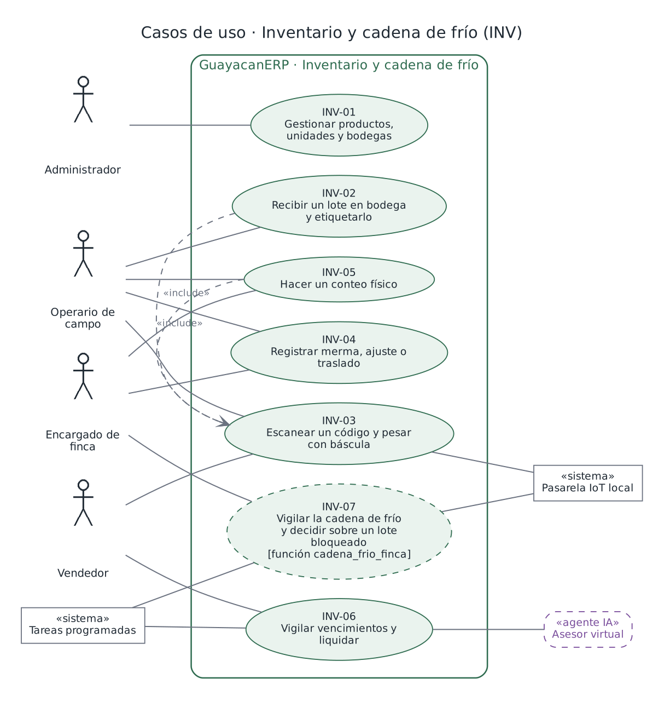
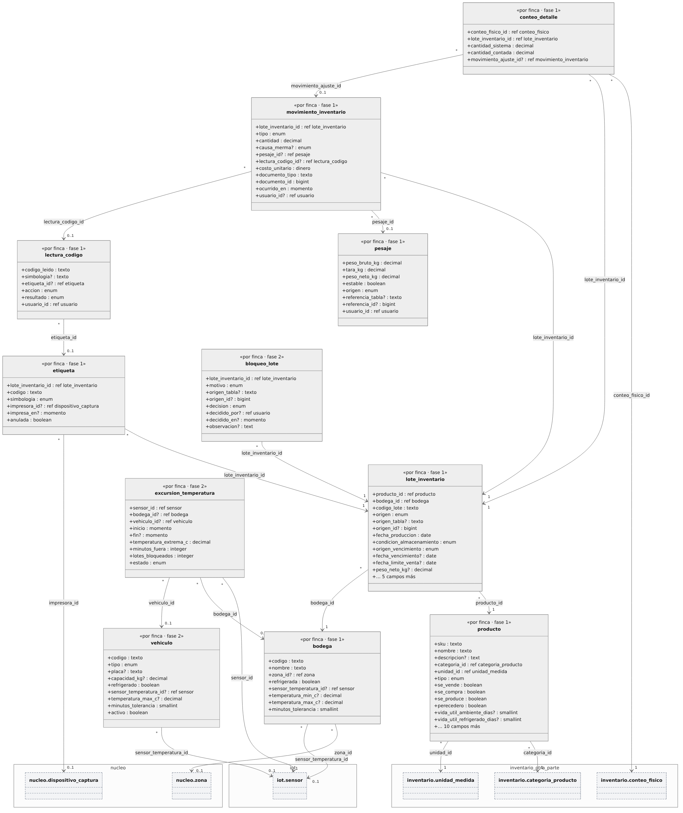
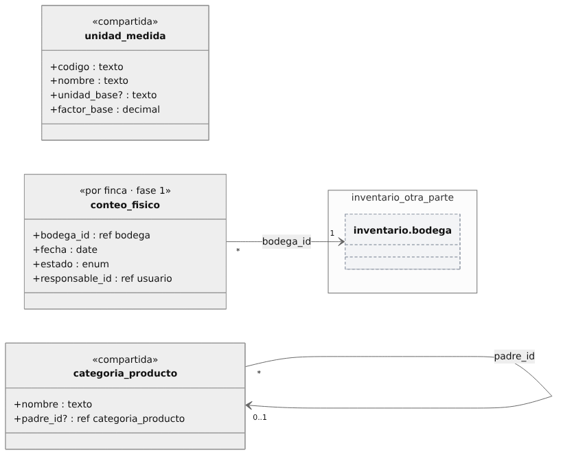
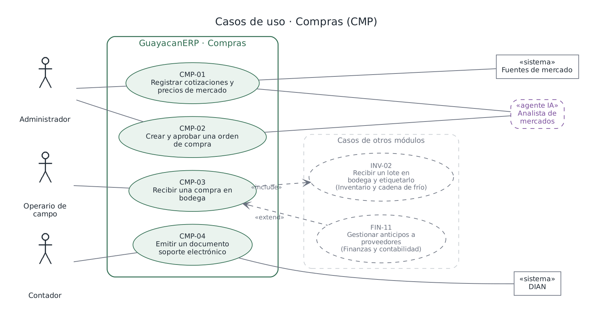
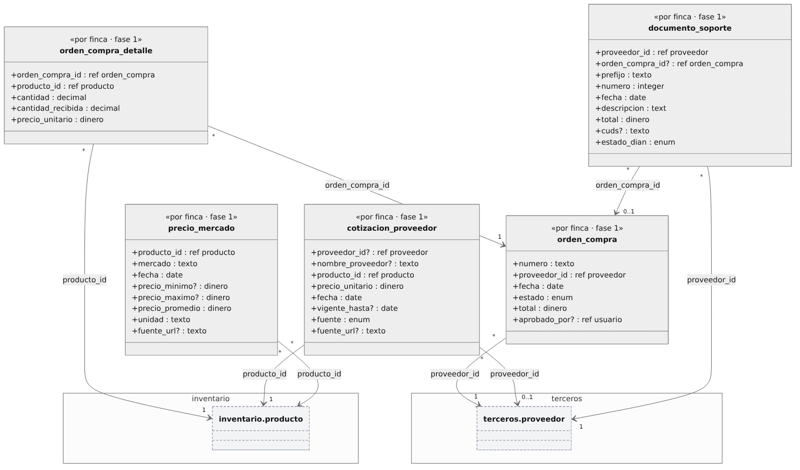
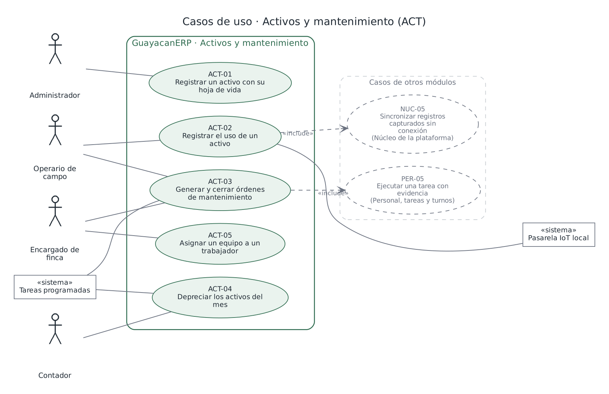
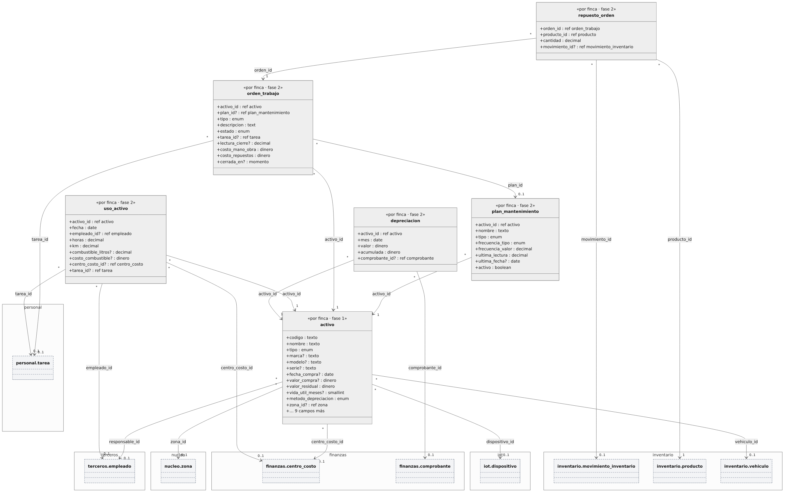

# Casos de uso 3 · Inventario, compras y activos

Especificación completa de los casos de uso de inventario y cadena de frío, compras, y activos y mantenimiento. Cada módulo trae su diagrama de casos de uso, su diagrama de clases y la ficha de cada caso.

## Inventario y cadena de frío (INV)

El kardex es la única fuente de las cantidades: nadie edita existencias a mano. Los lotes perecederos salen primero lo que vence primero (FEFO), dejan de venderse antes de su fecha límite y se bloquean solos si la nevera o el vehículo pierden el frío.

### INV-01 · Gestionar productos, unidades y bodegas

| Campo | Detalle |
| --- | --- |
| Objetivo | Tener el catálogo de todo lo que se compra, produce o vende y dónde se guarda |
| Disparador | Producto nuevo, cambio de presentación o bodega nueva |
| Precondiciones | Administrador |
| Postcondiciones | Producto con unidad, categoría, vida útil ambiente y refrigerada, días de alerta y banderas de compra, venta y producción |
| Actores | Primario: Administrador. Secundarios: ninguno |
| Fase y función | Fase 1 · siempre activa |
| Relaciones | ninguna |
| Reglas en la base | Unidades y categorías son catálogos compartidos; productos y bodegas son por finca |
| Datos | `inventario.producto`, `inventario.unidad_medida`, `inventario.categoria_producto`, `inventario.bodega` |
| API | CRUD `/api/v1/inventario/productos/`, `/api/v1/inventario/bodegas/`, `/api/v1/inventario/unidades-medida/` |
| Pruebas | v4 RLS |
| Requerimientos | RF-09 catálogo de productos |

**Flujo principal**

1. El administrador crea el producto con SKU, nombre, unidad y categoría.
2. Si es perecedero, define vida útil ambiente y refrigerada y días de alerta.
3. Crea bodegas, indicando si son refrigeradas y su sensor y rango de temperatura.

**Flujos alternos y excepciones**

- 1a. SKU repetido: 409.
- 3a. Bodega refrigerada sin sensor: se permite, pero la cadena de frío no la vigila.

### INV-02 · Recibir un lote en bodega y etiquetarlo

| Campo | Detalle |
| --- | --- |
| Objetivo | Que cada existencia tenga lote, origen, vencimiento y etiqueta con código |
| Disparador | Cosecha, postura clasificada, producción de abono o compra recibida |
| Precondiciones | Producto y bodega existentes |
| Postcondiciones | Lote disponible; entrada en kardex; vencimiento y fecha límite de venta estimados; etiqueta impresa |
| Actores | Primario: Operario de campo. Secundarios: ninguno |
| Fase y función | Fase 1 · siempre activa |
| Relaciones | incluye INV-03; incluido por PRO-06 y CMP-03 |
| Reglas en la base | `inventario.estimar_vencimiento()` (vida útil según almacenamiento, margen de venta), `inventario.entrada_inicial()`, `inventario.huella_lote_creado()` |
| Datos | `inventario.lote_inventario`, `inventario.etiqueta`, `inventario.movimiento_inventario` |
| API | CRUD `/api/v1/inventario/lotes-inventario/`; `POST /api/v1/inventario/etiquetas/` |
| Pruebas | v4 Vencimiento, v4 Kardex, v4 Frío |
| Requerimientos | RF-06 trazabilidad con QR, RQ-27 inventario perecedero |

**Flujo principal**

1. El operario elige producto, bodega, cantidad y fecha de producción (o la trae el origen).
2. La base calcula vencimiento y fecha límite de venta (huevo de 21 días de vida útil con 5 de margen).
3. La base crea la entrada en el kardex y la huella del lote.
4. La PWA imprime la etiqueta Code 128 o QR por la impresora Bluetooth.

**Flujos alternos y excepciones**

- 2a. Bodega refrigerada: usa la vida útil refrigerada.
- 4a. Sin impresora: la etiqueta queda pendiente y se imprime después desde el lote.

### INV-03 · Escanear un código y pesar con báscula

| Campo | Detalle |
| --- | --- |
| Objetivo | Identificar lotes y pesos sin digitar, para no equivocarse |
| Disparador | Recibo, despacho, conteo o venta |
| Precondiciones | Lector en modo teclado, cámara del celular o báscula Bluetooth o de banco |
| Postcondiciones | Lectura y pesaje registrados con equipo, origen (báscula o digitado) y estabilidad |
| Actores | Primario: Operario de campo, Vendedor. Secundarios: Pasarela IoT local |
| Fase y función | Fase 1 · siempre activa |
| Relaciones | incluido por INV-02, INV-05, VTA-04 y VTA-05 |
| Reglas en la base | Un peso no estable no se acepta para vender; lo digitado queda marcado |
| Datos | `inventario.lectura_codigo`, `inventario.pesaje` |
| API | CRUD `/api/v1/inventario/lecturas-codigo/` y `/api/v1/inventario/pesajes/` |
| Pruebas | pendiente: escribir la prueba al construir |
| Requerimientos | RF-06 trazabilidad, RNF-03 sin conexión |

**Flujo principal**

1. La PWA lee el código con BarcodeDetector (o ZXing) o recibe el texto del lector.
2. Busca el lote en la copia local y muestra producto, vencimiento y estado.
3. Si hay pesaje, lee la báscula por Web Bluetooth o Web Serial, o la báscula de banco publica el peso.
4. Registra la lectura y el pesaje con su resultado.

**Flujos alternos y excepciones**

- 2a. Código desconocido: resultado no\_encontrado y se permite buscar a mano.
- 3a. iPhone sin Web Bluetooth: peso digitado, marcado como tal.
- 3b. Peso inestable: no se acepta para venta.

### INV-04 · Registrar merma, ajuste o traslado

| Campo | Detalle |
| --- | --- |
| Objetivo | Explicar toda diferencia de inventario con su causa |
| Disparador | Producto dañado, vencido, consumido en la finca o movido de bodega |
| Precondiciones | Lote con existencias |
| Postcondiciones | Movimiento en kardex; cantidades del lote actualizadas por la base |
| Actores | Primario: Operario de campo, Encargado de finca. Secundarios: ninguno |
| Fase y función | Fase 1 · siempre activa |
| Relaciones | ninguna |
| Reglas en la base | `inventario.aplicar_movimiento()` (con bloqueo de fila), `inventario.proteger_cantidades()`; toda merma exige causa; los movimientos son de solo inserción |
| Datos | `inventario.movimiento_inventario` |
| API | `POST /api/v1/inventario/movimientos-inventario/` |
| Pruebas | v4 Merma, v4 Kardex |
| Requerimientos | RQ-27 inventario perecedero |

**Flujo principal**

1. El usuario escanea el lote.
2. Elige el tipo (merma, ajuste, traslado, autoconsumo) y la cantidad.
3. Para merma elige la causa (vencido, roto, plaga, otro) y escribe la observación.
4. La base aplica el movimiento al lote.

**Flujos alternos y excepciones**

- 3a. Merma sin causa: «Toda merma debe indicar su causa».
- 4a. Cantidad mayor que la disponible: rechazado.
- 4b. Corrección de un movimiento: se registra el movimiento contrario; no se edita.

### INV-05 · Hacer un conteo físico

| Campo | Detalle |
| --- | --- |
| Objetivo | Comparar lo que hay en la bodega con el sistema y ajustar las diferencias |
| Disparador | Cierre de mes o sospecha de diferencia |
| Precondiciones | Bodega con lotes |
| Postcondiciones | Conteo cerrado con diferencias; ajustes en kardex aprobados por el encargado |
| Actores | Primario: Operario de campo, Encargado de finca. Secundarios: ninguno |
| Fase y función | Fase 1 · siempre activa |
| Relaciones | incluye INV-03 |
| Reglas en la base | Estados en\_curso → cerrado → ajustado; los ajustes son movimientos de kardex |
| Datos | `inventario.conteo_fisico`, `inventario.conteo_detalle` |
| API | CRUD `/api/v1/inventario/conteos/` y `/api/v1/inventario/conteos/{id}/detalles/` |
| Pruebas | pendiente: escribir la prueba al construir |
| Requerimientos | RQ-27 inventario |

**Flujo principal**

1. El encargado abre el conteo de la bodega; el sistema congela la cantidad del sistema por lote.
2. El operario escanea y cuenta cada lote.
3. Al cerrar, el sistema lista las diferencias.
4. El encargado aprueba los ajustes; cada uno crea su movimiento.

**Flujos alternos y excepciones**

- 2a. Lote encontrado que no estaba en el sistema: se registra como hallazgo para revisar su origen.

### INV-06 · Vigilar vencimientos y liquidar

| Campo | Detalle |
| --- | --- |
| Objetivo | Vender primero lo que está por vencer y no vender lo vencido |
| Disparador | Tarea diaria y consulta del vendedor |
| Precondiciones | Productos perecederos con días de alerta; parámetro `descuento_por_vencer_pct` aprobado |
| Postcondiciones | Lotes vencidos marcados; semáforo y precio de liquidación disponibles |
| Actores | Primario: Tareas programadas, Vendedor. Secundarios: Asesor virtual (IA) |
| Fase y función | Fase 1 · siempre activa |
| Relaciones | ninguna |
| Reglas en la base | `inventario.marcar_vencidos()`, vista `inventario.v_alertas_vencimiento`, `inventario.puede_venderse()` |
| Datos | `inventario.lote_inventario` |
| API | `GET /api/v1/inventario/alertas-vencimiento/` |
| Pruebas | v4 Alerta, v4 Vencidos, v4 Catálogo |
| Requerimientos | RQ-27 inventario perecedero |

**Flujo principal**

1. Cada noche se marcan vencidos los lotes pasados de su fecha de vencimiento.
2. El vendedor abre las alertas: verde, amarillo (vender primero) y rojo (no vender).
3. Para los amarillos ve el precio de liquidación (por ejemplo, 15 % sobre $19.500 = $16.575).
4. El Asesor virtual puede ofrecerlos a clientes con autorización de publicidad.

**Flujos alternos y excepciones**

- 2a. Lote en rojo: el catálogo ya no lo ofrece; una persona decide merma, autoconsumo o alimento animal.

### INV-07 · Vigilar la cadena de frío y decidir sobre un lote bloqueado

| Campo | Detalle |
| --- | --- |
| Objetivo | Que un producto que perdió el frío no llegue al cliente sin que una persona lo revise |
| Disparador | Temperatura de nevera o vehículo fuera de rango |
| Precondiciones | Función `cadena_frio_finca` (o `cadena_frio_transporte`) encendida; sensor asociado |
| Postcondiciones | Excursión registrada; lotes perecederos bloqueados si supera la tolerancia; decisión humana registrada |
| Actores | Primario: Encargado de finca. Secundarios: Pasarela IoT local, Tareas programadas |
| Fase y función | Fase 2 · función `cadena_frio_finca` (apagada al instalar) |
| Relaciones | ninguna |
| Reglas en la base | `inventario.evaluar_excursion()` (tolerancia en minutos), `inventario.aplicar_bloqueo()` (solo una persona libera o descarta; la decisión no cambia) |
| Datos | `inventario.excursion_temperatura`, `inventario.bloqueo_lote`, `inventario.vehiculo` |
| API | `POST /api/v1/inventario/bloqueos-lote/{id}/decidir/` |
| Pruebas | v4 Frío (10 pruebas) |
| Requerimientos | RQ-27 cadena de frío |

**Flujo principal**

1. El sensor reporta fuera de rango y se abre la excursión (SQ10).
2. A los 30 minutos (tolerancia de la nevera) la base bloquea los lotes perecederos y publica los eventos.
3. El encargado recibe el aviso, revisa el producto y decide liberar o descartar con observación.
4. La base registra la decisión y, si es descarte, crea la merma.

**Flujos alternos y excepciones**

- 2a. Vuelve al rango antes de la tolerancia: la excursión se cierra sin bloquear.
- 3a. Un agente intenta liberar: «Solo una persona decide sobre un lote bloqueado».
- 3b. Intento de cambiar una decisión tomada: «El bloqueo ya fue decidido».

## Compras (CMP)

Las compras se deciden con cotizaciones y precios de mercado como referencia; el Analista de mercados propone, una persona aprueba, y lo recibido entra a bodega por el kardex.

### CMP-01 · Registrar cotizaciones y precios de mercado

| Campo | Detalle |
| --- | --- |
| Objetivo | Comparar proveedores y el mercado antes de comprar o fijar precios |
| Disparador | Necesidad de compra o actualización semanal de precios de referencia |
| Precondiciones | Proveedores registrados; productos de compra |
| Postcondiciones | Cotizaciones con vigencia y precios de mercado con fuente y fecha |
| Actores | Primario: Administrador. Secundarios: Analista de mercados (IA), Fuentes de mercado |
| Fase y función | Fase 1 · siempre activa |
| Relaciones | ninguna |
| Reglas en la base | Cada precio de mercado lleva su fuente (SIPSA-DANE, Corabastos, Fenavi) |
| Datos | `compras.cotizacion_proveedor`, `compras.precio_mercado` |
| API | CRUD `/api/v1/compras/cotizaciones-proveedor/` y `/api/v1/compras/precios-mercado/` |
| Pruebas | pendiente: escribir la prueba al construir |
| Requerimientos | RQ-23 agentes que proponen con evidencia |

**Flujo principal**

1. El administrador registra la cotización recibida (proveedor, producto, precio, vigencia).
2. Cada semana el Analista de mercados carga los precios de referencia con su fuente.
3. El sistema muestra la comparación por producto.

**Flujos alternos y excepciones**

- 2a. La fuente no responde: el agente lo reporta y no inventa precios.

### CMP-02 · Crear y aprobar una orden de compra

| Campo | Detalle |
| --- | --- |
| Objetivo | Comprar con aprobación y dejar el compromiso registrado |
| Disparador | Stock bajo, plan de producción o propuesta del Analista de mercados |
| Precondiciones | Proveedor y productos de compra |
| Postcondiciones | Orden aprobada con líneas y valores |
| Actores | Primario: Administrador. Secundarios: Analista de mercados (IA) |
| Fase y función | Fase 1 · siempre activa |
| Relaciones | ninguna |
| Reglas en la base | Estados borrador → aprobada → recibida o parcial, o anulada; un agente solo crea borradores |
| Datos | `compras.orden_compra`, `compras.orden_compra_detalle` |
| API | CRUD `/api/v1/compras/ordenes-compra/` y `/api/v1/compras/ordenes-compra/{id}/lineas/`; `POST /api/v1/compras/ordenes-compra/{id}/aprobar/` |
| Pruebas | pendiente: escribir la prueba al construir |
| Requerimientos | RQ-23 la IA propone y una persona decide |

**Flujo principal**

1. El usuario (o el agente) crea la orden en borrador con sus líneas.
2. El administrador revisa contra cotizaciones y la aprueba.
3. El sistema envía la orden al proveedor por correo o WhatsApp.

**Flujos alternos y excepciones**

- 2a. Rechazo: la orden se anula con motivo.

### CMP-03 · Recibir una compra en bodega

| Campo | Detalle |
| --- | --- |
| Objetivo | Que lo comprado entre al inventario con su costo y su lote |
| Disparador | Llega el pedido del proveedor |
| Precondiciones | Orden aprobada |
| Postcondiciones | Lotes creados con costo unitario; orden recibida o parcial; anticipo aplicado si existía |
| Actores | Primario: Operario de campo. Secundarios: ninguno |
| Fase y función | Fase 1 · siempre activa |
| Relaciones | incluye INV-02; lo extiende FIN-11 (aplicar anticipo) |
| Reglas en la base | `inventario.entrada_inicial()` |
| Datos | `compras.orden_compra`, `inventario.lote_inventario` |
| API | `POST /api/v1/compras/ordenes-compra/{id}/recibir/` |
| Pruebas | v4 Kardex |
| Requerimientos | RF-06 trazabilidad |

**Flujo principal**

1. El operario abre la orden y registra lo recibido por línea.
2. El servicio crea los lotes con su costo y vencimiento.
3. La orden pasa a recibida o a parcial.
4. Si hay anticipo abierto al proveedor, el contador lo aplica (FIN-11).

**Flujos alternos y excepciones**

- 1a. Llega menos de lo pedido: orden parcial; el saldo queda pendiente o se anula.
- 1b. Producto en mal estado: se rechaza la línea con observación.

### CMP-04 · Emitir un documento soporte electrónico

| Campo | Detalle |
| --- | --- |
| Objetivo | Soportar ante la DIAN las compras a quien no factura (campesinos, permutas) |
| Disparador | Compra a un no obligado a facturar |
| Precondiciones | Proveedor con documento; compra registrada |
| Postcondiciones | Documento soporte con CUDS y estado DIAN |
| Actores | Primario: Contador. Secundarios: DIAN |
| Fase y función | Fase 1 · siempre activa |
| Relaciones | ninguna |
| Reglas en la base | Lo genera una regla fija, no la IA |
| Datos | `compras.documento_soporte` |
| API | `POST /api/v1/compras/documentos-soporte/{id}/transmitir/` |
| Pruebas | v4 Permuta |
| Requerimientos | RNF-13 reportes y soporte contable |

**Flujo principal**

1. El contador genera el documento desde la compra.
2. Celery lo envía al proveedor tecnológico o al servicio de la DIAN.
3. Se guarda el CUDS, el XML y la respuesta.

**Flujos alternos y excepciones**

- 2a. Rechazo de la DIAN: queda rechazado con el motivo para corregir y reenviar.

## Activos y mantenimiento (ACT)

Cada equipo tiene hoja de vida, plan de mantenimiento por horas, kilómetros o días y depreciación mensual. Las órdenes de trabajo llegan como tareas al responsable.

### ACT-01 · Registrar un activo con su hoja de vida

| Campo | Detalle |
| --- | --- |
| Objetivo | Saber qué equipos hay, cuánto valen, quién responde y qué mantenimiento necesitan |
| Disparador | Compra o inventario inicial |
| Precondiciones | Administrador |
| Postcondiciones | Activo operativo con valor, vida útil, responsable y plan de mantenimiento |
| Actores | Primario: Administrador. Secundarios: ninguno |
| Fase y función | Fase 2 · siempre activa |
| Relaciones | ninguna |
| Reglas en la base | Un dron debe tener registro Aerocivil para volar (lo exige IOT-08) |
| Datos | `activos.activo`, `activos.plan_mantenimiento` |
| API | CRUD `/api/v1/activos/activos/` y `/api/v1/activos/planes-mantenimiento/` |
| Pruebas | v5 Activos |
| Requerimientos | RQ-31 activos y mantenimiento |

**Flujo principal**

1. El administrador registra código, nombre, tipo, valor de compra, fecha, vida útil y responsable.
2. Agrega uno o más planes (por ejemplo, cambio de aceite cada 50 horas).
3. Adjunta factura y manual (DOC-02).

**Flujos alternos y excepciones**

- 1a. Activo dado de baja: estado dado\_de\_baja; deja de depreciarse.

### ACT-02 · Registrar el uso de un activo

| Campo | Detalle |
| --- | --- |
| Objetivo | Medir horas o kilómetros para saber cuándo toca mantenimiento |
| Disparador | Fin de la jornada de uso |
| Precondiciones | Activo operativo |
| Postcondiciones | Uso registrado; horómetro u odómetro del activo actualizado |
| Actores | Primario: Operario de campo. Secundarios: Pasarela IoT local |
| Fase y función | Fase 2 · siempre activa |
| Relaciones | incluye NUC-05 |
| Reglas en la base | `activos.sumar_uso()` |
| Datos | `activos.uso_activo` |
| API | CRUD `/api/v1/activos/usos-activo/` |
| Pruebas | v5 Activos |
| Requerimientos | RQ-31 activos |

**Flujo principal**

1. El operario escanea el QR del equipo.
2. Registra horas o kilómetros usados.
3. La base suma al horómetro u odómetro.

**Flujos alternos y excepciones**

- 2a. Equipo con sensor de horas: la pasarela envía el uso.

### ACT-03 · Generar y cerrar órdenes de mantenimiento

| Campo | Detalle |
| --- | --- |
| Objetivo | Que el mantenimiento se haga a tiempo y quede su costo |
| Disparador | Tarea diaria; daño reportado |
| Precondiciones | Plan de mantenimiento |
| Postcondiciones | Orden de trabajo con su tarea; al cerrar, repuestos, costo y plan reiniciado |
| Actores | Primario: Tareas programadas, Encargado de finca, Operario de campo. Secundarios: ninguno |
| Fase y función | Fase 2 · siempre activa |
| Relaciones | incluye PER-05 |
| Reglas en la base | `activos.generar_ordenes_trabajo()` (no duplica la orden abierta), `activos.cerrar_orden()` |
| Datos | `activos.orden_trabajo`, `activos.repuesto_orden`, `personal.tarea` |
| API | `POST /api/v1/activos/ordenes-trabajo/generar/`; CRUD `/api/v1/activos/ordenes-trabajo/` |
| Pruebas | v5 Activos |
| Requerimientos | RQ-31 mantenimiento |

**Flujo principal**

1. Cada noche la tarea revisa los planes vencidos por horas, kilómetros o días.
2. Crea la orden y su tarea con origen orden\_trabajo.
3. El operario hace el mantenimiento como tarea (PER-05) y registra repuestos.
4. El encargado cierra la orden; el plan reinicia desde la lectura actual.

**Flujos alternos y excepciones**

- 1a. Orden ya abierta para ese plan: no crea otra.
- 3a. Repuesto del inventario: crea su salida en kardex.

### ACT-04 · Depreciar los activos del mes

| Campo | Detalle |
| --- | --- |
| Objetivo | Llevar el gasto de depreciación a la contabilidad cada mes |
| Disparador | Cierre mensual (AC02) |
| Precondiciones | Activos con valor y vida útil |
| Postcondiciones | Una depreciación por activo y mes; comprobante contable |
| Actores | Primario: Tareas programadas, Contador. Secundarios: ninguno |
| Fase y función | Fase 2 · siempre activa |
| Relaciones | ninguna |
| Reglas en la base | `activos.depreciar_mes()`: línea recta; no repite el mes; se detiene en el valor residual |
| Datos | `activos.depreciacion` |
| API | `POST /api/v1/activos/depreciar/?mes=` |
| Pruebas | v5 Activos |
| Requerimientos | RQ-31 activos, RQ-38 costos y estados |

**Flujo principal**

1. El contador ejecuta la depreciación del mes.
2. La base calcula valor / vida útil por activo (1.200.000 / 12 = 100.000).
3. El servicio genera el comprobante (gasto 5160 contra depreciación acumulada 1592).

**Flujos alternos y excepciones**

- 1a. Mes ya depreciado: no hace nada.

### ACT-05 · Asignar un equipo a un trabajador

| Campo | Detalle |
| --- | --- |
| Objetivo | Saber quién tiene cada herramienta y cuándo la devolvió |
| Disparador | Entrega o devolución del equipo |
| Precondiciones | Activo operativo; trabajador activo |
| Postcondiciones | Asignación abierta o cerrada con estado de entrega |
| Actores | Primario: Encargado de finca. Secundarios: ninguno |
| Fase y función | Fase 2 · siempre activa |
| Relaciones | ninguna |
| Reglas en la base | Un activo solo tiene una asignación abierta |
| Datos | `personal.asignacion_equipo` |
| API | CRUD `/api/v1/personal/asignaciones-equipo/` |
| Pruebas | pendiente: escribir la prueba al construir |
| Requerimientos | RQ-31 activos, RQ-28 responsabilidades |

**Flujo principal**

1. El encargado escanea el equipo y elige al trabajador.
2. El trabajador firma en la app la recepción.
3. Al devolver, el encargado registra la fecha y el estado.

**Flujos alternos y excepciones**

- 3a. Equipo dañado: se abre una orden de trabajo correctiva.
