# Casos de uso 4 · Ventas, clientes y turismo

Especificación completa de los casos de uso de ventas, clientes potenciales (CRM), canales y redes sociales, turismo, y agenda y portería. Cada módulo trae su diagrama de casos de uso, su diagrama de clases y la ficha de cada caso.

## Ventas (VTA)

Las ventas llegan por el vendedor, el Asesor virtual, la tienda en línea, la feria o la API B2B, pero todas pasan por el mismo pedido: precio vigente congelado al confirmar, reserva FEFO, despacho con trazabilidad y factura por regla fija.

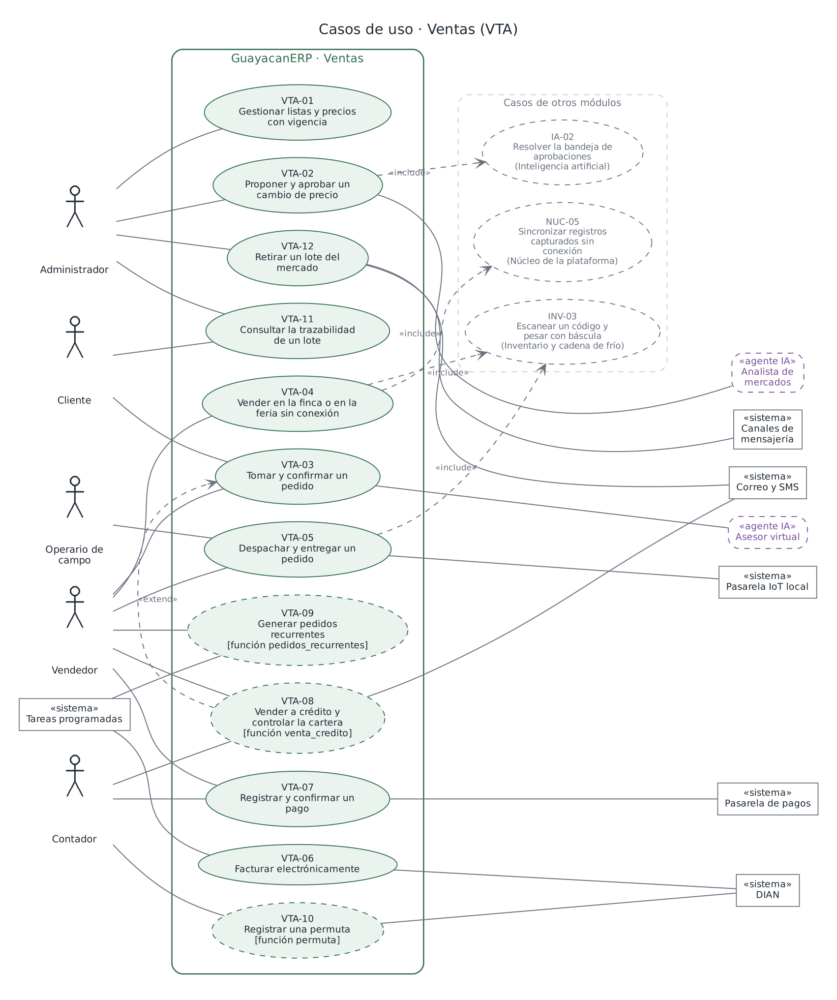

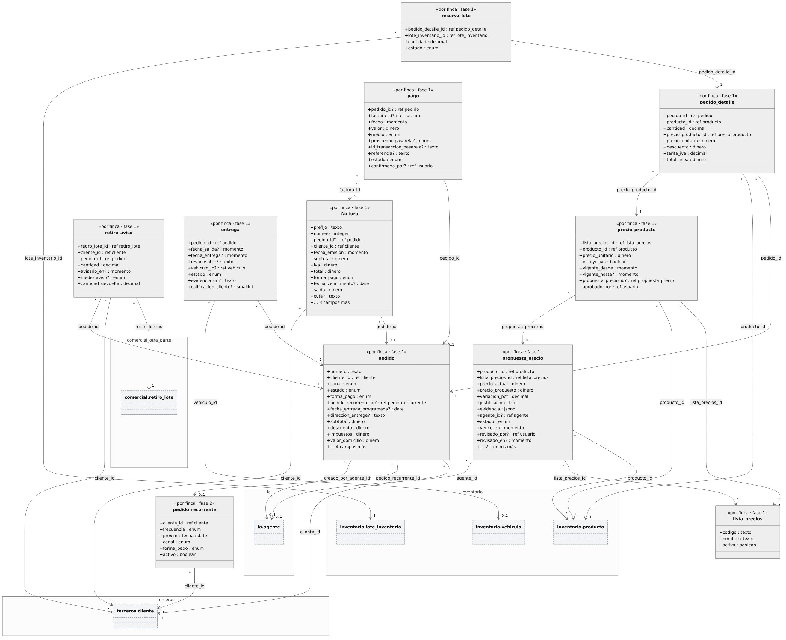

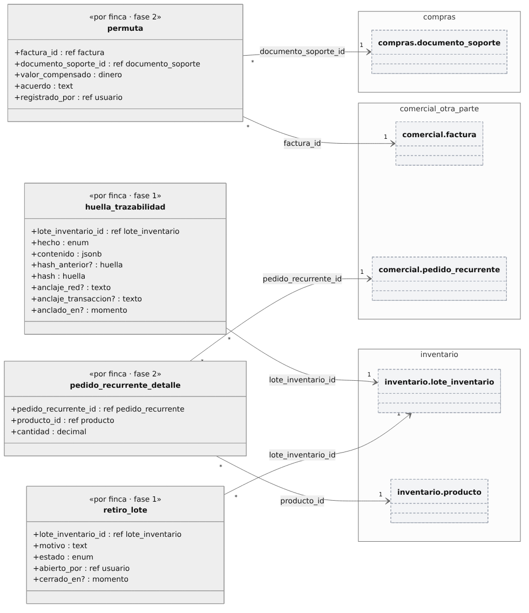

### VTA-01 · Gestionar listas y precios con vigencia

| Campo | Detalle |
| --- | --- |
| Objetivo | Tener precios por canal (público, tiendas, HORECA, mayoristas) con historial completo |
| Disparador | Cambio de precio aprobado o lista nueva |
| Precondiciones | Administrador |
| Postcondiciones | Precio vigente nuevo; el anterior cerrado con fecha |
| Actores | Primario: Administrador. Secundarios: ninguno |
| Fase y función | Fase 1 · siempre activa |
| Relaciones | ninguna |
| Reglas en la base | Un precio nunca se edita: se cierra el vigente y se crea otro; margen mínimo con `margen_minimo_venta` |
| Datos | `comercial.lista_precios`, `comercial.precio_producto` |
| API | CRUD `/api/v1/comercial/listas-precios/` y `/api/v1/comercial/precios-producto/` |
| Pruebas | v4 Pedido (precio congelado) |
| Requerimientos | RF-09 precios por canal |

**Flujo principal**

1. El administrador elige lista y producto.
2. Escribe el nuevo precio y desde cuándo rige.
3. El servicio cierra el precio vigente y crea el nuevo en la misma transacción.

**Flujos alternos y excepciones**

- 2a. Precio por debajo del margen mínimo sobre el costo: advertencia que exige confirmar.
- 2b. Cambio mayor que `variacion_maxima_precio`: pasa por propuesta y aprobación (VTA-02).

### VTA-02 · Proponer y aprobar un cambio de precio

| Campo | Detalle |
| --- | --- |
| Objetivo | Ajustar precios con evidencia de mercado sin que la IA los cambie por su cuenta |
| Disparador | El Analista de mercados detecta una diferencia con el mercado o el costo |
| Precondiciones | Precios de mercado recientes |
| Postcondiciones | Propuesta aprobada y aplicada, rechazada o vencida |
| Actores | Primario: Administrador. Secundarios: Analista de mercados (IA) |
| Fase y función | Fase 1 · siempre activa |
| Relaciones | incluye IA-02 |
| Reglas en la base | `comercial.aplicar_propuesta_precio()`; lo confirmado, reservado o facturado conserva su precio |
| Datos | `comercial.propuesta_precio`, `ia.solicitud_aprobacion` |
| API | `POST /api/v1/comercial/propuestas-precio/{id}/aprobar/`; `POST /api/v1/comercial/propuestas-precio/{id}/rechazar/` |
| Pruebas | pendiente: prueba de aplicación de propuesta |
| Requerimientos | RF-09 precios dinámicos, RQ-23 la IA propone |

**Flujo principal**

1. El agente crea la propuesta con producto, lista, precio sugerido, justificación y evidencia (SQ06).
2. Aparece en la bandeja de aprobaciones del administrador.
3. El administrador la aprueba.
4. La base aplica el precio nuevo.

**Flujos alternos y excepciones**

- 3a. Rechazo con motivo: el motivo alimenta la mejora del agente.
- 3b. Pasa su fecha sin decidir: vencida.

### VTA-03 · Tomar y confirmar un pedido

| Campo | Detalle |
| --- | --- |
| Objetivo | Vender lo que hay, al precio vigente, reservando primero lo que vence antes |
| Disparador | El cliente pide por cualquier canal |
| Precondiciones | Cliente registrado; productos con precio vigente |
| Postcondiciones | Pedido confirmado con precios congelados, reservas FEFO y evento `pedido.confirmado` |
| Actores | Primario: Vendedor, Cliente. Secundarios: Asesor virtual (IA) |
| Fase y función | Fase 1 · siempre activa |
| Relaciones | lo extiende VTA-08 (crédito); extiende RED-01 |
| Reglas en la base | `comercial.confirmar_pedido()`, `inventario.reservar_fefo()` (con bloqueo de fila), `inventario.puede_venderse()` |
| Datos | `comercial.pedido`, `comercial.pedido_detalle`, `comercial.reserva_lote` |
| API | CRUD `/api/v1/comercial/pedidos/` y `/api/v1/comercial/pedidos/{id}/lineas/`; `POST /api/v1/comercial/pedidos/{id}/confirmar/`; `POST /api/v1/comercial/pedidos/{id}/cancelar/` |
| Pruebas | v4 FEFO, v4 Pedido, v4 Catálogo |
| Requerimientos | RF-10 pedidos, RQ-27 FEFO |

**Flujo principal**

1. El vendedor (o el agente) crea el pedido en borrador con cliente, canal y líneas.
2. El sistema muestra el precio vigente y la cantidad vendible de cada producto.
3. El vendedor confirma.
4. La base valida precio y cupo, reserva por FEFO y congela los precios (SQ04).
5. El cliente recibe la confirmación por su canal.

**Flujos alternos y excepciones**

- 4a. No alcanza el inventario vendible: «Inventario insuficiente de …: faltan N» y ninguna reserva queda a medias.
- 4b. El precio cambió después de crear el pedido: «actualícelo antes de confirmar».
- 4c. Pedido que no está en borrador: «no se puede confirmar».
- 5a. Cancelación antes de despachar: se liberan las reservas; después de despachar solo hay devolución.

### VTA-04 · Vender en la finca o en la feria sin conexión

| Campo | Detalle |
| --- | --- |
| Objetivo | Vender y cobrar en la finca o en ferias campesinas sin señal |
| Disparador | Llega un comprador al puesto |
| Precondiciones | PWA con catálogo y lotes del día descargados |
| Postcondiciones | Venta y pago guardados en el celular; al sincronizar, pedido entregado, pago y salida de inventario |
| Actores | Primario: Vendedor. Secundarios: ninguno |
| Fase y función | Fase 2 · siempre activa |
| Relaciones | incluye NUC-05 e INV-03 |
| Reglas en la base | Las mismas del pedido al sincronizar; el celular reserva contra su copia local |
| Datos | `comercial.pedido`, `comercial.pago` |
| API | `POST /api/v1/sincronizacion/lote/` |
| Pruebas | v4 Sin conexión |
| Requerimientos | RF-12 punto de venta móvil sin conexión |

**Flujo principal**

1. Antes de salir, el vendedor descarga el catálogo y asigna a su celular los lotes que lleva.
2. En la feria escanea productos, cobra (efectivo, Nequi, Bre-B) y entrega.
3. Al volver la señal, la venta sube como pedido confirmado y entregado con su pago.

**Flujos alternos y excepciones**

- 3a. La venta excede lo que el celular llevaba: se rechaza al sincronizar y el vendedor ajusta.
- 2a. El cliente pide factura electrónica: se toman sus datos y la factura sale al sincronizar.

### VTA-05 · Despachar y entregar un pedido

| Campo | Detalle |
| --- | --- |
| Objetivo | Que salga exactamente lo reservado y quede la trazabilidad hasta el cliente |
| Disparador | Pedido confirmado listo para salir |
| Precondiciones | Reservas vigentes |
| Postcondiciones | Reservas despachadas, salida en kardex, huella de despacho, entrega en ruta y entregada |
| Actores | Primario: Operario de campo, Vendedor. Secundarios: Pasarela IoT local (registrador del vehículo) |
| Fase y función | Fase 1 · siempre activa |
| Relaciones | incluye INV-03 |
| Reglas en la base | `comercial.despachar_pedido()`, `comercial.huella_despacho()` |
| Datos | `comercial.entrega`, `comercial.reserva_lote`, `inventario.movimiento_inventario` |
| API | `POST /api/v1/comercial/pedidos/{id}/despachar/`; CRUD `/api/v1/comercial/entregas/` |
| Pruebas | v4 Despacho, v4 Trazabilidad |
| Requerimientos | RF-10 pedidos, RQ-27 trazabilidad |

**Flujo principal**

1. El operario escanea cada lote reservado al empacar.
2. Despacha: la base descuenta y registra la huella.
3. El conductor marca en ruta y, al entregar, entregada con foto o firma.

**Flujos alternos y excepciones**

- 1a. Se escanea un lote distinto al reservado: la PWA avisa y pide el correcto.
- 3a. Entrega fallida: se registra el motivo y se reprograma.
- 3b. Vehículo refrigerado fuera de rango: los lotes en ruta se bloquean (INV-07).

### VTA-06 · Facturar electrónicamente

| Campo | Detalle |
| --- | --- |
| Objetivo | Emitir la factura electrónica válida ante la DIAN por regla fija |
| Disparador | Pedido despachado o venta de contado |
| Precondiciones | Resolución de facturación vigente en parámetros |
| Postcondiciones | Factura con CUFE, XML y PDF; saldo y vencimiento calculados; comprobante contable |
| Actores | Primario: Tareas programadas. Secundarios: DIAN |
| Fase y función | Fase 1 · siempre activa |
| Relaciones | ninguna |
| Reglas en la base | `comercial.preparar_factura()` (saldo, vencimiento según plazo del cliente); la IA no factura |
| Datos | `comercial.factura` |
| API | `POST /api/v1/comercial/pedidos/{id}/facturar/` |
| Pruebas | v4 Crédito |
| Requerimientos | RNF-13 soporte contable |

**Flujo principal**

1. Al despachar, el servicio crea la factura con los precios congelados.
2. La base calcula saldo y vencimiento.
3. Celery la envía al proveedor tecnológico y guarda CUFE, XML y PDF.
4. Se envía al cliente por correo o WhatsApp.

**Flujos alternos y excepciones**

- 3a. Rechazo de la DIAN: queda rechazada con el motivo; nota crédito si ya se había aceptado.

### VTA-07 · Registrar y confirmar un pago

| Campo | Detalle |
| --- | --- |
| Objetivo | Que el dinero recibido baje el saldo de la factura solo cuando una persona o la pasarela lo confirman |
| Disparador | Pago en efectivo, transferencia, Bre-B o webhook de la pasarela |
| Precondiciones | Pedido o factura con saldo |
| Postcondiciones | Pago confirmado; saldo actualizado; bloqueo por mora levantado si queda al día |
| Actores | Primario: Vendedor, Contador. Secundarios: Pasarela de pagos |
| Fase y función | Fase 1 · siempre activa |
| Relaciones | ninguna |
| Reglas en la base | `comercial.aplicar_pago()`; un agente no confirma pagos |
| Datos | `comercial.pago` |
| API | `POST /api/v1/comercial/pagos/{id}/confirmar/`; `POST /api/v1/pagos/webhook/` (firma verificada) |
| Pruebas | v4 Pagos, v4 Crédito |
| Requerimientos | RF-21 pasarela de pagos |

**Flujo principal**

1. El vendedor registra el pago pendiente (medio, valor, referencia).
2. El contador lo confirma al verlo en la cuenta.
3. La base aplica el pago al saldo.

**Flujos alternos y excepciones**

- 1a. Pago en línea: la pasarela envía el webhook firmado y el pago queda confirmado sin intervención.
- 2a. Un agente intenta confirmar: «Un agente no puede confirmar pagos».
- 3a. Pago reversado: el saldo vuelve y se avisa al vendedor.

### VTA-08 · Vender a crédito y controlar la cartera

| Campo | Detalle |
| --- | --- |
| Objetivo | Dar crédito a clientes institucionales sin pasar su cupo ni venderle a quien está en mora |
| Disparador | Pedido a crédito de un cliente con cupo |
| Precondiciones | Función `venta_credito` encendida; cliente con cupo y plazo |
| Postcondiciones | Factura con vencimiento; cartera por edades; cliente bloqueado si tiene facturas vencidas |
| Actores | Primario: Contador, Vendedor. Secundarios: Correo y SMS |
| Fase y función | Fase 2 · función `venta_credito` (apagada al instalar) |
| Relaciones | extiende VTA-03 |
| Reglas en la base | `comercial.confirmar_pedido()` (cupo y mora), `comercial.actualizar_mora()`, vista `comercial.v_cartera` |
| Datos | `comercial.factura`, `terceros.cliente` |
| API | `GET /api/v1/comercial/cartera/` |
| Pruebas | v4 Crédito |
| Requerimientos | RF-11 control de cartera |

**Flujo principal**

1. Al confirmar, la base suma la cartera abierta y el pedido y la compara con el cupo.
2. La factura queda con vencimiento según el plazo (por ejemplo, 30 días).
3. Cada noche se actualiza la mora; las vencidas bloquean al cliente.
4. Se envían recordatorios antes y después del vencimiento.

**Flujos alternos y excepciones**

- 1a. Supera el cupo: «Cupo de crédito insuficiente: cartera X, pedido Y, cupo Z».
- 1b. Cliente en mora: «no puede comprar a crédito»; puede comprar de contado.
- 3a. Pago total: se levanta el bloqueo.

### VTA-09 · Generar pedidos recurrentes

| Campo | Detalle |
| --- | --- |
| Objetivo | Que tiendas, restaurantes y hoteles reciban su pedido fijo sin volver a pedirlo |
| Disparador | Tarea diaria |
| Precondiciones | Función `pedidos_recurrentes` encendida; pedido recurrente activo |
| Postcondiciones | Pedido del día en borrador; próxima fecha calculada |
| Actores | Primario: Tareas programadas, Vendedor. Secundarios: ninguno |
| Fase y función | Fase 2 · función `pedidos_recurrentes` (apagada al instalar) |
| Relaciones | ninguna |
| Reglas en la base | `comercial.generar_pedidos_recurrentes()` |
| Datos | `comercial.pedido_recurrente`, `comercial.pedido_recurrente_detalle` |
| API | CRUD `/api/v1/comercial/pedidos-recurrente/` |
| Pruebas | v4 Recurrentes |
| Requerimientos | RF-10 clientes recurrentes |

**Flujo principal**

1. El vendedor configura cliente, productos, cantidades y frecuencia.
2. Cada noche la tarea crea en borrador los que tocan.
3. El vendedor los revisa y confirma (VTA-03).

**Flujos alternos y excepciones**

- 2a. Función apagada: no genera nada.

### VTA-10 · Registrar una permuta

| Campo | Detalle |
| --- | --- |
| Objetivo | Formalizar un trueque como venta y compra que se compensan, con soporte DIAN |
| Disparador | Se intercambia producto por un bien o servicio |
| Precondiciones | Función `permuta` encendida; factura y documento soporte |
| Postcondiciones | Pago de compensación aplicado a la factura y al documento soporte |
| Actores | Primario: Contador. Secundarios: DIAN |
| Fase y función | Fase 2 · función `permuta` (apagada al instalar) |
| Relaciones | ninguna |
| Reglas en la base | `comercial.aplicar_permuta()`: no compensa más del saldo de la factura ni de lo disponible del documento soporte; la mano de obra no se paga con producto |
| Datos | `comercial.permuta`, `compras.documento_soporte`, `comercial.factura` |
| API | CRUD `/api/v1/comercial/permutas/` |
| Pruebas | v4 Permuta |
| Requerimientos | RNF-13 soporte contable |

**Flujo principal**

1. El contador elige la factura y el documento soporte.
2. Indica el valor a compensar.
3. La base crea el pago de compensación y deja el saldo restante.

**Flujos alternos y excepciones**

- 2a. Valor mayor que el saldo o lo disponible: rechazado.

### VTA-11 · Consultar la trazabilidad de un lote

| Campo | Detalle |
| --- | --- |
| Objetivo | Que un cliente vea de dónde viene su producto y que la finca sepa a quién llegó cada lote |
| Disparador | El cliente escanea el QR de la etiqueta o el administrador investiga un lote |
| Precondiciones | Lote con huellas registradas |
| Postcondiciones | Ninguna escritura |
| Actores | Primario: Cliente, Administrador. Secundarios: ninguno |
| Fase y función | Fase 1 · siempre activa |
| Relaciones | ninguna |
| Reglas en la base | Vista `comercial.v_trazabilidad_lote`; `comercial.verificar_cadena_huellas()` confirma que la cadena SHA-256 no fue alterada |
| Datos | `comercial.huella_trazabilidad` |
| API | `GET /api/v1/publico/trazabilidad/{codigo}/` (público, sin datos de clientes); `GET /api/v1/comercial/trazabilidad/{lote}/` (interno) |
| Pruebas | v4 Trazabilidad, v4 Huellas |
| Requerimientos | RF-06 trazabilidad con QR |

**Flujo principal**

1. El cliente escanea el QR y abre la página pública.
2. Ve producto, zona, fecha de cosecha o postura, prácticas e insumos aplicados.
3. La página indica si la cadena de huellas está íntegra.
4. Internamente, el administrador ve además a qué pedidos y clientes llegó.

**Flujos alternos y excepciones**

- 1a. Código inexistente: página de lote no encontrado.

### VTA-12 · Retirar un lote del mercado

| Campo | Detalle |
| --- | --- |
| Objetivo | Sacar del mercado un lote con problema y avisar a cada cliente que lo recibió |
| Disparador | Reclamo, hallazgo sanitario o aviso de una autoridad |
| Precondiciones | Lote con trazabilidad |
| Postcondiciones | Lote bloqueado; un aviso por cliente con lo recibido; retiro cerrado con lo devuelto |
| Actores | Primario: Administrador. Secundarios: Correo y SMS, Canales de mensajería |
| Fase y función | Fase 1 · siempre activa |
| Relaciones | ninguna |
| Reglas en la base | `comercial.abrir_retiro()` bloquea y crea los avisos |
| Datos | `comercial.retiro_lote`, `comercial.retiro_aviso`, `inventario.bloqueo_lote` |
| API | `POST /api/v1/comercial/retiros-lote/`; `PATCH /api/v1/comercial/retiros-lote/{id}/avisos/{aviso}/` |
| Pruebas | v4 Retiro |
| Requerimientos | RF-06 trazabilidad, RQ-27 inventario perecedero |

**Flujo principal**

1. El administrador abre el retiro con el lote y el motivo.
2. La base bloquea el lote y crea un aviso por cliente con la cantidad recibida.
3. El sistema envía el aviso por el canal de cada cliente (mensaje de servicio, no de mercadeo).
4. Se registra lo devuelto por cada cliente y se cierra el retiro.

**Flujos alternos y excepciones**

- 3a. Cliente sin canal disponible: el vendedor lo llama y registra el aviso a mano.

## Clientes potenciales (CRM)

El CRM registra personas y empresas que todavía no compran, desde el formulario hasta el primer pedido. De una persona solo se guarda teléfono o correo con su autorización, y nadie le escribe si la revoca.

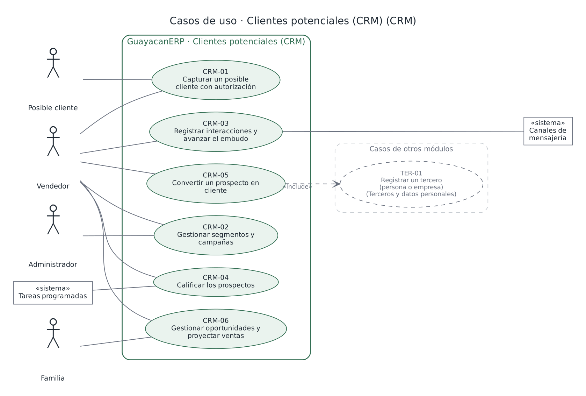

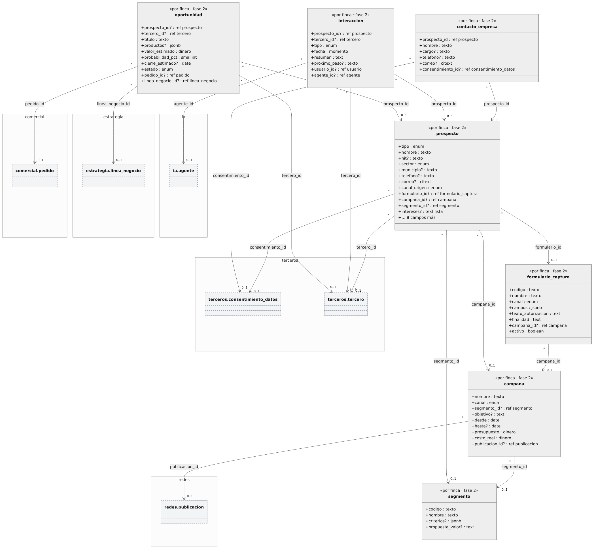

### CRM-01 · Capturar un posible cliente con autorización

| Campo | Detalle |
| --- | --- |
| Objetivo | Recoger datos de interesados en ferias, en la web o en la finca, con autorización válida |
| Disparador | La persona llena el formulario o el vendedor la registra |
| Precondiciones | Formulario activo con su texto de autorización y finalidades |
| Postcondiciones | Prospecto nuevo con canal de origen y campaña; autorización registrada si la dio |
| Actores | Primario: Posible cliente, Vendedor. Secundarios: ninguno |
| Fase y función | Fase 2 · siempre activa |
| Relaciones | ninguna |
| Reglas en la base | `crm.validar_prospecto()`: persona con teléfono o correo exige autorización; una empresa guarda datos públicos |
| Datos | `crm.formulario_captura`, `crm.prospecto`, `terceros.consentimiento_datos` |
| API | `POST /api/v1/crm/captura/{formulario}/` (público, con límite y captcha); CRUD `/api/v1/crm/prospectos/` |
| Pruebas | v5 CRM |
| Requerimientos | RQ-36 captura de clientes potenciales, RNF-04 Ley 1581 |

**Flujo principal**

1. La persona abre el formulario (QR en la feria, enlace en redes, tableta en la finca).
2. Escribe nombre, tipo (persona o empresa), sector, teléfono o correo e interés.
3. Marca las finalidades que autoriza.
4. El sistema guarda la autorización y el prospecto con su campaña.

**Flujos alternos y excepciones**

- 3a. No autoriza: se guarda sin datos de contacto o se descarta.
- 4a. Ya existe el tercero: el prospecto se liga a él.
- 4b. Demasiados envíos desde una IP: límite de Nginx y del detector.

### CRM-02 · Gestionar segmentos y campañas

| Campo | Detalle |
| --- | --- |
| Objetivo | Atender a cada segmento con su propuesta de valor y medir cuánto cuesta cada cliente nuevo |
| Disparador | Se planea una feria, una pauta o una visita comercial |
| Precondiciones | Segmentos definidos (hogares, tiendas, HORECA, instituciones, turistas) |
| Postcondiciones | Campaña con canal, fechas y costo real; prospectos ligados |
| Actores | Primario: Vendedor, Administrador. Secundarios: ninguno |
| Fase y función | Fase 2 · siempre activa |
| Relaciones | ninguna |
| Reglas en la base | Vista `crm.v_campanas` (prospectos, ganados, costo por cliente) |
| Datos | `crm.segmento`, `crm.campana` |
| API | CRUD `/api/v1/crm/segmentos/` y `/api/v1/crm/campanas/` |
| Pruebas | v5 CRM |
| Requerimientos | RQ-36 CRM |

**Flujo principal**

1. El vendedor crea la campaña con segmento, canal y fechas.
2. Asocia formularios y registra el costo real al terminar.
3. El tablero muestra prospectos, clientes ganados y costo por cliente.

**Flujos alternos y excepciones**

- 3a. Sin clientes ganados: el costo por cliente se muestra vacío, no infinito.

### CRM-03 · Registrar interacciones y avanzar el embudo

| Campo | Detalle |
| --- | --- |
| Objetivo | Llevar el historial de contacto y la etapa de cada prospecto |
| Disparador | Llamada, mensaje, visita o envío de propuesta |
| Precondiciones | Prospecto existente; autorización vigente para personas |
| Postcondiciones | Interacción guardada; etapa actualizada; próximo contacto programado |
| Actores | Primario: Vendedor. Secundarios: Canales de mensajería |
| Fase y función | Fase 2 · siempre activa |
| Relaciones | ninguna |
| Reglas en la base | `crm.validar_interaccion()`: no se contacta sin autorización vigente; el primer contacto pasa a contactado; perdido exige motivo |
| Datos | `crm.interaccion`, `crm.prospecto`, `crm.contacto_empresa` |
| API | CRUD `/api/v1/crm/interacciones/` y `/api/v1/crm/contactos-empresa/` |
| Pruebas | v5 CRM |
| Requerimientos | RQ-36 CRM |

**Flujo principal**

1. El vendedor registra la interacción (tipo, fecha, resumen, siguiente paso).
2. El sistema mueve la etapa según la regla y agenda el próximo contacto.
3. Para empresas, registra contactos con cargo.

**Flujos alternos y excepciones**

- 1a. Autorización revocada: «no se le escribe sin su autorización».
- 2a. Marcar perdido sin motivo: rechazado.

### CRM-04 · Calificar los prospectos

| Campo | Detalle |
| --- | --- |
| Objetivo | Ordenar a quién llamar primero con un puntaje explicable de 0 a 100 |
| Disparador | Tarea diaria o botón Recalcular |
| Precondiciones | Prospectos abiertos |
| Postcondiciones | Puntaje actualizado |
| Actores | Primario: Tareas programadas, Vendedor. Secundarios: ninguno |
| Fase y función | Fase 2 · siempre activa |
| Relaciones | ninguna |
| Reglas en la base | `crm.calificar()`: autorización o empresa 20, sector institucional 20, volumen hasta 30 (contra `volumen_referencia_prospecto`), contacto en 30 días 15, etapa avanzada 15 |
| Datos | `crm.prospecto` |
| API | `POST /api/v1/crm/prospectos/{id}/calificar/` |
| Pruebas | v5 CRM (un hotel con volumen alto da 85) |
| Requerimientos | RQ-36 CRM |

**Flujo principal**

1. La tarea recalcula el puntaje de los prospectos abiertos.
2. La lista del vendedor se ordena por puntaje y próximo contacto.
3. Al abrir un prospecto se ve el desglose del puntaje.

**Flujos alternos y excepciones**

- 1a. Prospecto ganado, perdido o descartado: no se recalcula.

### CRM-05 · Convertir un prospecto en cliente

| Campo | Detalle |
| --- | --- |
| Objetivo | Pasar al prospecto que compra a cliente sin volver a digitar sus datos |
| Disparador | Primer pedido o acuerdo comercial |
| Precondiciones | Prospecto en negociación o propuesta |
| Postcondiciones | Tercero y cliente creados (o reutilizados); prospecto ganado |
| Actores | Primario: Vendedor. Secundarios: ninguno |
| Fase y función | Fase 2 · siempre activa |
| Relaciones | incluye TER-01 |
| Reglas en la base | `crm.convertir_prospecto()`; ganado exige cliente creado |
| Datos | `crm.prospecto`, `terceros.tercero`, `terceros.cliente` |
| API | `POST /api/v1/crm/prospectos/{id}/convertir/` |
| Pruebas | v5 CRM |
| Requerimientos | RQ-36 CRM |

**Flujo principal**

1. El vendedor pulsa Convertir y elige el segmento o tipo de cliente.
2. La base crea el tercero (o usa el que ya tenía) y el cliente.
3. El prospecto queda ganado y se abre el primer pedido.

**Flujos alternos y excepciones**

- 1a. Intento de marcar ganado sin convertir: «conviértalo en cliente».

### CRM-06 · Gestionar oportunidades y proyectar ventas

| Campo | Detalle |
| --- | --- |
| Objetivo | Estimar las ventas de los próximos meses con valor y probabilidad |
| Disparador | Se identifica una posible venta grande (contrato con un hotel) |
| Precondiciones | Prospecto o cliente |
| Postcondiciones | Oportunidad abierta, ganada o perdida; proyección ponderada por mes |
| Actores | Primario: Vendedor, Familia. Secundarios: ninguno |
| Fase y función | Fase 2 · siempre activa |
| Relaciones | ninguna |
| Reglas en la base | Vistas `crm.v_embudo` y `crm.v_proyeccion_ventas` |
| Datos | `crm.oportunidad` |
| API | `GET /api/v1/crm/embudo/`; CRUD `/api/v1/crm/oportunidades/` |
| Pruebas | v5 CRM |
| Requerimientos | RQ-36 CRM, RQ-38 presupuesto de ventas |

**Flujo principal**

1. El vendedor crea la oportunidad con valor, probabilidad y fecha de cierre.
2. El tablero muestra el embudo por etapa y la proyección por mes.
3. La familia usa la proyección como premisa del presupuesto de ventas (FIN-06).

**Flujos alternos y excepciones**

- 1a. Oportunidad perdida: se registra el motivo.

## Canales y redes sociales (RED)

Los agentes atienden por WhatsApp, Instagram, Messenger, TikTok y la web, pero cada envío pasa por una regla fija que aplica la política de cada plataforma y la autorización del cliente. Las conversaciones viven en MongoDB; el control y lo que cuesta, en PostgreSQL.

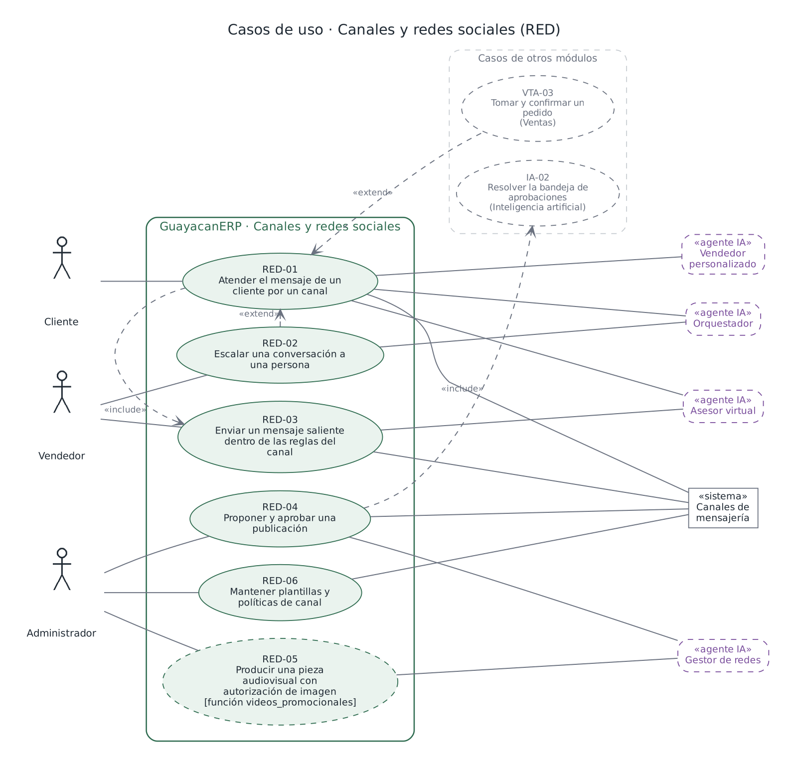

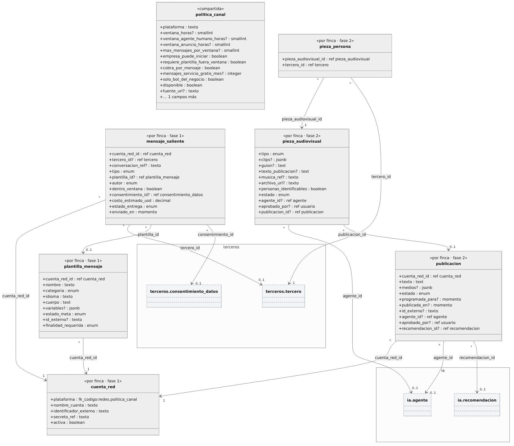

### RED-01 · Atender el mensaje de un cliente por un canal

| Campo | Detalle |
| --- | --- |
| Objetivo | Responder rápido preguntas de catálogo, precios, pedidos y la finca, con datos reales |
| Disparador | El cliente escribe por un canal |
| Precondiciones | Cuenta del canal conectada; reglas de conversación cargadas |
| Postcondiciones | Conversación y mensajes en MongoDB; mensaje saliente registrado; pedido en borrador si lo pidió |
| Actores | Primario: Cliente. Secundarios: Canales de mensajería, Orquestador, Asesor virtual, Vendedor personalizado (IA) |
| Fase y función | Fase 1 · siempre activa |
| Relaciones | incluye RED-03; lo extienden RED-02 y VTA-03 |
| Reglas en la base | Herramientas MCP de solo lectura o borrador; la personalización exige autorización; `redes.verificar_envio()` antes de responder |
| Datos | `redes.cuenta_red`, `ia.regla_conversacion` y las colecciones de MongoDB `conversaciones` y `mensajes` |
| API | `POST /canales/whatsapp/webhook` (servicio de agentes, firma verificada) |
| Pruebas | v4 WhatsApp |
| Requerimientos | RQ-24 atención por canales, RQ-23 agentes |

**Flujo principal**

1. El canal envía el webhook firmado; el servicio de agentes guarda el mensaje (SQ05).
2. El Orquestador identifica la intención y revisa las reglas de conversación.
3. El Asesor virtual consulta el catálogo o el pedido por MCP.
4. Verifica que el envío esté permitido y responde.
5. Si el cliente quiere comprar, crea el pedido en borrador para el vendedor.

**Flujos alternos y excepciones**

- 2a. Tema no permitido: respuesta cortés y fin.
- 2b. Cliente molesto o pedido complejo: escalamiento (RED-02).
- 3a. El cliente autorizó personalización: el Vendedor personalizado sugiere según su historial.

### RED-02 · Escalar una conversación a una persona

| Campo | Detalle |
| --- | --- |
| Objetivo | Que una persona atienda lo que el agente no debe resolver, dentro de la ventana del canal |
| Disparador | Regla de conversación, sentimiento negativo o petición expresa |
| Precondiciones | Conversación activa |
| Postcondiciones | Escalamiento atendido o vencido; respuesta humana registrada |
| Actores | Primario: Vendedor. Secundarios: Orquestador (IA) |
| Fase y función | Fase 1 · siempre activa |
| Relaciones | extiende RED-01 |
| Reglas en la base | Ventana del canal: en Instagram una persona puede responder hasta 7 días (etiqueta de agente humano); un agente de IA no usa esa extensión |
| Datos | `ia.escalamiento` |
| API | CRUD `/api/v1/ia/escalamientos/`; `POST /api/v1/ia/escalamientos/{id}/tomar/` |
| Pruebas | v4 Instagram |
| Requerimientos | RQ-24 canales |

**Flujo principal**

1. El Orquestador crea el escalamiento con motivo y hasta cuándo se puede responder.
2. El vendedor lo toma desde la bandeja y responde desde el panel.
3. Marca resuelto.

**Flujos alternos y excepciones**

- 2a. Pasa la ventana sin respuesta: vencido; solo se puede escribir con plantilla aprobada.

### RED-03 · Enviar un mensaje saliente dentro de las reglas del canal

| Campo | Detalle |
| --- | --- |
| Objetivo | No romper las políticas de Meta y TikTok ni escribir a quien no lo autorizó |
| Disparador | Respuesta, confirmación de pedido, recordatorio o promoción |
| Precondiciones | Política del canal vigente; plantillas aprobadas |
| Postcondiciones | Mensaje enviado o bloqueado, con la regla que lo decidió y su costo estimado |
| Actores | Primario: Vendedor. Secundarios: Canales de mensajería, Asesor virtual (IA) |
| Fase y función | Fase 1 · siempre activa |
| Relaciones | incluido por RED-01 |
| Reglas en la base | `redes.verificar_envio()`: WhatsApp responde libre en 24 horas y después solo con plantilla; las de mercadeo exigen autorización de publicidad; TikTok se detiene tras 10 mensajes en la ventana |
| Datos | `redes.mensaje_saliente`, `redes.plantilla_mensaje`, `redes.politica_canal` |
| API | `POST /api/v1/redes/mensajes-salientes/verificar/` |
| Pruebas | v4 WhatsApp, v4 Instagram, v4 TikTok |
| Requerimientos | RF-20 notificaciones, RQ-24 canales, RNF-04 Ley 1581 |

**Flujo principal**

1. El remitente (persona o agente) pide enviar con canal, conversación, tipo y plantilla.
2. La base revisa ventana, plantilla, autorización y tope.
3. Si está permitido, el conector envía y registra el mensaje.

**Flujos alternos y excepciones**

- 2a. Fuera de la ventana sin plantilla: bloqueado.
- 2b. Promoción sin autorización de publicidad: bloqueado.
- 2c. Tope del canal alcanzado: bloqueado hasta que el cliente vuelva a escribir.

### RED-04 · Proponer y aprobar una publicación

| Campo | Detalle |
| --- | --- |
| Objetivo | Publicar en redes con un borrador del agente y la aprobación de una persona |
| Disparador | Calendario de contenidos, temporada o una cifra ambiental del mes |
| Precondiciones | Cuenta de red conectada |
| Postcondiciones | Publicación aprobada, programada y publicada, o rechazada |
| Actores | Primario: Administrador. Secundarios: Gestor de redes (IA), Canales de mensajería |
| Fase y función | Fase 2 · siempre activa |
| Relaciones | incluye IA-02 |
| Reglas en la base | Solo una persona aprueba contenido para redes |
| Datos | `redes.publicacion` |
| API | CRUD `/api/v1/redes/publicaciones/`; `POST /api/v1/redes/publicaciones/{id}/aprobar/` |
| Pruebas | v4 Audiovisual (aprobación humana) |
| Requerimientos | RQ-24 redes, RQ-23 la IA propone |

**Flujo principal**

1. El Gestor de redes redacta texto, imagen y hashtags y lo deja como propuesta.
2. El administrador lo revisa, edita y aprueba con fecha.
3. Celery publica a la hora programada y guarda el enlace.

**Flujos alternos y excepciones**

- 2a. Rechazo con comentario: el agente aprende del motivo.

### RED-05 · Producir una pieza audiovisual con autorización de imagen

| Campo | Detalle |
| --- | --- |
| Objetivo | Hacer videos y time-lapse para redes sin publicar a nadie que no lo autorizó |
| Disparador | Se elige un clip o fotos para una pieza |
| Precondiciones | Función `videos_promocionales` encendida |
| Postcondiciones | Pieza armada con FFmpeg, aprobada y publicada; personas que aparecen con su autorización |
| Actores | Primario: Administrador. Secundarios: Gestor de redes (IA) |
| Fase y función | Fase 2 · función `videos_promocionales` (apagada al instalar) |
| Relaciones | ninguna |
| Reglas en la base | `redes.validar_pieza()`: no se aprueba si alguien que aparece no autorizó su imagen; un agente no aprueba |
| Datos | `redes.pieza_audiovisual`, `redes.pieza_persona` |
| API | CRUD `/api/v1/redes/piezas-audiovisual/` y `/api/v1/redes/piezas-persona/` |
| Pruebas | v4 Audiovisual |
| Requerimientos | RQ-24 redes, RNF-04 Ley 1581 |

**Flujo principal**

1. El agente propone guion y texto; el servicio arma el archivo con FFmpeg.
2. El administrador marca quién aparece.
3. El sistema verifica la autorización de imagen de cada persona.
4. El administrador aprueba y se publica (RED-04).

**Flujos alternos y excepciones**

- 3a. Falta una autorización: «Falta autorización de imagen de …»; se pide o se edita la pieza.

### RED-06 · Mantener plantillas y políticas de canal

| Campo | Detalle |
| --- | --- |
| Objetivo | Tener al día las reglas de cada plataforma y las plantillas aprobadas por Meta |
| Disparador | Meta o TikTok cambian sus políticas o se aprueba una plantilla |
| Precondiciones | Administrador |
| Postcondiciones | Política vigente por canal; plantilla con su categoría (servicio o mercadeo) y estado |
| Actores | Primario: Administrador. Secundarios: Canales de mensajería |
| Fase y función | Fase 1 · siempre activa |
| Relaciones | ninguna |
| Reglas en la base | Las políticas son catálogo compartido con vigencia |
| Datos | `redes.plantilla_mensaje`, `redes.politica_canal` |
| API | CRUD `/api/v1/redes/plantillas-mensaje/` y `/api/v1/redes/politicas-canal/` |
| Pruebas | v4 WhatsApp |
| Requerimientos | RQ-24 canales |

**Flujo principal**

1. El administrador registra la plantilla enviada a Meta.
2. Cuando Meta la aprueba, la marca aprobada con su categoría.
3. Ante un cambio de política, crea la nueva versión con fecha de vigencia.

**Flujos alternos y excepciones**

- 2a. Plantilla rechazada: no se puede usar.

## Turismo (TUR)

Cabañas y experiencias (pasadía, recorrido del cacao, talleres) con reservas y pago anticipado. Cada reserva confirmada ocupa la agenda de su recurso sin cruces, contando la limpieza.

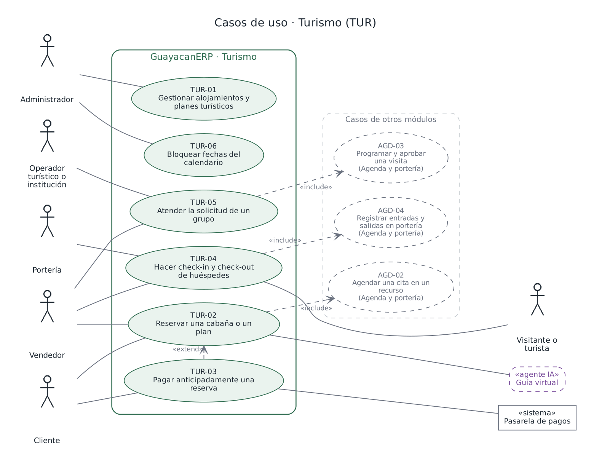

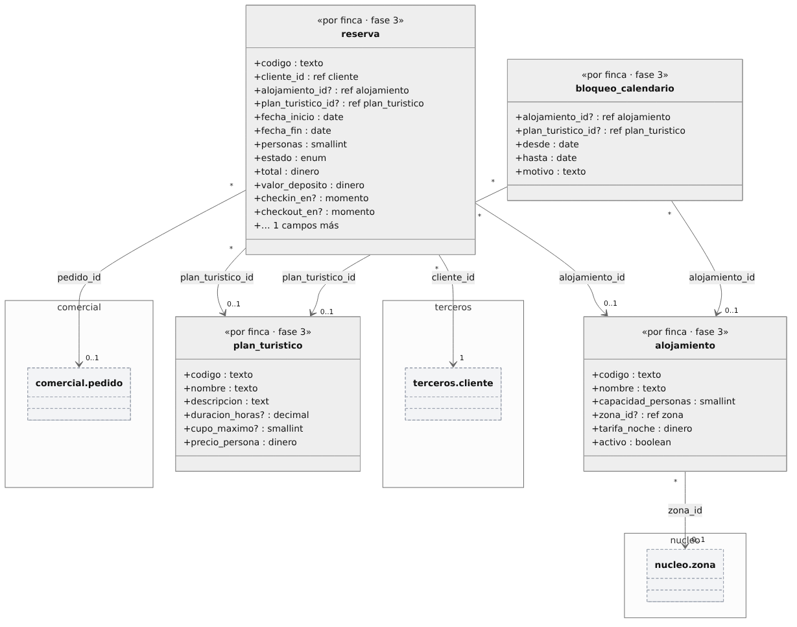

### TUR-01 · Gestionar alojamientos y planes turísticos

| Campo | Detalle |
| --- | --- |
| Objetivo | Publicar cabañas y experiencias con capacidad, precio y condiciones |
| Disparador | Apertura de la temporada o nueva experiencia |
| Precondiciones | Administrador |
| Postcondiciones | Alojamiento o plan activo, con su recurso agendable |
| Actores | Primario: Administrador. Secundarios: ninguno |
| Fase y función | Fase 3 · siempre activa |
| Relaciones | ninguna |
| Reglas en la base | Cada cabaña tiene un recurso de agenda con minutos de alistamiento |
| Datos | `turismo.alojamiento`, `turismo.plan_turistico`, `agenda.recurso` |
| API | CRUD `/api/v1/turismo/alojamientos/` y `/api/v1/turismo/planes-turistico/` |
| Pruebas | v5 Agenda |
| Requerimientos | RF-13 calendario de disponibilidad |

**Flujo principal**

1. El administrador crea la cabaña con capacidad, tarifa por noche y fotos.
2. El servicio crea su recurso de agenda con el tiempo de limpieza (por ejemplo, 120 minutos).
3. Crea los planes con duración, cupo y precio por persona.

**Flujos alternos y excepciones**

- 1a. Cabaña fuera de servicio: se desactiva el recurso; sus reservas futuras se revisan.

### TUR-02 · Reservar una cabaña o un plan

| Campo | Detalle |
| --- | --- |
| Objetivo | Que el cliente reserve solo fechas libres y para las personas que caben |
| Disparador | El cliente reserva en la web, por WhatsApp o con el vendedor |
| Precondiciones | Alojamiento o plan activo |
| Postcondiciones | Reserva solicitada; al confirmarse, cita en la agenda de 15:00 del día de llegada a 12:00 del de salida más la limpieza |
| Actores | Primario: Cliente, Vendedor. Secundarios: Guía virtual (IA) |
| Fase y función | Fase 3 · siempre activa |
| Relaciones | incluye AGD-02; lo extiende TUR-03 |
| Reglas en la base | `turismo.validar_reserva()` (capacidad, al menos una noche), `turismo.sincronizar_agenda()` con exclusión sin cruces |
| Datos | `turismo.reserva`, `agenda.cita` |
| API | `GET /api/v1/agenda/recursos/{id}/disponible/?desde=&hasta=`; CRUD `/api/v1/turismo/reservas/` |
| Pruebas | v5 Agenda |
| Requerimientos | RF-13 disponibilidad, RF-14 reservas en línea, RQ-39 agenda |

**Flujo principal**

1. El cliente elige fechas y número de personas; el sistema muestra solo lo disponible.
2. Crea la reserva solicitada con el total.
3. Al pagar el anticipo (TUR-03) o al confirmarla el vendedor, la base ocupa la agenda (SQ09).

**Flujos alternos y excepciones**

- 1a. Más personas que la capacidad: «La cabaña admite N personas».
- 3a. Otra reserva ganó la fecha al mismo tiempo: 409 «ya está ocupada o bloqueada», y se reembolsa si ya pagó.
- 3b. Llegada el mismo día de la salida anterior: permitido si queda después de la limpieza.

### TUR-03 · Pagar anticipadamente una reserva

| Campo | Detalle |
| --- | --- |
| Objetivo | Cobrar el anticipo que pide el plan financiero antes de comprometer la cabaña |
| Disparador | El cliente paga en línea |
| Precondiciones | Reserva solicitada |
| Postcondiciones | Pago confirmado por la pasarela; reserva pagada o confirmada |
| Actores | Primario: Cliente. Secundarios: Pasarela de pagos |
| Fase y función | Fase 3 · siempre activa |
| Relaciones | extiende TUR-02 |
| Reglas en la base | El pago de la pasarela llega por webhook firmado; un agente no confirma pagos |
| Datos | `turismo.reserva`, `comercial.pago` |
| API | `POST /api/v1/turismo/reservas/{id}/pagar/` (crea la sesión de pago); `POST /api/v1/pagos/webhook/` |
| Pruebas | v4 Pagos |
| Requerimientos | RF-14 pago anticipado, RF-21 pasarela de pagos |

**Flujo principal**

1. El sistema crea la sesión de pago con la pasarela (Wompi, PayU o Mercado Pago).
2. El cliente paga.
3. La pasarela envía el webhook; el sistema verifica la firma y confirma el pago.
4. La reserva pasa a pagada y ocupa la agenda.

**Flujos alternos y excepciones**

- 2a. Pago rechazado: la reserva sigue solicitada y vence a las 24 horas.
- 4a. La fecha ya no está libre: se reembolsa automáticamente y se avisa.

### TUR-04 · Hacer check-in y check-out de huéspedes

| Campo | Detalle |
| --- | --- |
| Objetivo | Registrar llegada con autorizaciones y salida, y alistar la cabaña |
| Disparador | Llega o sale el huésped |
| Precondiciones | Reserva pagada o confirmada |
| Postcondiciones | Check-in con autorización de datos y consentimiento de riesgos; check-out con tarea de limpieza |
| Actores | Primario: Portería, Vendedor. Secundarios: Visitante o turista |
| Fase y función | Fase 3 · siempre activa |
| Relaciones | incluye AGD-04 |
| Reglas en la base | `turismo.sincronizar_agenda()`: el check-out crea la tarea de limpieza del área AR-TURISMO |
| Datos | `turismo.reserva`, `terceros.consentimiento_datos`, `personal.tarea` |
| API | `POST /api/v1/turismo/reservas/{id}/check-in/`; `POST /api/v1/turismo/reservas/{id}/check-out/` |
| Pruebas | v5 Agenda |
| Requerimientos | RF-16 check-in digital con consentimiento, RNF-04 Ley 1581 |

**Flujo principal**

1. Portería registra la entrada del huésped y su vehículo (AGD-04).
2. El huésped firma en la tableta el consentimiento de riesgos y las autorizaciones de datos.
3. Se entrega la cabaña.
4. Al salir, se registra el check-out; la base crea la tarea de limpieza.

**Flujos alternos y excepciones**

- 2a. El huésped no autoriza publicidad: se registra igual el check-in; no recibirá promociones.
- 4a. Daños en la cabaña: se registra una orden de trabajo y, si aplica, un cobro.

### TUR-05 · Atender la solicitud de un grupo

| Campo | Detalle |
| --- | --- |
| Objetivo | Organizar visitas de colegios, universidades y operadores con plan a la medida |
| Disparador | Un operador o institución pide una visita |
| Precondiciones | Planes turísticos definidos |
| Postcondiciones | Reserva de grupo con plan, número de personas y visita programada |
| Actores | Primario: Operador turístico o institución. Secundarios: Vendedor |
| Fase y función | Fase 3 · siempre activa |
| Relaciones | incluye AGD-03 |
| Reglas en la base | Si el grupo visita el galpón, se exige la declaración de bioseguridad de la visita |
| Datos | `turismo.reserva`, `turismo.plan_turistico`, `agenda.visita` |
| API | `POST /api/v1/turismo/solicitudes-grupo/`; CRUD `/api/v1/turismo/reservas/` |
| Pruebas | pendiente: escribir la prueba al construir |
| Requerimientos | RF-15 gestión de grupos |

**Flujo principal**

1. El operador envía fecha, número de personas, edades e intereses.
2. El vendedor arma la propuesta con planes y precio y la envía.
3. Al aceptarse, crea la reserva y la visita programada con su anfitrión.

**Flujos alternos y excepciones**

- 1a. Grupo con menores de edad: se exige la autorización de la institución y del acudiente.

### TUR-06 · Bloquear fechas del calendario

| Campo | Detalle |
| --- | --- |
| Objetivo | Reservar días para mantenimiento o uso familiar |
| Disparador | Se programa pintura, reparación o visita de la familia |
| Precondiciones | Alojamiento existente |
| Postcondiciones | Bloqueo con su cita en la agenda |
| Actores | Primario: Administrador. Secundarios: ninguno |
| Fase y función | Fase 3 · siempre activa |
| Relaciones | ninguna |
| Reglas en la base | `turismo.sincronizar_bloqueo()`: el bloqueo choca con reservas existentes; al borrarlo, la cita se cancela |
| Datos | `turismo.bloqueo_calendario`, `agenda.cita` |
| API | CRUD `/api/v1/turismo/bloqueos-calendario/` |
| Pruebas | v5 Agenda |
| Requerimientos | RF-13 calendario |

**Flujo principal**

1. El administrador elige la cabaña, las fechas y el motivo.
2. La base crea la cita de bloqueo.

**Flujos alternos y excepciones**

- 2a. Ya hay una reserva en esas fechas: «El bloqueo choca con una reserva o cita de la cabaña».

## Agenda y portería (AGD)

Un calendario por recurso (cabañas, salón, vehículos, equipos, punto de cargue) que la base mantiene sin cruces, más las visitas con pase QR y la portería de personas y vehículos, que funciona sin internet.

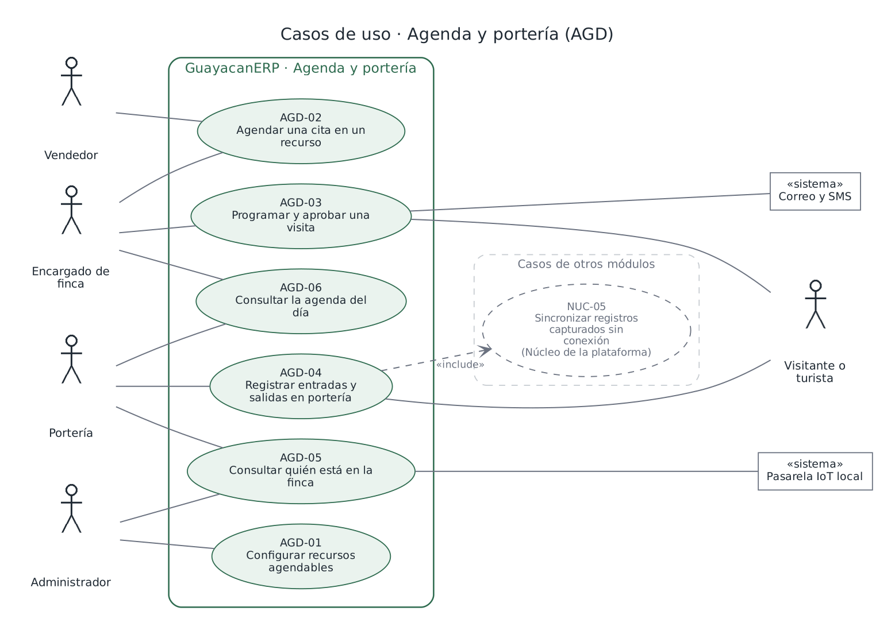

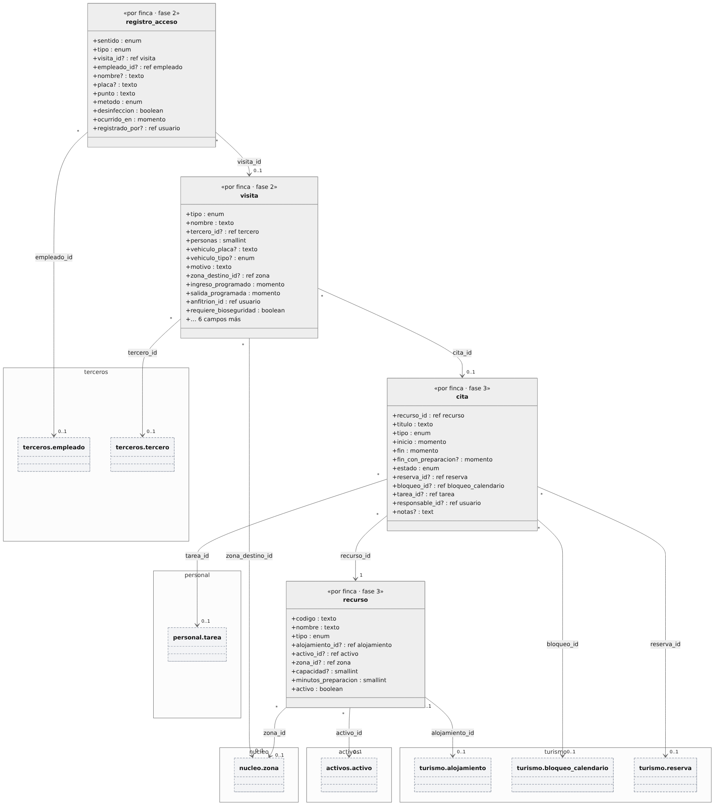

### AGD-01 · Configurar recursos agendables

| Campo | Detalle |
| --- | --- |
| Objetivo | Definir qué se agenda y cuánto tiempo de alistamiento necesita |
| Disparador | Recurso nuevo |
| Precondiciones | Administrador |
| Postcondiciones | Recurso activo, ligado a una cabaña o a un activo si aplica |
| Actores | Primario: Administrador. Secundarios: ninguno |
| Fase y función | Fase 3 · siempre activa |
| Relaciones | ninguna |
| Reglas en la base | Una cabaña tiene un solo recurso |
| Datos | `agenda.recurso` |
| API | CRUD `/api/v1/agenda/recursos/` |
| Pruebas | v5 Agenda |
| Requerimientos | RQ-39 agenda |

**Flujo principal**

1. El administrador crea el recurso con tipo, zona, capacidad y minutos de alistamiento.
2. Lo liga a la cabaña o al activo que representa.

**Flujos alternos y excepciones**

- 1a. Recurso inactivo: no acepta citas nuevas.

### AGD-02 · Agendar una cita en un recurso

| Campo | Detalle |
| --- | --- |
| Objetivo | Usar un recurso sin que dos personas lo tomen a la misma hora |
| Disparador | Limpieza, mantenimiento, uso familiar, entrega de proveedor, capacitación o reunión |
| Precondiciones | Recurso activo |
| Postcondiciones | Cita tentativa o confirmada con fin más alistamiento |
| Actores | Primario: Encargado de finca, Vendedor. Secundarios: ninguno |
| Fase y función | Fase 3 · siempre activa |
| Relaciones | incluido por TUR-02 |
| Reglas en la base | `agenda.preparar_cita()`, restricción de exclusión GiST sin cruces, `agenda.recurso_libre()` |
| Datos | `agenda.cita` |
| API | CRUD `/api/v1/agenda/citas/`; `GET /api/v1/agenda/recursos/{id}/disponible/?desde=&hasta=` |
| Pruebas | v5 Agenda |
| Requerimientos | RQ-39 agenda |

**Flujo principal**

1. El usuario elige el recurso y ve su disponibilidad.
2. Crea la cita con tipo, inicio, fin y responsable.
3. La base calcula el fin con alistamiento y verifica que no se cruce.

**Flujos alternos y excepciones**

- 3a. Se cruza con otra cita: 409; el usuario elige otra hora.
- 3b. Cancelación: el espacio queda libre de inmediato.

### AGD-03 · Programar y aprobar una visita

| Campo | Detalle |
| --- | --- |
| Objetivo | Que nadie entre a la finca sin estar programado y aprobado, y menos al galpón sin bioseguridad |
| Disparador | Un proveedor, técnico, cliente, autoridad o turista pide entrar |
| Precondiciones | Anfitrión con permiso `agenda.aprobar_visita` |
| Postcondiciones | Visita aprobada con pase QR (la base guarda solo su huella), o rechazada con motivo |
| Actores | Primario: Encargado de finca. Secundarios: Visitante o turista, Correo y SMS |
| Fase y función | Fase 2 · siempre activa |
| Relaciones | incluido por TUR-05 |
| Reglas en la base | `agenda.validar_visita()` (aprueba una persona; al galpón, declaración de 72 horas sin contacto con otras aves), `agenda.emitir_pase()` |
| Datos | `agenda.visita` |
| API | CRUD `/api/v1/agenda/visitas/`; `POST /api/v1/agenda/visitas/{id}/aprobar/`; `POST /api/v1/agenda/visitas/{id}/pase/` |
| Pruebas | v5 Visitas |
| Requerimientos | RQ-39 visitas, RF-16 ingreso con consentimiento |

**Flujo principal**

1. El anfitrión registra la visita: tipo, nombre, placa, motivo, zona, horario.
2. Si va al galpón, registra la declaración de bioseguridad.
3. Aprueba la visita.
4. Emite el pase; el visitante lo recibe como QR por WhatsApp o correo (SQ14).

**Flujos alternos y excepciones**

- 3a. Sin declaración o con contacto reciente con aves: no se aprueba.
- 3b. Rechazo sin motivo: no se permite.
- 4a. El visitante no llegó: estado no\_llego al final del día.

### AGD-04 · Registrar entradas y salidas en portería

| Campo | Detalle |
| --- | --- |
| Objetivo | Saber quién entra y sale, a qué hora y con qué vehículo |
| Disparador | Llega o sale una persona o un vehículo |
| Precondiciones | PWA de portería con las visitas del día descargadas |
| Postcondiciones | Registro de acceso inmutable; visita en sitio o salió; jornada del trabajador abierta o cerrada |
| Actores | Primario: Portería. Secundarios: Visitante o turista |
| Fase y función | Fase 2 · siempre activa |
| Relaciones | incluye NUC-05; incluido por TUR-04 |
| Reglas en la base | `agenda.validar_acceso()`: visita aprobada dentro de su horario (hasta 60 minutos antes), placa igual, desinfección al galpón; el carné abre y cierra la jornada; no hay salida sin entrada |
| Datos | `agenda.registro_acceso`, `personal.jornada` |
| API | `POST /api/v1/agenda/registros-acceso/` (también por sincronización) |
| Pruebas | v5 Portería |
| Requerimientos | RQ-39 portería, RF-16 check-in |

**Flujo principal**

1. El portero escanea el pase QR, el carné del trabajador o digita la placa.
2. La PWA muestra la visita y lo que exige (desinfección, zona).
3. Registra la entrada.
4. A la salida, escanea de nuevo y registra la salida.

**Flujos alternos y excepciones**

- 3a. Placa distinta a la de la visita: «no corresponde a la visita programada».
- 3b. Fuera del horario: «llega fuera del horario programado»; el anfitrión puede reprogramar.
- 3c. Al galpón sin desinfección: rechazado.
- 4a. Salida de alguien que no entró hoy: rechazado.
- 4b. Error de digitación: no se edita; se registra la corrección como nuevo registro con observación.

### AGD-05 · Consultar quién está en la finca

| Campo | Detalle |
| --- | --- |
| Objetivo | Saber en todo momento quién y qué vehículo está dentro |
| Disparador | Emergencia, cierre de portería o antes de mover un robot |
| Precondiciones | Registros de acceso del día |
| Postcondiciones | Ninguna escritura |
| Actores | Primario: Portería, Administrador. Secundarios: Pasarela IoT local |
| Fase y función | Fase 2 · siempre activa |
| Relaciones | incluido por IOT-08 |
| Reglas en la base | Vista `agenda.v_en_sitio` (último movimiento de las últimas 24 horas) |
| Datos | `agenda.registro_acceso` |
| API | `GET /api/v1/agenda/en-sitio/` |
| Pruebas | v5 Portería |
| Requerimientos | RQ-39 portería |

**Flujo principal**

1. El usuario abre «En la finca ahora».
2. Ve personas y vehículos con hora de entrada y zona de destino.

**Flujos alternos y excepciones**

- 2a. Evacuación: la lista se usa para el conteo en el punto de encuentro.

### AGD-06 · Consultar la agenda del día

| Campo | Detalle |
| --- | --- |
| Objetivo | Ver en un solo lugar citas, visitas y turnos del día |
| Disparador | Inicio de la jornada |
| Precondiciones | Ninguna |
| Postcondiciones | Ninguna escritura |
| Actores | Primario: Encargado de finca, Portería. Secundarios: ninguno |
| Fase y función | Fase 2 · siempre activa |
| Relaciones | ninguna |
| Reglas en la base | Vista `agenda.v_agenda_dia` |
| Datos | `agenda.cita`, `agenda.visita`, `personal.turno` |
| API | `GET /api/v1/agenda/dia/?fecha=` |
| Pruebas | v5 Agenda |
| Requerimientos | RQ-39 agenda |

**Flujo principal**

1. El usuario elige la fecha.
2. El sistema muestra la línea de tiempo por recurso, las visitas y los turnos.

**Flujos alternos y excepciones**

- 2a. Filtrar por área de responsabilidad o por recurso.
