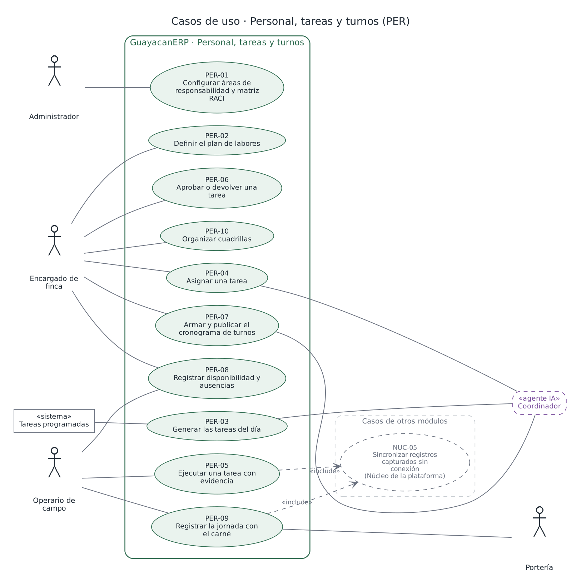
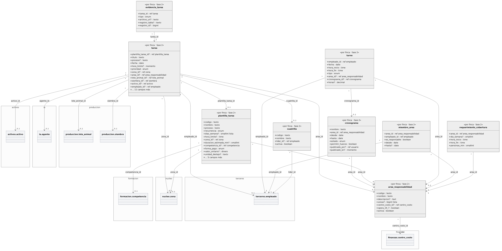
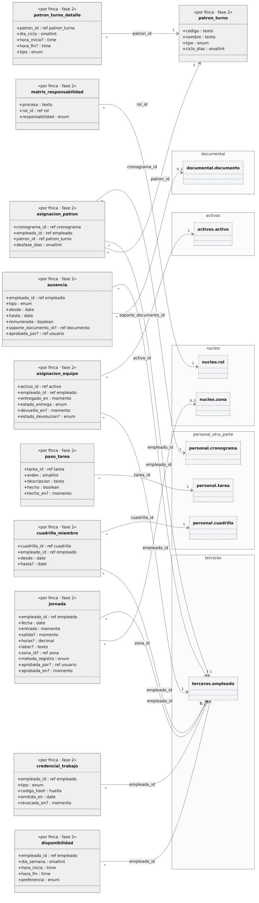
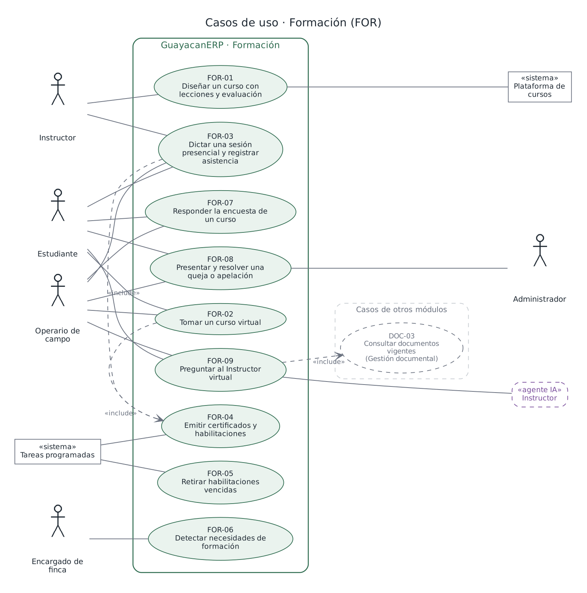
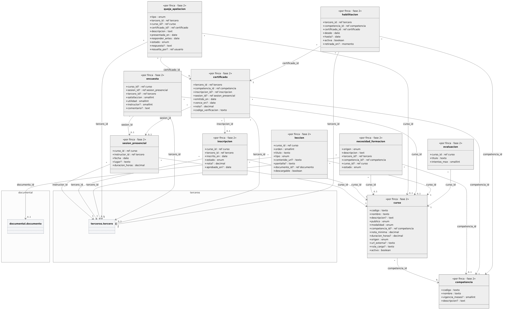
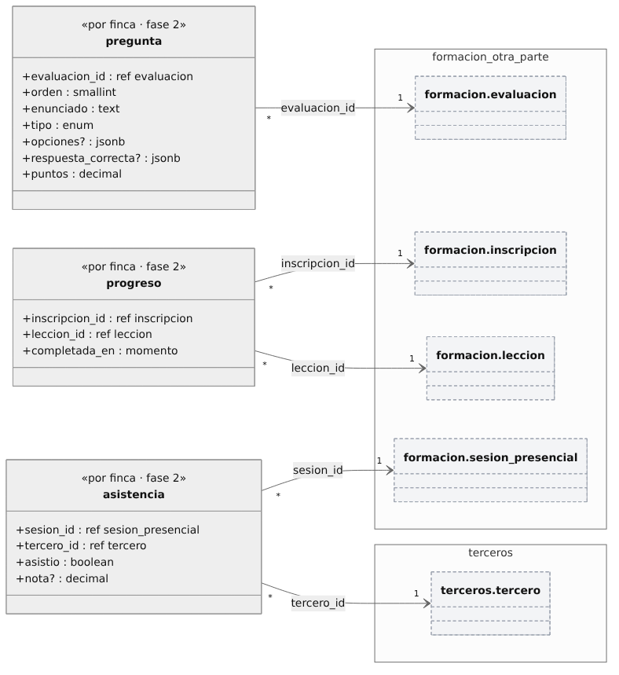
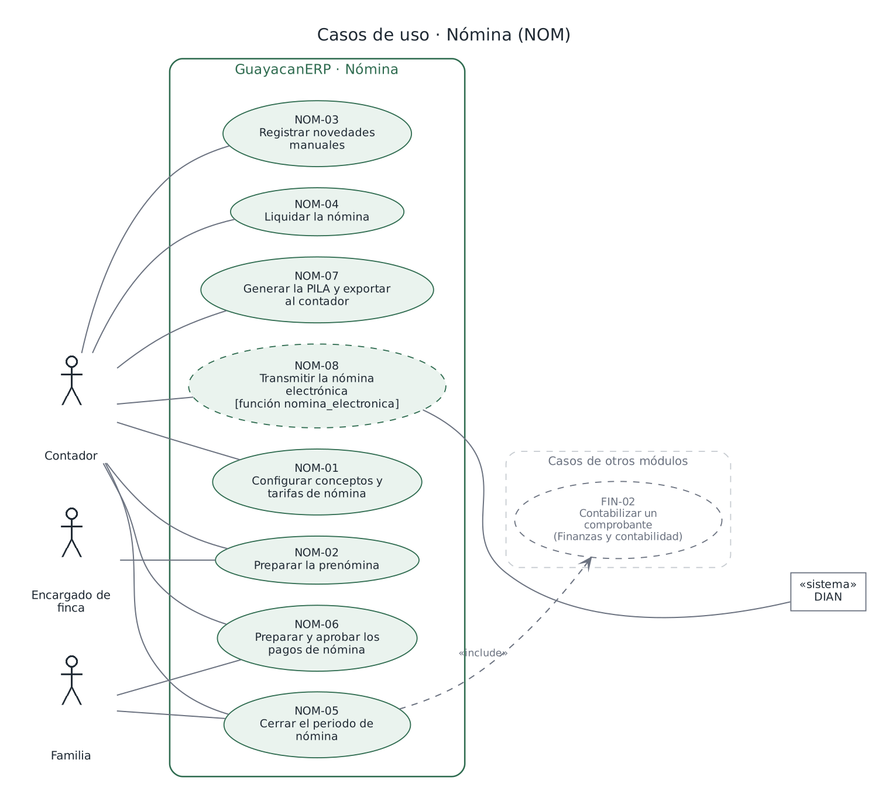
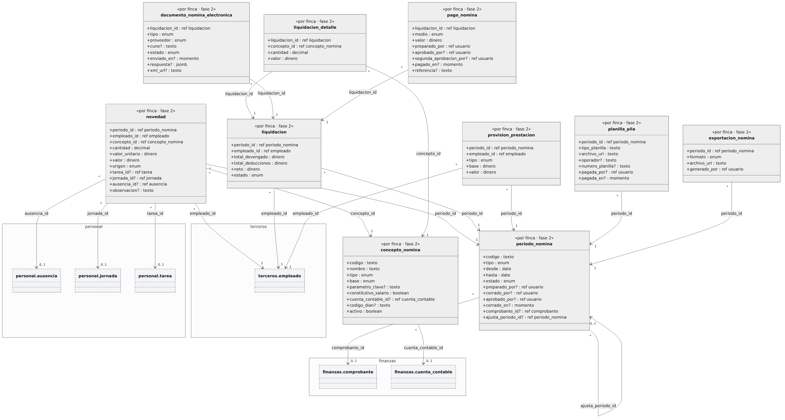

# Casos de uso 5 · Personas

Especificación completa de los casos de uso de personal con tareas y turnos, formación y nómina. Cada módulo trae su diagrama de casos de uso, su diagrama de clases y la ficha de cada caso.

## Personal, tareas y turnos (PER)

El trabajo se organiza en siete áreas de responsabilidad, con plan de labores, tareas con evidencia, cronogramas 24/7 y jornada por carné. La base solo deja asignar a quien está disponible, habilitado y es del área, y nadie aprueba su propia tarea.

### PER-01 · Configurar áreas de responsabilidad y matriz RACI

| Campo | Detalle |
| --- | --- |
| Objetivo | Dividir el trabajo por áreas, con miembros, un responsable y quién responde, aprueba, es consultado e informado en cada proceso |
| Disparador | Organización inicial o cambio de personal |
| Precondiciones | Empleados registrados |
| Postcondiciones | Áreas con miembros y responsable vigentes; matriz RACI por proceso |
| Actores | Primario: Administrador. Secundarios: ninguno |
| Fase y función | Fase 1 · siempre activa |
| Relaciones | ninguna |
| Reglas en la base | El responsable del área puede aprobar sus tareas (`personal.es_responsable_area()`); galpón y vigilancia operan 24/7 |
| Datos | `personal.area_responsabilidad`, `personal.miembro_area`, `personal.matriz_responsabilidad` |
| API | CRUD `/api/v1/personal/areas-responsabilidad/`, `/api/v1/personal/miembros-area/`, `/api/v1/personal/matrices-responsabilidad/` |
| Pruebas | v5 Áreas |
| Requerimientos | RQ-28 áreas de responsabilidad |

**Flujo principal**

1. El administrador revisa las siete áreas iniciales (galpón, cultivos, ovinos y peces, turismo, bodega, mantenimiento, vigilancia).
2. Agrega miembros con fecha desde y marca al responsable.
3. Revisa la matriz RACI por proceso.

**Flujos alternos y excepciones**

- 2a. Cambio de responsable: se cierra la vigencia del anterior; la historia queda.

### PER-02 · Definir el plan de labores

| Campo | Detalle |
| --- | --- |
| Objetivo | Que lo repetitivo (recoger huevos, desinfectar, revisar bebederos) se cree solo cada día |
| Disparador | Se organiza la rutina de un área |
| Precondiciones | Áreas y competencias definidas |
| Postcondiciones | Plantillas de tarea con recurrencia, días, hora límite, pasos, competencia exigida y forma de pago |
| Actores | Primario: Encargado de finca. Secundarios: ninguno |
| Fase y función | Fase 1 · siempre activa |
| Relaciones | ninguna |
| Reglas en la base | La forma de pago de la plantilla (jornal o destajo) decide la novedad de nómina |
| Datos | `personal.plantilla_tarea` |
| API | CRUD `/api/v1/personal/plantillas-tarea/` |
| Pruebas | v5 Personal |
| Requerimientos | RQ-28 tareas |

**Flujo principal**

1. El encargado crea la plantilla con nombre, proceso, área y recurrencia (diaria, semanal con días, mensual, única).
2. Agrega los pasos de la lista de chequeo.
3. Indica la competencia exigida y, si se paga a destajo, el valor por unidad.

**Flujos alternos y excepciones**

- 1a. Plantilla inactiva: deja de generar tareas.

### PER-03 · Generar las tareas del día

| Campo | Detalle |
| --- | --- |
| Objetivo | Tener cada mañana las tareas del día listas para asignar |
| Disparador | Tarea nocturna (AC01) |
| Precondiciones | Plan de labores |
| Postcondiciones | Tareas pendientes con sus pasos, sin duplicar |
| Actores | Primario: Tareas programadas. Secundarios: Coordinador (IA) |
| Fase y función | Fase 1 · siempre activa |
| Relaciones | ninguna |
| Reglas en la base | `personal.generar_tareas_del_dia()`: generar dos veces el mismo día no duplica |
| Datos | `personal.tarea`, `personal.paso_tarea` |
| API | `POST /api/v1/personal/tareas/generar-dia/` |
| Pruebas | v5 Personal |
| Requerimientos | RQ-28 tareas |

**Flujo principal**

1. La tarea nocturna genera las tareas del día siguiente.
2. El Coordinador propone asignaciones según turnos, disponibilidad y clima (sin asignar).
3. El encargado las ve en su tablero por área.

**Flujos alternos y excepciones**

- 2a. El agente intenta asignar: la base lo impide; sus propuestas quedan sin asignar.

### PER-04 · Asignar una tarea

| Campo | Detalle |
| --- | --- |
| Objetivo | Que cada tarea quede en manos de alguien disponible, habilitado y del área |
| Disparador | El encargado reparte el trabajo |
| Precondiciones | Tarea pendiente |
| Postcondiciones | Tarea asignada a una persona o a una cuadrilla; aviso en la app del trabajador |
| Actores | Primario: Encargado de finca. Secundarios: Coordinador (IA) |
| Fase y función | Fase 1 · siempre activa |
| Relaciones | ninguna |
| Reglas en la base | `personal.validar_tarea()`, `personal.validar_area_tarea()`, `personal.empleado_disponible()` (sin ausencia ni día de descanso), `formacion.esta_habilitado()` |
| Datos | `personal.tarea` |
| API | `PATCH /api/v1/personal/tareas/{id}/` (empleado o cuadrilla) |
| Pruebas | v5 Personal, v5 Áreas, v5 Cronograma |
| Requerimientos | RQ-28 tareas, RQ-30 habilitaciones |

**Flujo principal**

1. El encargado elige la tarea y ve los candidatos del área con turno ese día.
2. Asigna a una persona o a una cuadrilla.
3. La base valida y el trabajador recibe la tarea en la PWA.

**Flujos alternos y excepciones**

- 3a. Sin habilitación vigente: «no está habilitado».
- 3b. De vacaciones o en día de descanso: «no está disponible».
- 3c. No es del área: «no pertenece al área de responsabilidad de la tarea».
- 2a. Persona y cuadrilla a la vez: no se permite (CHECK).

### PER-05 · Ejecutar una tarea con evidencia

| Campo | Detalle |
| --- | --- |
| Objetivo | Hacer el trabajo siguiendo la lista de chequeo y dejar prueba |
| Disparador | El trabajador empieza su tarea |
| Precondiciones | Tarea asignada a él |
| Postcondiciones | Tarea terminada con pasos, cantidad, fotos y horas de inicio y fin |
| Actores | Primario: Operario de campo. Secundarios: ninguno |
| Fase y función | Fase 1 · siempre activa |
| Relaciones | incluye NUC-05; incluido por ACT-03 |
| Reglas en la base | `personal.validar_tarea()` marca inicio y fin; una tarea aprobada no se edita |
| Datos | `personal.tarea`, `personal.paso_tarea`, `personal.evidencia_tarea` |
| API | `PATCH /api/v1/personal/tareas/{id}/`; CRUD `/api/v1/personal/tareas/{id}/pasos/` y `/api/v1/personal/tareas/{id}/evidencias/` |
| Pruebas | v5 Personal |
| Requerimientos | RQ-28 tareas con evidencias, RNF-03 sin conexión |

**Flujo principal**

1. El trabajador abre la tarea y pulsa Iniciar.
2. Marca cada paso y toma fotos de evidencia.
3. Registra la cantidad (huevos, kilos, metros) y pulsa Terminar.
4. Si la tarea crea un registro (postura, bioseguridad), la PWA abre ese formulario ya lleno.

**Flujos alternos y excepciones**

- 2a. Paso que no se pudo hacer: se marca con observación.
- 3a. Sin conexión: todo se guarda y sincroniza después.

### PER-06 · Aprobar o devolver una tarea

| Campo | Detalle |
| --- | --- |
| Objetivo | Que una persona distinta verifique el trabajo antes de pagarlo |
| Disparador | Tarea terminada |
| Precondiciones | Permiso `personal.aprobar_tarea` o ser responsable del área |
| Postcondiciones | Tarea aprobada (genera novedad de jornal o destajo) o devuelta con comentario |
| Actores | Primario: Encargado de finca. Secundarios: ninguno |
| Fase y función | Fase 1 · siempre activa |
| Relaciones | ninguna |
| Reglas en la base | `personal.validar_tarea()`: solo desde terminada, con permiso o responsable del área, nunca la propia; devolver exige comentario |
| Datos | `personal.tarea` |
| API | `POST /api/v1/personal/tareas/{id}/aprobar/`; `POST /api/v1/personal/tareas/{id}/devolver/` |
| Pruebas | v5 Personal, v5 Áreas |
| Requerimientos | RQ-28 tareas, RQ-29 destajo |

**Flujo principal**

1. El aprobador ve las tareas terminadas de su área con sus evidencias.
2. Aprueba.
3. La tarea queda inmutable y entra a la prenómina (NOM-02).

**Flujos alternos y excepciones**

- 2a. Devuelve con comentario: la tarea vuelve a en curso.
- 2b. Aprobar la propia: «nadie aprueba su propia tarea».
- 2c. Sin permiso ni responsabilidad del área: «no tiene el permiso personal.aprobar\_tarea».

### PER-07 · Armar y publicar el cronograma de turnos

| Campo | Detalle |
| --- | --- |
| Objetivo | Cubrir cada área las horas que necesita, incluso 24/7, sin pasar la jornada legal |
| Disparador | Planeación del mes o de la quincena |
| Precondiciones | Patrones de turno, requerimientos de cobertura y disponibilidad registrados |
| Postcondiciones | Cronograma publicado con turnos por persona y día |
| Actores | Primario: Encargado de finca. Secundarios: Coordinador (IA) |
| Fase y función | Fase 2 · siempre activa |
| Relaciones | ninguna |
| Reglas en la base | `personal.generar_turnos()`, `personal.huecos_cobertura()`, `personal.validar_turno()` (cruces, 10 h de descanso, 11 h máximo al día), `personal.publicar_cronograma()` (42 h + 12 extra, un descanso cada 7 días, sin huecos) |
| Datos | `personal.cronograma`, `personal.patron_turno`, `personal.asignacion_patron`, `personal.requerimiento_cobertura`, `personal.turno` |
| API | `POST /api/v1/personal/cronogramas/{id}/generar/`; `GET /api/v1/personal/cronogramas/{id}/huecos/`; `POST /api/v1/personal/cronogramas/{id}/publicar/` |
| Pruebas | v5 Turnos, v5 Cronograma |
| Requerimientos | RQ-40 cronograma flexible 24/7 |

**Flujo principal**

1. El encargado crea el cronograma del área y el periodo.
2. Asigna a cada persona un patrón (semanal con días y horas, cíclico con desfase o flexible).
3. Genera los turnos.
4. Revisa los huecos de cobertura y agrega turnos donde falte.
5. Publica; los trabajadores ven sus turnos (SQ12).

**Flujos alternos y excepciones**

- 3a. Turno que cruza la medianoche: la base suma las horas al día en que empieza.
- 4a. Turnos cruzados o con menos de 10 horas de descanso: rechazados al guardarlos.
- 5a. Más de 42 + 12 horas en una semana, siete días sin descanso o huecos: no se publica, con el detalle.
- 5b. Hueco aceptado conscientemente: se publica con `permitir_huecos` y queda la advertencia.

### PER-08 · Registrar disponibilidad y ausencias

| Campo | Detalle |
| --- | --- |
| Objetivo | Saber cuándo puede y cuándo no puede trabajar cada persona, sin guardar diagnósticos |
| Disparador | La persona marca sus preferencias o informa vacaciones, licencia o incapacidad |
| Precondiciones | Empleado activo |
| Postcondiciones | Disponibilidad por día y hora; ausencia con tipo y fechas |
| Actores | Primario: Operario de campo, Encargado de finca. Secundarios: ninguno |
| Fase y función | Fase 2 · siempre activa |
| Relaciones | ninguna |
| Reglas en la base | `personal.empleado_disponible()`; la ausencia no guarda diagnóstico médico |
| Datos | `personal.disponibilidad`, `personal.ausencia` |
| API | CRUD `/api/v1/personal/disponibilidades/` y `/api/v1/personal/ausencias/` |
| Pruebas | v5 Personal, v5 Turnos |
| Requerimientos | RQ-40 disponibilidad |

**Flujo principal**

1. El trabajador marca en la app días y horas disponibles, preferidos o no disponibles.
2. El encargado registra la ausencia con tipo, fechas y soporte si aplica.

**Flujos alternos y excepciones**

- 2a. Ausencia sobre turnos publicados: el encargado reasigna; la base ya no deja programar ese día.

### PER-09 · Registrar la jornada con el carné

| Campo | Detalle |
| --- | --- |
| Objetivo | Medir horas trabajadas para pagar jornales y recargos |
| Disparador | Entrada o salida por portería o en el punto de trabajo |
| Precondiciones | Credencial QR o NFC activa (nunca biométrica) |
| Postcondiciones | Jornada con entrada, salida, horas y aprobación |
| Actores | Primario: Operario de campo. Secundarios: Portería |
| Fase y función | Fase 1 · siempre activa |
| Relaciones | incluye NUC-05 |
| Reglas en la base | `personal.calcular_jornada()`; la credencial es QR o NFC (CHECK); jornada aprobada no se edita |
| Datos | `personal.jornada`, `personal.credencial_trabajo` |
| API | CRUD `/api/v1/personal/jornadas/`; `POST /api/v1/personal/jornadas/{id}/aprobar/` |
| Pruebas | v5 Personal, v5 Portería |
| Requerimientos | RQ-28 jornada, RQ-29 nómina |

**Flujo principal**

1. El trabajador pasa el carné al entrar (AGD-04) o en la tableta del área.
2. Se abre la jornada; al salir, se cierra y la base calcula las horas.
3. El encargado aprueba la jornada.

**Flujos alternos y excepciones**

- 2a. Olvidó marcar la salida: el encargado la registra a mano con observación.

### PER-10 · Organizar cuadrillas

| Campo | Detalle |
| --- | --- |
| Objetivo | Asignar tareas grandes (cosecha, deshierbe) a un grupo |
| Disparador | Labor que requiere varias personas |
| Precondiciones | Empleados activos |
| Postcondiciones | Cuadrilla con líder y miembros vigentes |
| Actores | Primario: Encargado de finca. Secundarios: ninguno |
| Fase y función | Fase 1 · siempre activa |
| Relaciones | ninguna |
| Reglas en la base | Una tarea va a una persona o a una cuadrilla, no a ambas |
| Datos | `personal.cuadrilla`, `personal.cuadrilla_miembro` |
| API | CRUD `/api/v1/personal/cuadrillas/` y `/api/v1/personal/cuadrillas/{id}/miembros/` |
| Pruebas | pendiente: escribir la prueba al construir |
| Requerimientos | RQ-28 tareas |

**Flujo principal**

1. El encargado crea la cuadrilla con líder.
2. Agrega miembros con fechas.
3. Asigna tareas a la cuadrilla.

**Flujos alternos y excepciones**

- 3a. Pago a destajo de una cuadrilla: el líder reparte la cantidad entre los miembros al terminar.

## Formación (FOR)

Cursos virtuales y sesiones presenciales para operarios y estudiantes. Aprobar emite el certificado y la habilitación que la asignación de tareas exige; al vencer, la habilitación se retira sola. La gestión sigue la lógica de ISO 21001 (necesidades, satisfacción, quejas y apelaciones).

### FOR-01 · Diseñar un curso con lecciones y evaluación

| Campo | Detalle |
| --- | --- |
| Objetivo | Tener cursos con objetivo, contenido, evaluación y la competencia que otorgan |
| Disparador | Necesidad de formación detectada o curso nuevo del programa |
| Precondiciones | Competencia definida |
| Postcondiciones | Curso publicado con público (operarios, estudiantes o ambos), modalidad, nota mínima y lecciones |
| Actores | Primario: Instructor. Secundarios: Plataforma de cursos |
| Fase y función | Fase 2 · siempre activa; los cursos de Moodle exigen `cursos_externos` |
| Relaciones | ninguna |
| Reglas en la base | `formacion.validar_curso()` |
| Datos | `formacion.curso`, `formacion.leccion`, `formacion.evaluacion`, `formacion.pregunta`, `formacion.competencia` |
| API | CRUD `/api/v1/formacion/cursos/`, `/api/v1/formacion/lecciones/`, `/api/v1/formacion/evaluaciones/`, `/api/v1/formacion/preguntas/` |
| Pruebas | v5 Formación |
| Requerimientos | RQ-30 formación |

**Flujo principal**

1. El instructor crea el curso con código, nombre, público, modalidad, horas y competencia.
2. Agrega lecciones (texto, video, documento vigente) y la evaluación con preguntas.
3. Fija la nota mínima (3,5 por defecto) y publica.

**Flujos alternos y excepciones**

- 1a. Curso alojado en Moodle con la función apagada: «cursos\_externos» no activa.

### FOR-02 · Tomar un curso virtual

| Campo | Detalle |
| --- | --- |
| Objetivo | Aprender a su ritmo, también sin señal, y quedar habilitado al aprobar |
| Disparador | El estudiante u operario se inscribe o lo inscriben |
| Precondiciones | Curso publicado |
| Postcondiciones | Inscripción con progreso por lección y nota; aprobado emite certificado |
| Actores | Primario: Estudiante, Operario de campo. Secundarios: ninguno |
| Fase y función | Fase 2 · siempre activa |
| Relaciones | incluye FOR-04 |
| Reglas en la base | `formacion.validar_inscripcion()` (no aprueba bajo la nota mínima), `formacion.certificar_inscripcion()` |
| Datos | `formacion.inscripcion`, `formacion.progreso` |
| API | CRUD `/api/v1/formacion/inscripciones/` y `/api/v1/formacion/progresos/` |
| Pruebas | v5 Formación |
| Requerimientos | RQ-30 cursos virtuales |

**Flujo principal**

1. La persona abre el curso; la PWA descarga las lecciones.
2. Avanza lección por lección; el progreso se sincroniza.
3. Presenta la evaluación.
4. Con nota igual o mayor a la mínima queda aprobada y recibe el certificado.

**Flujos alternos y excepciones**

- 4a. Nota menor a la mínima: reprobado; puede repetir según la regla del curso.

### FOR-03 · Dictar una sesión presencial y registrar asistencia

| Campo | Detalle |
| --- | --- |
| Objetivo | Que la formación en campo cuente igual que la virtual |
| Disparador | Se dicta la sesión |
| Precondiciones | Curso presencial o mixto |
| Postcondiciones | Asistencia y nota por persona; certificados emitidos |
| Actores | Primario: Instructor. Secundarios: Estudiante, Operario de campo |
| Fase y función | Fase 2 · siempre activa |
| Relaciones | incluye FOR-04 |
| Reglas en la base | `formacion.certificar_sesion()` |
| Datos | `formacion.sesion_presencial`, `formacion.asistencia` |
| API | CRUD `/api/v1/formacion/sesiones-presencial/` y `/api/v1/formacion/asistencias/`; `POST /api/v1/formacion/sesiones-presenciales/{id}/certificar/` |
| Pruebas | v5 Formación |
| Requerimientos | RQ-30 formación |

**Flujo principal**

1. El instructor programa la sesión (puede ser una cita en el salón, AGD-02).
2. Registra asistencia y nota de cada participante.
3. Certifica la sesión; la base emite los certificados.

**Flujos alternos y excepciones**

- 2a. Asistió pero no aprobó la práctica: sin certificado.

### FOR-04 · Emitir certificados y habilitaciones

| Campo | Detalle |
| --- | --- |
| Objetivo | Convertir la aprobación en un certificado verificable y en una habilitación para trabajar |
| Disparador | Inscripción aprobada o sesión certificada |
| Precondiciones | Curso con competencia |
| Postcondiciones | Certificado con código de verificación y vencimiento según la competencia; habilitación vigente |
| Actores | Primario: Tareas programadas (proceso automático). Secundarios: ninguno |
| Fase y función | Fase 2 · siempre activa |
| Relaciones | incluido por FOR-02 y FOR-03 |
| Reglas en la base | `formacion.emitir_certificado()`, `formacion.habilitar_desde_certificado()` |
| Datos | `formacion.certificado`, `formacion.habilitacion` |
| API | `GET /api/v1/publico/certificados/{codigo}/` (verificación) |
| Pruebas | v5 Formación |
| Requerimientos | RQ-30 habilitaciones |

**Flujo principal**

1. Al aprobar, la base emite el certificado con vencimiento (por ejemplo, 12 meses para bioseguridad).
2. Crea la habilitación de la competencia.
3. El certificado se puede verificar por su código en la página pública.

**Flujos alternos y excepciones**

- 1a. Competencia sin vencimiento: el certificado no vence.

### FOR-05 · Retirar habilitaciones vencidas

| Campo | Detalle |
| --- | --- |
| Objetivo | Que nadie siga asignado a trabajos para los que ya no está habilitado |
| Disparador | Tarea nocturna |
| Precondiciones | Habilitaciones con vencimiento |
| Postcondiciones | Habilitaciones vencidas retiradas; aviso al trabajador y al encargado |
| Actores | Primario: Tareas programadas. Secundarios: ninguno |
| Fase y función | Fase 2 · siempre activa |
| Relaciones | ninguna |
| Reglas en la base | `formacion.actualizar_habilitaciones()`; la asignación ya ignora el certificado vencido desde el día siguiente |
| Datos | `formacion.habilitacion` |
| API | sin endpoint (tarea Celery) |
| Pruebas | v5 Formación |
| Requerimientos | RQ-30 habilitaciones |

**Flujo principal**

1. La tarea revisa los certificados vencidos.
2. Retira las habilitaciones.
3. Avisa con 30 días de anticipación y al vencer.

**Flujos alternos y excepciones**

- 3a. El expediente de cumplimiento que exige esa competencia se reevalúa (CUM-03).

### FOR-06 · Detectar necesidades de formación

| Campo | Detalle |
| --- | --- |
| Objetivo | Planear la formación desde los cargos, las no conformidades y los cambios |
| Disparador | Ingreso de personal, no conformidad, norma nueva o solicitud |
| Precondiciones | Ninguna |
| Postcondiciones | Necesidad registrada y planificada con un curso |
| Actores | Primario: Encargado de finca. Secundarios: ninguno |
| Fase y función | Fase 2 · siempre activa |
| Relaciones | ninguna |
| Reglas en la base | Estados abierta → planificada → atendida o descartada |
| Datos | `formacion.necesidad_formacion` |
| API | CRUD `/api/v1/formacion/necesidades-formacion/` |
| Pruebas | v5 Formación |
| Requerimientos | RQ-30 formación, RQ-33 ISO 21001 |

**Flujo principal**

1. El encargado registra la necesidad con su origen.
2. La liga a un curso existente o pide uno nuevo.
3. Al terminar la formación, la marca atendida.

**Flujos alternos y excepciones**

- 1a. Necesidad nacida de una no conformidad: se liga a su acción correctiva.

### FOR-07 · Responder la encuesta de un curso

| Campo | Detalle |
| --- | --- |
| Objetivo | Medir satisfacción, utilidad e instructor para mejorar los cursos |
| Disparador | Fin del curso o de la sesión |
| Precondiciones | Participación en el curso |
| Postcondiciones | Encuesta guardada (puede ser anónima) |
| Actores | Primario: Estudiante, Operario de campo. Secundarios: ninguno |
| Fase y función | Fase 2 · siempre activa |
| Relaciones | ninguna |
| Reglas en la base | Valores de 1 a 5 (CHECK); vista `formacion.v_satisfaccion` |
| Datos | `formacion.encuesta` |
| API | CRUD `/api/v1/formacion/encuestas/`; `GET /api/v1/formacion/satisfaccion/` |
| Pruebas | v5 Formación |
| Requerimientos | RQ-30 formación, RQ-33 ISO 21001 |

**Flujo principal**

1. La app pide calificar satisfacción, utilidad e instructor y deja un comentario.
2. El instructor y el administrador ven el resultado por curso con la tasa de aprobación.

**Flujos alternos y excepciones**

- 1a. La persona no responde: no bloquea el certificado.

### FOR-08 · Presentar y resolver una queja o apelación

| Campo | Detalle |
| --- | --- |
| Objetivo | Atender reclamos sobre la formación y revisar notas con imparcialidad |
| Disparador | La persona presenta la queja o apela una nota |
| Precondiciones | Curso o certificado relacionado |
| Postcondiciones | Respuesta en plazo, resuelta por alguien distinto del instructor |
| Actores | Primario: Estudiante, Operario de campo. Secundarios: Administrador |
| Fase y función | Fase 2 · siempre activa |
| Relaciones | ninguna |
| Reglas en la base | `formacion.validar_queja()`: plazo según `dias_respuesta_queja` (15); no la resuelve el instructor del curso; exige respuesta |
| Datos | `formacion.queja_apelacion` |
| API | CRUD `/api/v1/formacion/quejas-apelacion/` |
| Pruebas | v5 Formación |
| Requerimientos | RQ-30 formación, RQ-33 ISO 21001 |

**Flujo principal**

1. La persona describe la queja o apelación.
2. La base fija la fecha límite de respuesta.
3. El administrador estudia y responde.

**Flujos alternos y excepciones**

- 3a. Intenta resolverla el instructor del curso: rechazado.
- 3b. Vence el plazo sin respuesta: aviso al administrador.

### FOR-09 · Preguntar al Instructor virtual

| Campo | Detalle |
| --- | --- |
| Objetivo | Resolver dudas técnicas en campo con respuestas basadas solo en documentos aprobados |
| Disparador | El operario o estudiante pregunta en la app |
| Precondiciones | Documentos aprobados y autorizados para agentes, indexados |
| Postcondiciones | Respuesta con la fuente citada; si no sabe, remite al encargado |
| Actores | Primario: Operario de campo, Estudiante. Secundarios: Instructor (IA) |
| Fase y función | Fase 2 · siempre activa |
| Relaciones | incluye DOC-03 |
| Reglas en la base | `documental.documento_para_agente()`; búsqueda semántica sobre `ia.fragmento_conocimiento` |
| Datos | `documental.version_documento`, `ia.fragmento_conocimiento` |
| API | `POST /agentes/instructor/preguntar` (servicio de agentes) |
| Pruebas | v5 Documental |
| Requerimientos | RQ-30 tutoriales, RQ-23 agentes |

**Flujo principal**

1. La persona escribe o dicta la pregunta.
2. El Instructor busca en los fragmentos de los documentos vigentes.
3. Responde citando el documento y la versión.

**Flujos alternos y excepciones**

- 2a. No encuentra fuente: «No tengo un documento aprobado sobre eso» y avisa al encargado.

## Nómina (NOM)

Salario, jornal, destajo y mixto conviven. La prenómina sale de contratos, tareas y jornadas aprobadas; la liquidación usa tarifas de `nucleo.parametro`; el cierre y los pagos exigen dos o tres personas distintas. El ERP calcula y exporta para el contador; la nómina electrónica queda apagada hasta definir la obligación.

### NOM-01 · Configurar conceptos y tarifas de nómina

| Campo | Detalle |
| --- | --- |
| Objetivo | Definir devengados y deducciones y sus tarifas sin tocar el código |
| Disparador | Inicio del año o cambio legal |
| Precondiciones | Contador |
| Postcondiciones | Conceptos con tipo, base, parámetro y código DIAN; tarifas vigentes |
| Actores | Primario: Contador. Secundarios: ninguno |
| Fase y función | Fase 2 · siempre activa |
| Relaciones | ninguna |
| Reglas en la base | `nomina.concepto()`; tarifas en parámetros (salud y pensión 4 %, cesantías 8,33 %, recargos) |
| Datos | `nomina.concepto_nomina`, `nucleo.parametro` |
| API | CRUD `/api/v1/nomina/conceptos-nomina/` |
| Pruebas | v5 Nómina |
| Requerimientos | RQ-29 nómina |

**Flujo principal**

1. El contador revisa los conceptos iniciales (SALARIO, AUX\_TRANSPORTE, JORNAL, DESTAJO, HED, RN, SALUD\_EMP, PENSION\_EMP, PRESTAMO).
2. Ajusta tarifas en parámetros con su vigencia (NUC-03).

**Flujos alternos y excepciones**

- 2a. Cambio de ley a mitad de año: nueva vigencia; los periodos cerrados no cambian.

### NOM-02 · Preparar la prenómina

| Campo | Detalle |
| --- | --- |
| Objetivo | Reunir en un periodo todo lo que se debe pagar, sin digitarlo |
| Disparador | Fin de la quincena o del mes |
| Precondiciones | Periodo abierto; tareas y jornadas aprobadas |
| Postcondiciones | Novedades de salario (30 días o proporcional), auxilio de transporte (hasta 2 SMMLV), jornales y destajo |
| Actores | Primario: Contador, Encargado de finca. Secundarios: ninguno |
| Fase y función | Fase 2 · siempre activa |
| Relaciones | ninguna |
| Reglas en la base | `nomina.preparar_prenomina()`, `nomina.validar_novedad()` (el salario de un contrato no depende de tareas; solo pagan tareas y jornadas aprobadas) |
| Datos | `nomina.periodo_nomina`, `nomina.novedad` |
| API | `POST /api/v1/nomina/periodos/{id}/prenomina/` |
| Pruebas | v5 Nómina |
| Requerimientos | RQ-29 salario, jornal y destajo |

**Flujo principal**

1. El contador abre el periodo y ejecuta la prenómina (SQ07).
2. La base crea las novedades desde contratos, tareas aprobadas y jornadas aprobadas.
3. El encargado revisa por trabajador y corrige con novedades manuales (NOM-03).

**Flujos alternos y excepciones**

- 2a. Tarea aprobada que ya pagó en otro periodo: no se repite (única por tarea).
- 2b. Trabajador que ingresó a mitad de periodo: salario proporcional.

### NOM-03 · Registrar novedades manuales

| Campo | Detalle |
| --- | --- |
| Objetivo | Agregar horas extra, recargos, préstamos y otros conceptos |
| Disparador | Hay algo que no salió de tareas ni jornadas |
| Precondiciones | Periodo abierto o en prenómina |
| Postcondiciones | Novedad con concepto, cantidad y valor |
| Actores | Primario: Contador. Secundarios: ninguno |
| Fase y función | Fase 2 · siempre activa |
| Relaciones | ninguna |
| Reglas en la base | `nomina.validar_novedad()`, `nomina.proteger_detalle_periodo()` (un periodo cerrado no recibe novedades) |
| Datos | `nomina.novedad` |
| API | CRUD `/api/v1/nomina/novedades/` |
| Pruebas | v5 Nómina |
| Requerimientos | RQ-29 nómina |

**Flujo principal**

1. El contador elige trabajador y concepto.
2. Escribe cantidad y valor (las horas del domingo y de noche salen de `personal.v_carga_semanal`).
3. Guarda.

**Flujos alternos y excepciones**

- 3a. Periodo cerrado: «está cerrado»; la corrección va en una nota de ajuste del periodo siguiente.

### NOM-04 · Liquidar la nómina

| Campo | Detalle |
| --- | --- |
| Objetivo | Calcular devengado, deducciones, neto y provisiones de prestaciones por trabajador |
| Disparador | Prenómina revisada |
| Precondiciones | Novedades completas |
| Postcondiciones | Liquidación en borrador con su detalle; provisiones de cesantías, intereses, prima y vacaciones para contratos |
| Actores | Primario: Contador. Secundarios: ninguno |
| Fase y función | Fase 2 · siempre activa |
| Relaciones | ninguna |
| Reglas en la base | `nomina.liquidar()` con tarifas de parámetros; el jornalero no provisiona prestaciones de contrato |
| Datos | `nomina.liquidacion`, `nomina.liquidacion_detalle`, `nomina.provision_prestacion` |
| API | `POST /api/v1/nomina/periodos/{id}/liquidar/` |
| Pruebas | v5 Nómina (devengado 2.000.000, neto 1.859.928) |
| Requerimientos | RQ-29 nómina |

**Flujo principal**

1. El contador liquida el periodo.
2. La base suma devengados, aplica aportes del trabajador sobre la base salarial y calcula el neto.
3. Calcula las provisiones del empleador.
4. El contador revisa el desprendible de cada trabajador.

**Flujos alternos y excepciones**

- 1a. Se liquida de nuevo: reemplaza la liquidación en borrador.

### NOM-05 · Cerrar el periodo de nómina

| Campo | Detalle |
| --- | --- |
| Objetivo | Dejar la nómina firme, con su causación contable, aprobada por dos personas |
| Disparador | Liquidación revisada |
| Precondiciones | Comprobante de causación cuadrado y contabilizado |
| Postcondiciones | Periodo cerrado; liquidaciones aprobadas; periodo inmutable |
| Actores | Primario: Familia, Contador. Secundarios: ninguno |
| Fase y función | Fase 2 · siempre activa |
| Relaciones | incluye FIN-02 |
| Reglas en la base | `nomina.proteger_periodo()`: dos personas distintas, ningún agente, comprobante contabilizado |
| Datos | `nomina.periodo_nomina`, `finanzas.comprobante` |
| API | `POST /api/v1/nomina/periodos/{id}/cerrar/` |
| Pruebas | v5 Nómina |
| Requerimientos | RQ-29 nómina |

**Flujo principal**

1. El contador contabiliza la causación (FIN-02).
2. La familia cierra el periodo; el contador lo aprueba (SQ08).
3. La base aprueba las liquidaciones y congela el periodo.

**Flujos alternos y excepciones**

- 2a. La misma persona cierra y aprueba: «necesita dos personas distintas».
- 2b. Sin comprobante contabilizado: rechazado.
- 2c. Un agente intenta cerrar: rechazado.

### NOM-06 · Preparar y aprobar los pagos de nómina

| Campo | Detalle |
| --- | --- |
| Objetivo | Pagar el neto sin fraudes ni errores, con segregación de funciones |
| Disparador | Periodo cerrado |
| Precondiciones | Liquidaciones aprobadas |
| Postcondiciones | Pago preparado, aprobado (y con segunda aprobación si es grande), pagado con referencia; liquidación pagada |
| Actores | Primario: Contador, Familia. Secundarios: ninguno |
| Fase y función | Fase 2 · siempre activa |
| Relaciones | ninguna |
| Reglas en la base | `nomina.validar_pago()`: quien prepara no aprueba, nadie aprueba su propio pago, no supera el neto, sobre `monto_doble_aprobacion` exige tercera persona; `nomina.marcar_pagada()` |
| Datos | `nomina.pago_nomina` |
| API | CRUD `/api/v1/nomina/pagos-nomina/`; `POST /api/v1/nomina/pagos-nomina/{id}/aprobar/` |
| Pruebas | v5 Nómina |
| Requerimientos | RQ-29 nómina |

**Flujo principal**

1. El contador prepara el pago (medio, valor).
2. La familia lo aprueba.
3. Si supera el monto de doble aprobación, el encargado da la segunda aprobación.
4. El contador hace la transferencia y registra la referencia.

**Flujos alternos y excepciones**

- 1a. Valor mayor que el neto: «supera el neto».
- 2a. El mismo que preparó intenta aprobar: rechazado.
- 4a. Pagar sin segunda aprobación cuando se exige: rechazado.

### NOM-07 · Generar la PILA y exportar al contador

| Campo | Detalle |
| --- | --- |
| Objetivo | Liquidar aportes a seguridad social y entregar la nómina al programa contable |
| Disparador | Periodo cerrado |
| Precondiciones | Liquidaciones aprobadas |
| Postcondiciones | Archivo plano de la PILA; exportación en el formato elegido |
| Actores | Primario: Contador. Secundarios: ninguno |
| Fase y función | Fase 2 · siempre activa |
| Relaciones | ninguna |
| Reglas en la base | Cada exportación queda registrada (y vigilada por exportación masiva) |
| Datos | `nomina.planilla_pila`, `nomina.exportacion_nomina` |
| API | `GET /api/v1/nomina/periodos/{id}/pila/`; `GET /api/v1/nomina/periodos/{id}/exportar/?formato=` |
| Pruebas | pendiente: prueba del archivo PILA contra la especificación vigente |
| Requerimientos | RQ-29 nómina |

**Flujo principal**

1. El contador genera el archivo de la PILA.
2. Lo carga en el operador de PILA y registra el número de planilla y el pago.
3. Exporta la nómina en CSV, Excel o el formato de su programa (Siigo, World Office, Helisa).

**Flujos alternos y excepciones**

- 2a. El operador rechaza el archivo: se corrige el dato y se genera otra vez.

### NOM-08 · Transmitir la nómina electrónica

| Campo | Detalle |
| --- | --- |
| Objetivo | Enviar el documento soporte de nómina electrónica cuando la finca esté obligada |
| Disparador | Periodo pagado |
| Precondiciones | Función `nomina_electronica` encendida; régimen tributario definido |
| Postcondiciones | Documento por trabajador con CUNE y estado DIAN |
| Actores | Primario: Contador. Secundarios: DIAN |
| Fase y función | Fase 2 · función `nomina_electronica` (apagada al instalar) |
| Relaciones | ninguna |
| Reglas en la base | `nomina.validar_documento_electronico()` |
| Datos | `nomina.documento_nomina_electronica` |
| API | `POST /api/v1/nomina/periodos/{id}/transmitir/` |
| Pruebas | v5 Nómina (apagada) |
| Requerimientos | RQ-29 nómina |

**Flujo principal**

1. El contador genera los documentos del periodo.
2. Celery los envía al proveedor o al servicio gratuito de la DIAN.
3. Guarda CUNE, XML y respuesta.

**Flujos alternos y excepciones**

- 1a. Función apagada o régimen por definir: rechazado.
- 2a. Rechazo de la DIAN: se corrige con nota de ajuste electrónica.
