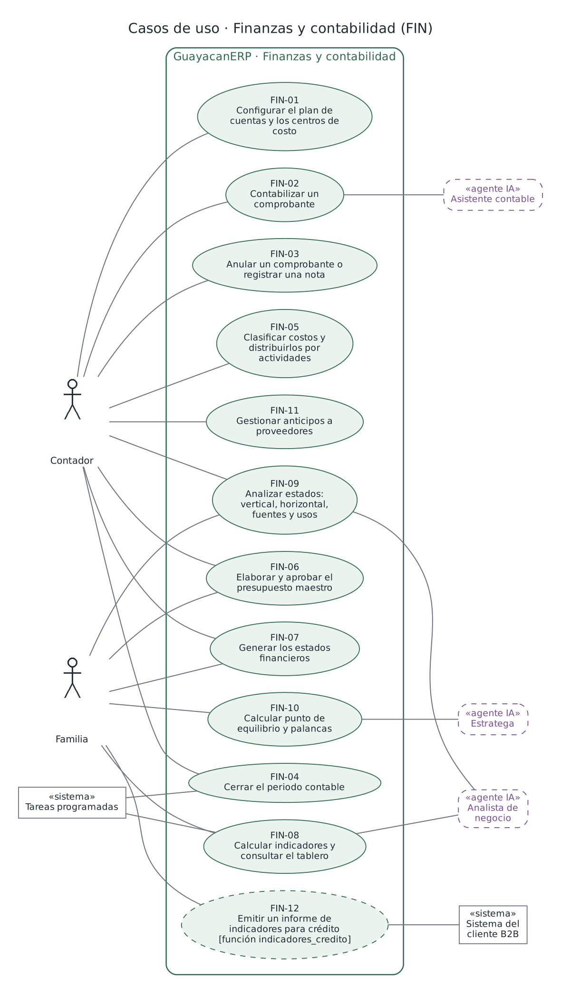
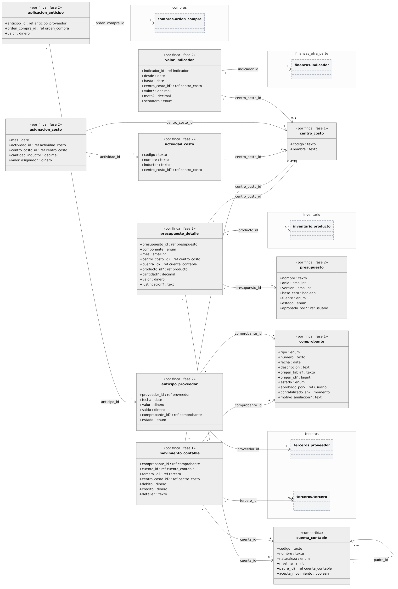
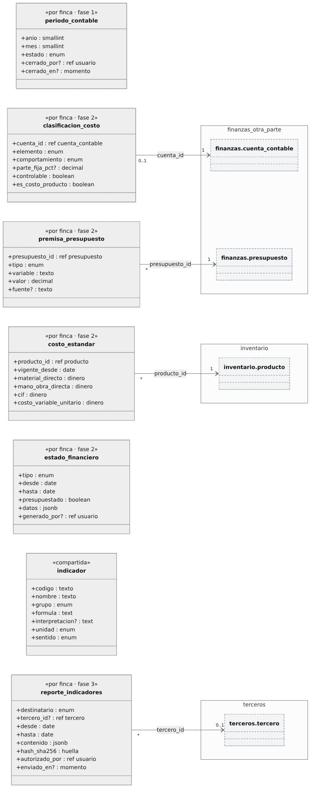
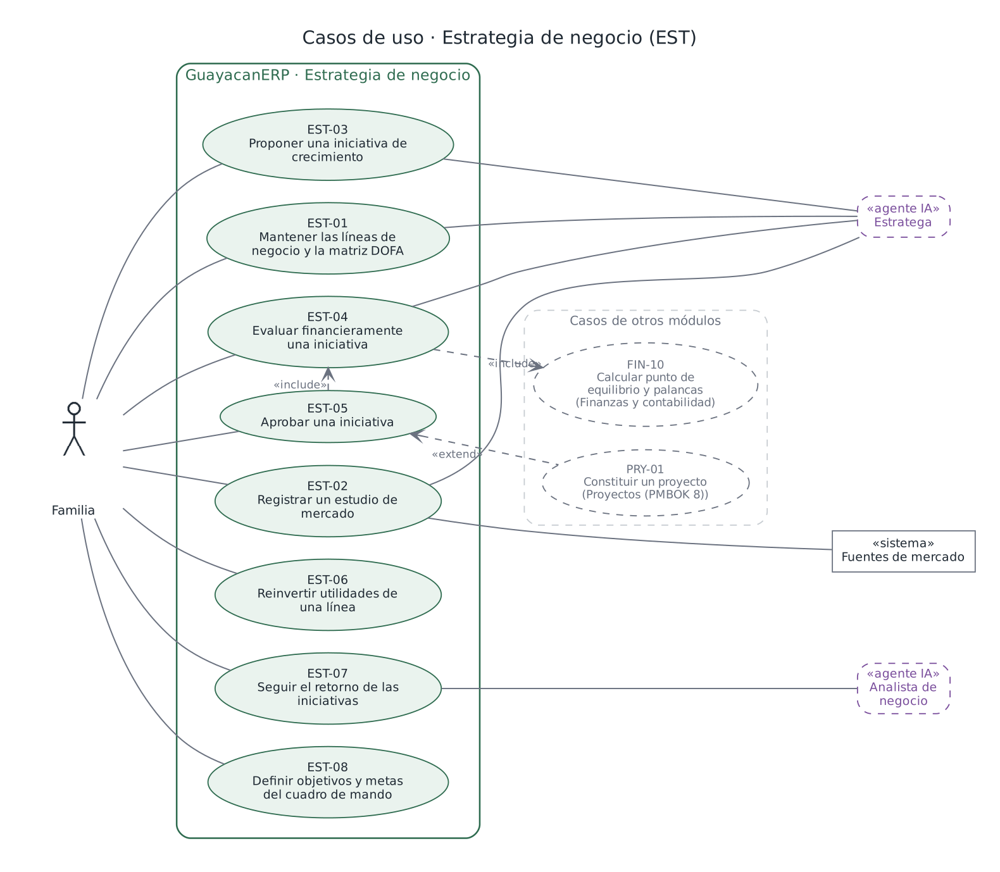
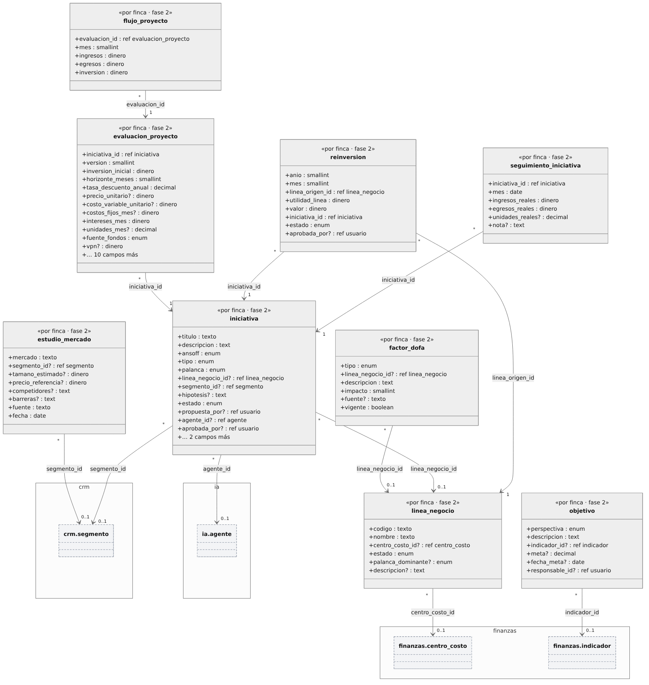
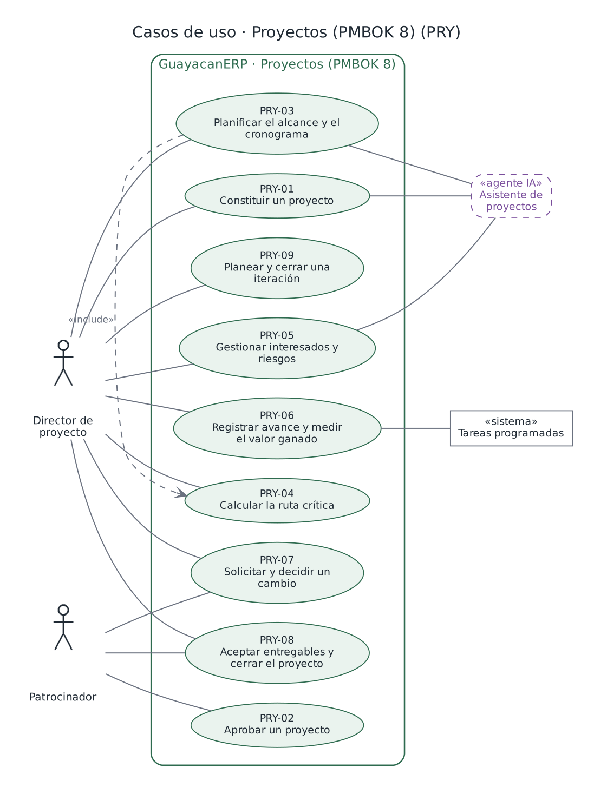
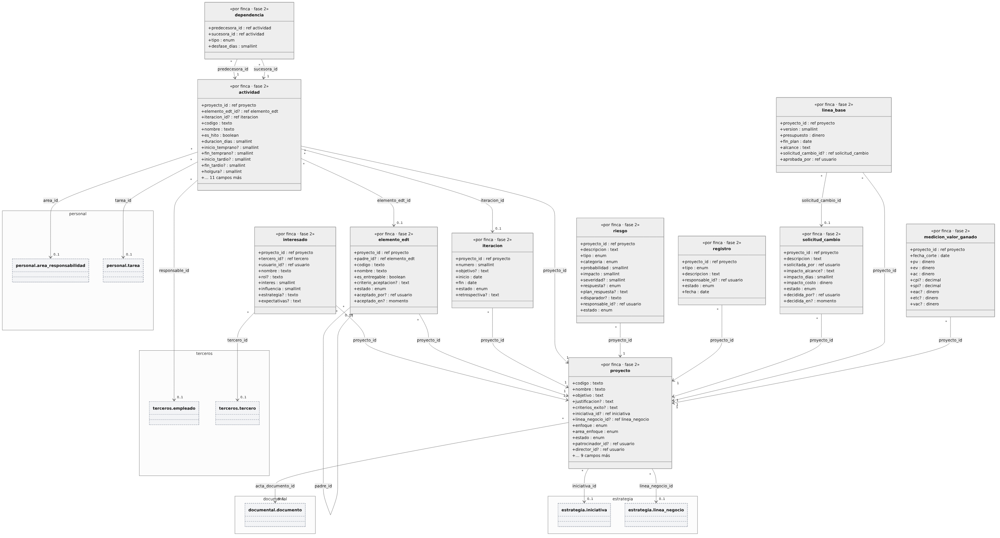
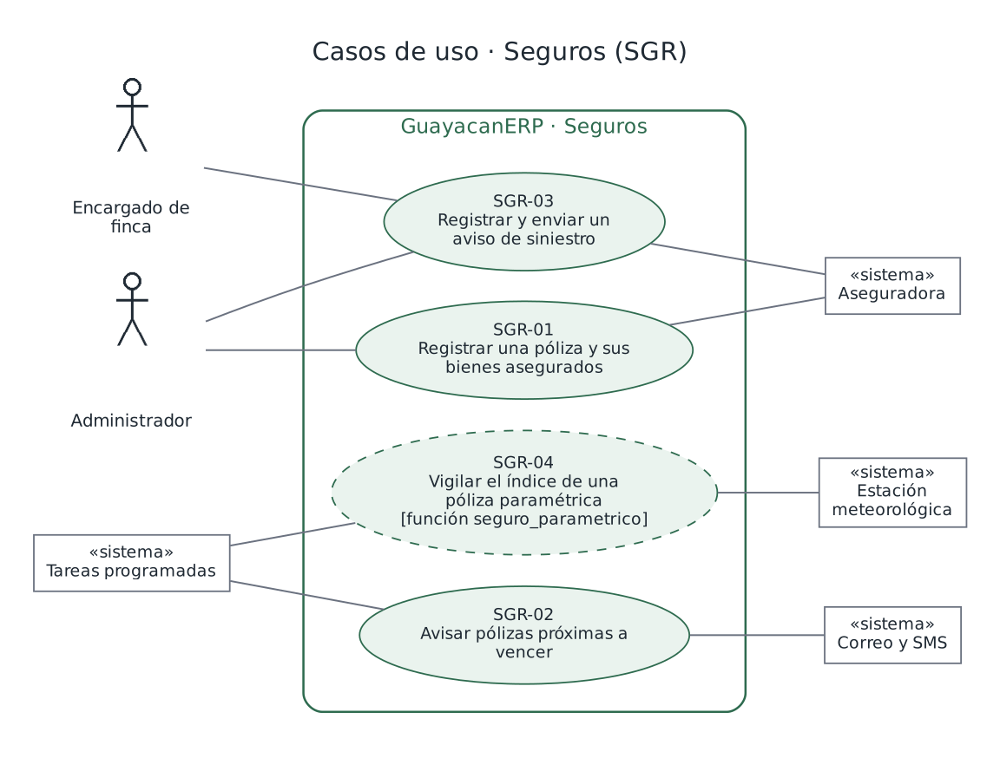
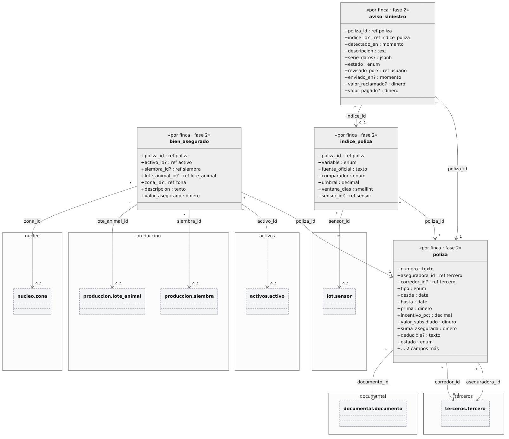

# Casos de uso 6 · Dinero y decisiones

Especificación completa de los casos de uso de finanzas y contabilidad, estrategia de negocio, proyectos (PMBOK 8) y seguros. Cada módulo trae su diagrama de casos de uso, su diagrama de clases y la ficha de cada caso.

## Finanzas y contabilidad (FIN)

Contabilidad sobre el PUC colombiano con comprobantes que generan las reglas y que un contador contabiliza; encima, costos (variable, absorbente y ABC), presupuesto maestro, estados, análisis e indicadores calculados en la base.

### FIN-01 · Configurar el plan de cuentas y los centros de costo

| Campo | Detalle |
| --- | --- |
| Objetivo | Tener el PUC adaptado y un centro de costo por línea de negocio |
| Disparador | Instalación o nueva línea |
| Precondiciones | Contador |
| Postcondiciones | Cuentas con naturaleza y nivel; centros de costo (avícola, ovino-caprino, piscícola, ciclo corto, perennes, turismo, administración) |
| Actores | Primario: Contador. Secundarios: ninguno |
| Fase y función | Fase 1 · siempre activa |
| Relaciones | ninguna |
| Reglas en la base | El PUC es catálogo compartido; solo las cuentas que aceptan movimiento reciben líneas |
| Datos | `finanzas.cuenta_contable`, `finanzas.centro_costo` |
| API | CRUD `/api/v1/finanzas/cuentas-contable/` y `/api/v1/finanzas/centros-costo/` |
| Pruebas | pendiente: escribir la prueba al construir |
| Requerimientos | RF-17 ingresos por línea |

**Flujo principal**

1. El contador revisa el PUC cargado y agrega subcuentas si las necesita.
2. Revisa los centros de costo y los liga a cada línea de negocio (EST-01).

**Flujos alternos y excepciones**

- 1a. Cuenta con movimientos: no se borra; se desactiva.

### FIN-02 · Contabilizar un comprobante

| Campo | Detalle |
| --- | --- |
| Objetivo | Registrar la contabilidad cuadrada e inmutable |
| Disparador | Venta, compra, nómina, depreciación o ajuste |
| Precondiciones | Periodo contable abierto |
| Postcondiciones | Comprobante contabilizado con fecha; movimientos inmutables |
| Actores | Primario: Contador. Secundarios: Asistente contable (IA) |
| Fase y función | Fase 1 · siempre activa |
| Relaciones | incluido por NOM-05 |
| Reglas en la base | `finanzas.validar_cuadre()` (débitos = créditos), `finanzas.proteger_movimiento()`, `finanzas.periodo_abierto()` |
| Datos | `finanzas.comprobante`, `finanzas.movimiento_contable` |
| API | CRUD `/api/v1/finanzas/comprobantes/` y `/api/v1/finanzas/comprobantes/{id}/movimientos/`; `POST /api/v1/finanzas/comprobantes/{id}/contabilizar/` |
| Pruebas | v4 Contabilidad |
| Requerimientos | RF-17 tablero financiero, RNF-13 reportes |

**Flujo principal**

1. La regla de negocio (o el contador) crea el comprobante en borrador con sus líneas y centros de costo.
2. El Asistente contable revisa y señala inconsistencias, sin contabilizar.
3. El contador contabiliza.
4. La base verifica el cuadre y el periodo y registra el momento.

**Flujos alternos y excepciones**

- 4a. Descuadrado: «Comprobante X descuadrado: débitos A, créditos B».
- 4b. Periodo cerrado o inexistente: rechazado.
- 4c. Editar movimientos contabilizados: «use una nota contable».

### FIN-03 · Anular un comprobante o registrar una nota

| Campo | Detalle |
| --- | --- |
| Objetivo | Corregir sin borrar la historia |
| Disparador | Error en un comprobante contabilizado |
| Precondiciones | Periodo abierto |
| Postcondiciones | Comprobante anulado con motivo o nota contable que lo corrige |
| Actores | Primario: Contador. Secundarios: ninguno |
| Fase y función | Fase 1 · siempre activa |
| Relaciones | ninguna |
| Reglas en la base | `finanzas.proteger_comprobante()`: un contabilizado solo se anula con motivo |
| Datos | `finanzas.comprobante` |
| API | `POST /api/v1/finanzas/comprobantes/{id}/anular/` |
| Pruebas | v4 Contabilidad |
| Requerimientos | RNF-13 reportes auditables |

**Flujo principal**

1. El contador abre el comprobante y elige Anular o Nota.
2. Escribe el motivo.
3. La base anula, o se crea la nota con las líneas de corrección.

**Flujos alternos y excepciones**

- 2a. Sin motivo: rechazado.

### FIN-04 · Cerrar el periodo contable

| Campo | Detalle |
| --- | --- |
| Objetivo | Congelar el mes una vez revisado |
| Disparador | Cierre mensual (AC02) |
| Precondiciones | Sin comprobantes en borrador del mes |
| Postcondiciones | Periodo cerrado; estados financieros congelados |
| Actores | Primario: Contador. Secundarios: Tareas programadas |
| Fase y función | Fase 1 · siempre activa |
| Relaciones | ninguna |
| Reglas en la base | Un comprobante solo se contabiliza o anula con el mes abierto |
| Datos | `finanzas.periodo_contable` |
| API | `POST /api/v1/finanzas/periodos-contable/{id}/cerrar/` |
| Pruebas | v4 Contabilidad |
| Requerimientos | RNF-13 reportes |

**Flujo principal**

1. El contador revisa que no queden borradores y que la depreciación y la nómina estén causadas.
2. Genera y congela los estados del mes (FIN-07).
3. Cierra el periodo.

**Flujos alternos y excepciones**

- 1a. Hay borradores: el sistema los lista y no cierra.

### FIN-05 · Clasificar costos y distribuirlos por actividades

| Campo | Detalle |
| --- | --- |
| Objetivo | Saber cuánto cuesta producir cada kilo o cada cubeta, por línea |
| Disparador | Configuración inicial y cierre mensual |
| Precondiciones | PUC y centros de costo |
| Postcondiciones | Cuentas clasificadas por elemento (MD, MOD, CIF) y comportamiento; costos indirectos repartidos por inductor; costo estándar para comparar |
| Actores | Primario: Contador. Secundarios: ninguno |
| Fase y función | Fase 2 · siempre activa |
| Relaciones | ninguna |
| Reglas en la base | `finanzas.validar_clasificacion()` (semivariable declara su parte fija), `finanzas.distribuir_costos()` (ABC) |
| Datos | `finanzas.clasificacion_costo`, `finanzas.actividad_costo`, `finanzas.asignacion_costo`, `finanzas.costo_estandar` |
| API | CRUD `/api/v1/finanzas/clasificaciones-costo/`, `/api/v1/finanzas/actividades-costo/`, `/api/v1/finanzas/costos-estandar/` |
| Pruebas | v5 Finanzas |
| Requerimientos | RF-18 costo por kilogramo, RQ-38 costos |

**Flujo principal**

1. El contador clasifica cada cuenta de costo o gasto (fijo, variable, semivariable con su parte fija, escalonado).
2. Define actividades con su inductor (aves-día, jornales, m² regados, horas de máquina).
3. Al cierre ejecuta la distribución del mes.
4. Compara costo real contra el estándar por producto.

**Flujos alternos y excepciones**

- 1a. Cuenta sin clasificar: se trata como fija (prudente) en los informes.

### FIN-06 · Elaborar y aprobar el presupuesto maestro

| Campo | Detalle |
| --- | --- |
| Objetivo | Planear el año en la secuencia del presupuesto maestro y compararlo contra lo real |
| Disparador | Planeación anual o informe al Fondo Emprender |
| Precondiciones | Premisas (inflación, salario mínimo, precio del concentrado, crecimiento) |
| Postcondiciones | Presupuesto aprobado por mes, centro y cuenta: ventas, producción, materias primas, mano de obra, CIF, gastos, inversión y caja |
| Actores | Primario: Contador, Familia. Secundarios: ninguno |
| Fase y función | Fase 2 · siempre activa |
| Relaciones | ninguna |
| Reglas en la base | `finanzas.validar_presupuesto_detalle()`: en base cero cada rubro se justifica; un presupuesto aprobado no cambia sus rubros |
| Datos | `finanzas.presupuesto`, `finanzas.premisa_presupuesto`, `finanzas.presupuesto_detalle` |
| API | CRUD `/api/v1/finanzas/presupuestos/` y `/api/v1/finanzas/presupuestos/{id}/detalles/`; `POST /api/v1/finanzas/presupuestos/{id}/aprobar/` |
| Pruebas | v5 Finanzas |
| Requerimientos | RQ-38 presupuesto maestro, RNF-13 ejecución presupuestal |

**Flujo principal**

1. El contador crea el presupuesto del año (con o sin base cero) y registra las premisas.
2. Llena los componentes en orden: ventas (con la proyección del CRM), producción, insumos, mano de obra, CIF, gastos, inversiones y caja.
3. La familia lo aprueba.
4. Cada mes el tablero compara presupuesto contra real.

**Flujos alternos y excepciones**

- 2a. Base cero sin justificación: rechazado.
- 3a. Cambio después de aprobado: se crea una nueva versión.

### FIN-07 · Generar los estados financieros

| Campo | Detalle |
| --- | --- |
| Objetivo | Tener estado de resultados por costeo variable y balance que cuadre, total o por línea |
| Disparador | Cierre de mes o consulta |
| Precondiciones | Comprobantes contabilizados |
| Postcondiciones | Estados calculados; al cierre, congelados en `estado_financiero` |
| Actores | Primario: Contador, Familia. Secundarios: ninguno |
| Fase y función | Fase 2 · siempre activa |
| Relaciones | ninguna |
| Reglas en la base | `finanzas.estado_resultados()` (margen de contribución, utilidad operacional y neta, EBITDA), `finanzas.balance_general()` (activo = pasivo + patrimonio), `finanzas.saldo()` |
| Datos | `finanzas.estado_financiero` |
| API | `GET /api/v1/finanzas/estado-resultados/?desde=&hasta=&centro=`; `GET /api/v1/finanzas/balance/?hasta=` |
| Pruebas | v5 Finanzas |
| Requerimientos | RF-17 tablero financiero, RQ-38 estados |

**Flujo principal**

1. El usuario elige el periodo y, si quiere, la línea.
2. La base calcula el estado de resultados y el balance.
3. El panel los muestra y permite exportar a PDF y Excel.

**Flujos alternos y excepciones**

- 2a. El balance no cuadra: se muestra la diferencia y se alerta al contador.

### FIN-08 · Calcular indicadores y consultar el tablero

| Campo | Detalle |
| --- | --- |
| Objetivo | Ver de un vistazo liquidez, endeudamiento, rentabilidad, actividad, palancas, EVA y riesgo contra la meta |
| Disparador | Cierre mensual o consulta |
| Precondiciones | Estados del periodo; metas en el cuadro de mando (EST-08) |
| Postcondiciones | Valor de cada indicador con semáforo (verde, amarillo, rojo o sin meta) |
| Actores | Primario: Familia, Tareas programadas. Secundarios: Analista de negocio (IA) |
| Fase y función | Fase 2 · siempre activa |
| Relaciones | ninguna |
| Reglas en la base | `finanzas.calcular_indicadores()` (30 indicadores: razón corriente, prueba ácida, endeudamiento, RSA, RSP, Du Pont, GPO, GPF, EVA, Z de Altman, ciclo del efectivo, postura por ave y otros) |
| Datos | `finanzas.indicador`, `finanzas.valor_indicador`, `estrategia.objetivo` |
| API | `POST /api/v1/finanzas/indicadores/calcular/`; `GET /api/v1/finanzas/valores-indicador/?periodo=` |
| Pruebas | v5 Finanzas |
| Requerimientos | RF-17 tablero, RF-18 reportes, RQ-38 indicadores |

**Flujo principal**

1. Al cierre se calculan los indicadores del mes.
2. La familia abre el tablero: cada indicador con su fórmula, valor, meta y semáforo.
3. El Analista de negocio propone recomendaciones sobre los rojos (IA-04).

**Flujos alternos y excepciones**

- 2a. Indicador sin meta: semáforo «sin meta», no verde.

### FIN-09 · Analizar estados: vertical, horizontal, fuentes y usos

| Campo | Detalle |
| --- | --- |
| Objetivo | Ver el peso de cada cuenta, cómo cambió entre periodos y de dónde salió y a dónde fue la plata |
| Disparador | Análisis mensual o anual |
| Precondiciones | Dos periodos con contabilidad |
| Postcondiciones | Ninguna escritura |
| Actores | Primario: Contador, Familia. Secundarios: Analista de negocio (IA) |
| Fase y función | Fase 2 · siempre activa |
| Relaciones | ninguna |
| Reglas en la base | `finanzas.analisis_vertical_horizontal()`, `finanzas.fuentes_usos()` |
| Datos | `finanzas.cuenta_contable`, `finanzas.movimiento_contable` |
| API | `GET /api/v1/finanzas/analisis/?a=&b=`; `GET /api/v1/finanzas/fuentes-usos/?a=&b=` |
| Pruebas | v5 Finanzas |
| Requerimientos | RQ-38 análisis financiero |

**Flujo principal**

1. El usuario elige los dos periodos.
2. El sistema muestra por cuenta el valor, la variación absoluta y relativa y el peso sobre activo o ventas.
3. Muestra el estado de fuentes y usos.

**Flujos alternos y excepciones**

- 2a. Cuenta con valor cero en el primer periodo: variación relativa vacía.

### FIN-10 · Calcular punto de equilibrio y palancas

| Campo | Detalle |
| --- | --- |
| Objetivo | Saber cuánto hay que vender para no perder y qué tan sensible es la utilidad a las ventas y a la deuda |
| Disparador | Decisión de precio, de crecimiento o de crédito |
| Precondiciones | Precio, costo variable, costos fijos e intereses |
| Postcondiciones | Ninguna escritura |
| Actores | Primario: Familia. Secundarios: Estratega (IA) |
| Fase y función | Fase 2 · siempre activa |
| Relaciones | incluido por EST-04 |
| Reglas en la base | `finanzas.palancas()`: PE = CF / (P − CV), margen de seguridad, GPO = MC / UO, GPF = UO / (UO − I), GPT = GPO × GPF |
| Datos | cálculo sin tablas propias |
| API | `GET /api/v1/finanzas/palancas/?q=&p=&cv=&cf=&i=` |
| Pruebas | v5 Finanzas (PE 500, GPO 2, GPF 1,25, GPT 2,5) |
| Requerimientos | RQ-38 palancas, RQ-37 estrategia |

**Flujo principal**

1. El usuario escribe unidades, precio, costo variable, costos fijos e intereses (o los toma de una línea).
2. El sistema muestra equilibrio, margen de seguridad y los tres grados de palanca con su lectura.

**Flujos alternos y excepciones**

- 2a. Precio menor o igual al costo variable: no hay equilibrio; se avisa.

### FIN-11 · Gestionar anticipos a proveedores

| Campo | Detalle |
| --- | --- |
| Objetivo | Controlar lo pagado por adelantado y descontarlo de las compras |
| Disparador | Pago anticipado a un proveedor |
| Precondiciones | Proveedor registrado |
| Postcondiciones | Anticipo con saldo; aplicaciones a órdenes del mismo proveedor |
| Actores | Primario: Contador. Secundarios: ninguno |
| Fase y función | Fase 2 · siempre activa |
| Relaciones | extiende CMP-03 |
| Reglas en la base | `finanzas.aplicar_anticipo()`, `finanzas.preparar_anticipo()`: el saldo nunca queda negativo; solo al mismo proveedor; no se reciben recargas de clientes |
| Datos | `finanzas.anticipo_proveedor`, `finanzas.aplicacion_anticipo` |
| API | CRUD `/api/v1/finanzas/anticipos-proveedor/` y `/api/v1/finanzas/aplicaciones-anticipo/` |
| Pruebas | v5 Finanzas |
| Requerimientos | RQ-38 finanzas |

**Flujo principal**

1. El contador registra el anticipo con fecha y valor.
2. Al recibir una compra del proveedor, aplica parte o todo el saldo.
3. Cuando el saldo llega a cero, el anticipo queda aplicado.

**Flujos alternos y excepciones**

- 2a. Aplicación mayor que el saldo: rechazada.
- 2b. Orden de otro proveedor: rechazada.

### FIN-12 · Emitir un informe de indicadores para crédito

| Campo | Detalle |
| --- | --- |
| Objetivo | Compartir con Finagro, bancos o gremios indicadores verificables, sin costos ni datos personales |
| Disparador | Solicitud de crédito o certificación |
| Precondiciones | Función `indicadores_credito` encendida |
| Postcondiciones | Informe con autorización del titular y huella SHA-256 |
| Actores | Primario: Familia. Secundarios: Sistema del cliente B2B (entidad receptora) |
| Fase y función | Fase 3 · función `indicadores_credito` (apagada al instalar) |
| Relaciones | ninguna |
| Reglas en la base | `finanzas.validar_reporte_indicadores()`; el informe es inmutable |
| Datos | `finanzas.reporte_indicadores` |
| API | `POST /api/v1/finanzas/reportes-indicadores/` |
| Pruebas | v5 Finanzas |
| Requerimientos | RQ-38 indicadores, RNF-13 reportes |

**Flujo principal**

1. La familia elige el destinatario, el periodo y los indicadores.
2. Autoriza el envío.
3. La base guarda el contenido con su huella; se entrega el PDF con un código de verificación.

**Flujos alternos y excepciones**

- 1a. El contenido incluye costos o datos personales: rechazado.

## Estrategia de negocio (EST)

Orienta el crecimiento hacia nuevos mercados, productos y negocios rentables, financiados con la utilidad de cada línea. El Estratega propone; la familia aprueba solo con la evaluación financiera calculada, y reinvierte con tope y solo desde líneas con utilidad.

### EST-01 · Mantener las líneas de negocio y la matriz DOFA

| Campo | Detalle |
| --- | --- |
| Objetivo | Saber qué línea genera recursos y cuál está subsidiada, y tener al día la DOFA |
| Disparador | Revisión trimestral |
| Precondiciones | Centros de costo ligados a líneas |
| Postcondiciones | Líneas con estado y palanca dominante; factores DOFA vigentes |
| Actores | Primario: Familia. Secundarios: Estratega (IA) |
| Fase y función | Fase 2 · siempre activa |
| Relaciones | ninguna |
| Reglas en la base | Vista `estrategia.v_matriz_lineas` (ingreso, margen y utilidad del año por línea) |
| Datos | `estrategia.linea_negocio`, `estrategia.factor_dofa` |
| API | `GET /api/v1/estrategia/lineas/`; CRUD `/api/v1/estrategia/lineas-negocio/` y `/api/v1/estrategia/factores-dofa/` |
| Pruebas | v5 Estrategia |
| Requerimientos | RQ-37 estrategia |

**Flujo principal**

1. La familia revisa la matriz de líneas del año.
2. Actualiza fortalezas, debilidades, oportunidades y amenazas con su evidencia.
3. El Estratega resume cambios desde la revisión anterior.

**Flujos alternos y excepciones**

- 1a. Línea con pérdida varios meses: se marca en estudio.

### EST-02 · Registrar un estudio de mercado

| Campo | Detalle |
| --- | --- |
| Objetivo | Respaldar una idea con datos de demanda, precio y competencia |
| Disparador | Una idea necesita evidencia |
| Precondiciones | Ninguna |
| Postcondiciones | Estudio con fuentes, fecha y conclusiones |
| Actores | Primario: Familia. Secundarios: Estratega (IA), Fuentes de mercado |
| Fase y función | Fase 2 · siempre activa |
| Relaciones | ninguna |
| Reglas en la base | Cada cifra lleva su fuente |
| Datos | `estrategia.estudio_mercado` |
| API | CRUD `/api/v1/estrategia/estudios-mercado/` |
| Pruebas | pendiente: escribir la prueba al construir |
| Requerimientos | RQ-37 nuevos mercados |

**Flujo principal**

1. El Estratega reúne precios SIPSA, datos del DANE y visitas a clientes.
2. La familia completa con entrevistas y observaciones.
3. Se guardan conclusiones y fuentes.

**Flujos alternos y excepciones**

- 1a. Datos insuficientes: el estudio queda abierto.

### EST-03 · Proponer una iniciativa de crecimiento

| Campo | Detalle |
| --- | --- |
| Objetivo | Registrar ideas de nuevos mercados, productos o negocios clasificadas por Ansoff y por palanca |
| Disparador | Oportunidad detectada |
| Precondiciones | Línea de negocio de referencia |
| Postcondiciones | Iniciativa en estado idea, con autor (persona o agente) |
| Actores | Primario: Familia. Secundarios: Estratega (IA) |
| Fase y función | Fase 2 · siempre activa |
| Relaciones | ninguna |
| Reglas en la base | `estrategia.validar_iniciativa()`: un agente solo crea ideas |
| Datos | `estrategia.iniciativa` |
| API | CRUD `/api/v1/estrategia/iniciativas/` |
| Pruebas | v5 Estrategia |
| Requerimientos | RQ-37 estrategia, RQ-23 la IA propone |

**Flujo principal**

1. La familia o el agente describe la iniciativa: título, hipótesis, segmento, Ansoff (penetración, desarrollo de mercado, de producto, diversificación) y palanca (mercadeo, producción, operacional, financiera).
2. La guarda como idea.

**Flujos alternos y excepciones**

- 1a. Un agente intenta crearla ya aprobada: «solo propone».

### EST-04 · Evaluar financieramente una iniciativa

| Campo | Detalle |
| --- | --- |
| Objetivo | Decidir con VPN, TIR, ROI, recuperación, equilibrio y palancas |
| Disparador | Una idea pasa a evaluación |
| Precondiciones | Inversión, horizonte, precio, costo variable, costos fijos, unidades y tasa de oportunidad |
| Postcondiciones | Evaluación calculada con sus flujos |
| Actores | Primario: Familia. Secundarios: Estratega (IA) |
| Fase y función | Fase 2 · siempre activa |
| Relaciones | incluye FIN-10; incluido por EST-05 |
| Reglas en la base | `estrategia.evaluar_proyecto()`, `estrategia.vpn()`, `estrategia.tir()` (bisección) |
| Datos | `estrategia.evaluacion_proyecto`, `estrategia.flujo_proyecto` |
| API | CRUD `/api/v1/estrategia/evaluaciones-proyecto/`; `POST /api/v1/estrategia/evaluaciones-proyecto/{id}/calcular/` |
| Pruebas | v5 Estrategia (VPN 8.815.882, TIR 112,7 % anual, ROI 100 %) |
| Requerimientos | RQ-37 retorno calculado |

**Flujo principal**

1. La familia (o el agente) llena los supuestos.
2. Calcula; la base genera los flujos y los resultados.
3. El panel muestra una lectura: si el VPN es positivo a la tasa de oportunidad, en cuántos meses se recupera y cuánto pueden caer las ventas.

**Flujos alternos y excepciones**

- 2a. Los flujos no cambian de signo: TIR vacía.

### EST-05 · Aprobar una iniciativa

| Campo | Detalle |
| --- | --- |
| Objetivo | Que solo avancen iniciativas evaluadas y aprobadas por una persona |
| Disparador | Revisión de la evaluación |
| Precondiciones | Evaluación calculada |
| Postcondiciones | Iniciativa aprobada con quién y cuándo; lista para piloto o proyecto |
| Actores | Primario: Familia. Secundarios: ninguno |
| Fase y función | Fase 2 · siempre activa |
| Relaciones | incluye EST-04; lo extiende PRY-01 |
| Reglas en la base | `estrategia.validar_iniciativa()`: no se aprueba sin evaluación; un agente no aprueba |
| Datos | `estrategia.iniciativa` |
| API | `POST /api/v1/estrategia/iniciativas/{id}/aprobar/` |
| Pruebas | v5 Estrategia |
| Requerimientos | RQ-37 estrategia |

**Flujo principal**

1. La familia revisa la evaluación y la aprueba.
2. Decide si arranca como piloto o como proyecto (PRY-01).

**Flujos alternos y excepciones**

- 1a. Sin evaluación: «no se aprueba sin evaluación financiera».
- 1b. Descartar: con motivo como lección.

### EST-06 · Reinvertir utilidades de una línea

| Campo | Detalle |
| --- | --- |
| Objetivo | Financiar iniciativas aprobadas con parte de lo que gana cada sección |
| Disparador | Cierre del mes con utilidad |
| Precondiciones | Iniciativa aprobada; línea con utilidad en el mes |
| Postcondiciones | Reinversión aprobada con la utilidad de la línea tomada de la contabilidad |
| Actores | Primario: Familia. Secundarios: ninguno |
| Fase y función | Fase 2 · siempre activa |
| Relaciones | ninguna |
| Reglas en la base | `estrategia.validar_reinversion()`, `estrategia.utilidad_linea()`: no desde una línea sin utilidad; hasta `tope_reinversion_pct` (30 %) |
| Datos | `estrategia.reinversion` |
| API | CRUD `/api/v1/estrategia/reinversiones/` |
| Pruebas | v5 Estrategia |
| Requerimientos | RQ-37 reinversión de utilidades |

**Flujo principal**

1. La familia elige línea de origen, mes e iniciativa destino.
2. La base trae la utilidad de la línea y el tope.
3. La familia fija el valor y aprueba.

**Flujos alternos y excepciones**

- 3a. Valor mayor al tope: «supera el tope».
- 2a. Línea con pérdida: «no se reinvierte desde una línea sin utilidad».

### EST-07 · Seguir el retorno de las iniciativas

| Campo | Detalle |
| --- | --- |
| Objetivo | Comparar lo proyectado con lo real y decidir si escalar o cerrar |
| Disparador | Cierre mensual |
| Precondiciones | Iniciativa en piloto o escalada |
| Postcondiciones | Seguimiento mensual con ingresos y egresos reales; ROI real |
| Actores | Primario: Familia. Secundarios: Analista de negocio (IA) |
| Fase y función | Fase 2 · siempre activa |
| Relaciones | ninguna |
| Reglas en la base | Vista `estrategia.v_retorno_iniciativas` |
| Datos | `estrategia.seguimiento_iniciativa` |
| API | `GET /api/v1/estrategia/retorno/`; CRUD `/api/v1/estrategia/seguimientos-iniciativa/` |
| Pruebas | v5 Estrategia |
| Requerimientos | RQ-37 retorno |

**Flujo principal**

1. Al cierre se registra lo real del mes por iniciativa.
2. El tablero muestra ROI proyectado contra real y lo reinvertido.
3. La familia decide escalar, mantener o descartar.

**Flujos alternos y excepciones**

- 3a. Descartar una iniciativa escalada: requiere cerrar su proyecto (PRY-08).

### EST-08 · Definir objetivos y metas del cuadro de mando

| Campo | Detalle |
| --- | --- |
| Objetivo | Traducir la estrategia en metas medibles por perspectiva (financiera, clientes, procesos, aprendizaje) |
| Disparador | Planeación anual |
| Precondiciones | Indicadores en el catálogo |
| Postcondiciones | Objetivos con indicador, meta y rango de semáforo |
| Actores | Primario: Familia. Secundarios: ninguno |
| Fase y función | Fase 2 · siempre activa |
| Relaciones | ninguna |
| Reglas en la base | El semáforo de `finanzas.calcular_indicadores()` usa estas metas |
| Datos | `estrategia.objetivo` |
| API | CRUD `/api/v1/estrategia/objetivos/` |
| Pruebas | v5 Finanzas |
| Requerimientos | RQ-37 estrategia, RQ-38 indicadores |

**Flujo principal**

1. La familia define cada objetivo con su perspectiva e indicador.
2. Fija la meta y los rangos.
3. El tablero de indicadores empieza a mostrar el semáforo.

**Flujos alternos y excepciones**

- 2a. Meta sin rango amarillo: el semáforo solo usa verde y rojo.

## Dirección de proyectos (PRY)

Proyectos de la finca (galpón nuevo, sistema de riego, glamping) dirigidos con PMBOK 8: acta, línea base inmutable, EDT, ruta crítica, interesados, riesgos, valor ganado, control de cambios y cierre con lecciones aprendidas. Admite enfoque predictivo, ágil (iteraciones) o híbrido.

### PRY-01 · Constituir un proyecto

| Campo | Detalle |
| --- | --- |
| Objetivo | Dejar el acta de constitución con objetivo, patrocinador, director, presupuesto y fechas |
| Disparador | Iniciativa aprobada (EST-05) o necesidad de la finca |
| Precondiciones | Director de proyecto con rol |
| Postcondiciones | Proyecto en estado propuesto, con el acta como documento |
| Actores | Primario: Director de proyecto. Secundarios: Asistente de proyectos (IA) |
| Fase y función | Fase 2 · siempre activa |
| Relaciones | extiende EST-05 |
| Reglas en la base | Validación de formato y permisos de DRF; las reglas de estado actúan al aprobar |
| Datos | `proyectos.proyecto`, `documental.documento` |
| API | CRUD `/api/v1/proyectos/proyectos/` |
| Pruebas | v5 Proyectos |
| Requerimientos | RQ-41 dirección de proyectos (PMBOK 8) |

**Flujo principal**

1. El director crea el proyecto: código, nombre, objetivo, justificación, enfoque (predictivo, ágil o híbrido), iniciativa de origen si la hay.
2. El Asistente de proyectos propone un borrador del acta con supuestos y restricciones.
3. El director lo completa con patrocinador, presupuesto y fechas y lo guarda como propuesto.

**Flujos alternos y excepciones**

- 1a. Sin iniciativa: es un proyecto interno; se aprueba igual por el patrocinador.

### PRY-02 · Aprobar un proyecto

| Campo | Detalle |
| --- | --- |
| Objetivo | Autorizar el proyecto y fijar la línea base 1 |
| Disparador | Acta lista |
| Precondiciones | Proyecto propuesto con patrocinador, director, presupuesto y fechas |
| Postcondiciones | Proyecto aprobado (área de enfoque: planificación); línea base versión 1 inmutable con presupuesto, fin y alcance |
| Actores | Primario: Patrocinador. Secundarios: ninguno |
| Fase y función | Fase 2 · siempre activa |
| Relaciones | ninguna |
| Reglas en la base | `proyectos.validar_proyecto()`, `proyectos.linea_base_inicial()`; la línea base no se edita ni se borra |
| Datos | `proyectos.proyecto`, `proyectos.linea_base` |
| API | `POST /api/v1/proyectos/proyectos/{id}/aprobar/`; consulta `/api/v1/proyectos/lineas-base/` |
| Pruebas | v5 Proyectos |
| Requerimientos | RQ-41 dirección de proyectos (PMBOK 8) |

**Flujo principal**

1. El patrocinador revisa el acta y aprueba.
2. La base verifica que sea su patrocinador y que el acta esté completa.
3. Nace la línea base 1.
4. El director pasa el proyecto a en curso cuando arranca.

**Flujos alternos y excepciones**

- 2a. Lo aprueba otra persona: «El proyecto lo aprueba su patrocinador».
- 2b. Acta incompleta: «necesita patrocinador, director, presupuesto y fechas».
- 2c. Iniciativa de origen sin aprobar: rechazado.
- 2d. Un agente intenta aprobar: rechazado.

### PRY-03 · Planificar el alcance y el cronograma

| Campo | Detalle |
| --- | --- |
| Objetivo | Descomponer el trabajo (EDT) en entregables y actividades con duración, costo y dependencias |
| Disparador | Proyecto aprobado |
| Precondiciones | Proyecto aprobado o en curso |
| Postcondiciones | EDT con entregables marcados; actividades con dependencias FC, CC, FF o CF y desfase |
| Actores | Primario: Director de proyecto. Secundarios: Asistente de proyectos (IA) |
| Fase y función | Fase 2 · siempre activa |
| Relaciones | incluye PRY-04 |
| Reglas en la base | `proyectos.validar_dependencia()`: mismo proyecto y sin ciclos |
| Datos | `proyectos.elemento_edt`, `proyectos.actividad`, `proyectos.dependencia` |
| API | CRUD `/api/v1/proyectos/elementos-edt/`, `/api/v1/proyectos/actividades/` y `/api/v1/proyectos/actividades/{id}/dependencias/` |
| Pruebas | v5 Proyectos |
| Requerimientos | RQ-41 dirección de proyectos (PMBOK 8) |

**Flujo principal**

1. El director arma la EDT por niveles y marca los entregables.
2. Crea las actividades de cada paquete con duración, costo planeado y responsable.
3. Enlaza las dependencias.
4. Calcula la ruta crítica (PRY-04) y ve el Gantt.

**Flujos alternos y excepciones**

- 3a. Dependencia que cierra un ciclo: «La dependencia crea un ciclo en el cronograma».
- 3b. Actividades de dos proyectos: rechazado.

### PRY-04 · Calcular la ruta crítica

| Campo | Detalle |
| --- | --- |
| Objetivo | Saber qué actividades no pueden atrasarse y cuánto dura el proyecto |
| Disparador | Cambio en actividades o dependencias |
| Precondiciones | Actividades con duración |
| Postcondiciones | Inicio y fin tempranos y tardíos, holgura, marca de crítica y fechas planeadas por actividad |
| Actores | Primario: Director de proyecto. Secundarios: ninguno |
| Fase y función | Fase 2 · siempre activa |
| Relaciones | incluido por PRY-03 |
| Reglas en la base | `proyectos.calcular_ruta_critica()` (CPM con FC, CC, FF y CF; devuelve la duración en días) |
| Datos | `proyectos.actividad` |
| API | `POST /api/v1/proyectos/proyectos/{id}/ruta-critica/` |
| Pruebas | v5 Proyectos |
| Requerimientos | RQ-41 dirección de proyectos (PMBOK 8) |

**Flujo principal**

1. El director pide el cálculo.
2. La base hace la pasada hacia adelante y hacia atrás y marca holguras.
3. El Gantt resalta la ruta crítica y muestra la duración total.

**Flujos alternos y excepciones**

- 2a. Proyecto sin fecha de inicio: se calculan días relativos y las fechas quedan vacías.

### PRY-05 · Gestionar interesados y riesgos

| Campo | Detalle |
| --- | --- |
| Objetivo | Saber a quién gestionar de cerca y qué amenazas u oportunidades vigilar |
| Disparador | Planificación y revisiones periódicas |
| Precondiciones | Proyecto aprobado |
| Postcondiciones | Interesados clasificados por poder e interés; riesgos con probabilidad, impacto, severidad, respuesta y dueño; registro de supuestos, problemas y decisiones |
| Actores | Primario: Director de proyecto. Secundarios: Asistente de proyectos (IA) |
| Fase y función | Fase 2 · siempre activa |
| Relaciones | ninguna |
| Reglas en la base | `proyectos.clasificar_interesado()` (estrategia: gestionar de cerca, mantener satisfecho, informar o monitorear) |
| Datos | `proyectos.interesado`, `proyectos.riesgo`, `proyectos.registro` |
| API | CRUD `/api/v1/proyectos/interesados/`, `/api/v1/proyectos/riesgos/` y `/api/v1/proyectos/registros/` |
| Pruebas | v5 Proyectos |
| Requerimientos | RQ-41 dirección de proyectos (PMBOK 8) |

**Flujo principal**

1. El director registra interesados (familia, vecinos, Fondo Emprender, ICA, proveedores) con poder e interés.
2. La base les asigna la estrategia.
3. Registra riesgos; el Asistente sugiere riesgos típicos de proyectos agropecuarios.
4. Cada riesgo con severidad de 15 o más aparece en el tablero.

**Flujos alternos y excepciones**

- 3a. Un riesgo se materializa: se registra como problema y se ejecuta la respuesta.

### PRY-06 · Registrar avance y medir el valor ganado

| Campo | Detalle |
| --- | --- |
| Objetivo | Saber si el proyecto va bien en costo y en tiempo |
| Disparador | Corte semanal o mensual |
| Precondiciones | Ruta crítica calculada; costos reales registrados |
| Postcondiciones | Medición con PV, EV, AC, CPI, SPI, EAC, ETC y VAC a la fecha de corte |
| Actores | Primario: Director de proyecto. Secundarios: Tareas programadas |
| Fase y función | Fase 2 · siempre activa |
| Relaciones | ninguna |
| Reglas en la base | `proyectos.avance_actividad()` (fechas reales al empezar y terminar), `proyectos.calcular_valor_ganado()` (EAC = BAC / CPI); vista `proyectos.v_tablero` |
| Datos | `proyectos.actividad`, `proyectos.medicion_valor_ganado` |
| API | `POST /api/v1/proyectos/proyectos/{id}/valor-ganado/?corte=`; `GET /api/v1/proyectos/tablero/` |
| Pruebas | v5 Proyectos |
| Requerimientos | RQ-41 dirección de proyectos (PMBOK 8) |

**Flujo principal**

1. Los responsables actualizan el porcentaje de avance y el costo real de sus actividades.
2. En el corte se calcula el valor ganado (una medición por fecha; si se repite, se actualiza).
3. El tablero muestra avance ponderado, CPI, SPI, riesgos altos, cambios por decidir y críticas atrasadas.

**Flujos alternos y excepciones**

- 3a. CPI o SPI menor que 0,9: alerta al patrocinador y el Asistente propone acciones.

### PRY-07 · Solicitar y decidir un cambio

| Campo | Detalle |
| --- | --- |
| Objetivo | Cambiar alcance, costo o plazo de forma controlada |
| Disparador | Necesidad de cambio |
| Precondiciones | Proyecto con línea base |
| Postcondiciones | Solicitud decidida por otra persona; si se aprueba, nueva línea base (versión + 1) y proyecto actualizado |
| Actores | Primario: Director de proyecto, Patrocinador. Secundarios: ninguno |
| Fase y función | Fase 2 · siempre activa |
| Relaciones | ninguna |
| Reglas en la base | `proyectos.decidir_cambio()`, `proyectos.nueva_linea_base()` |
| Datos | `proyectos.solicitud_cambio`, `proyectos.linea_base` |
| API | CRUD `/api/v1/proyectos/solicitudes-cambio/`; `POST /api/v1/proyectos/solicitudes-cambio/{id}/decidir/` |
| Pruebas | v5 Proyectos |
| Requerimientos | RQ-41 dirección de proyectos (PMBOK 8) |

**Flujo principal**

1. El director registra la solicitud con impacto en costo, días y alcance.
2. El patrocinador la aprueba o rechaza.
3. Si la aprueba, la base crea la nueva línea base y ajusta presupuesto y fecha fin.

**Flujos alternos y excepciones**

- 2a. Quien pide decide: «Quien pide el cambio no lo aprueba».
- 2b. Solicitud ya decidida: rechazado.
- 3a. Proyecto sin línea base: «ápruebelo primero».

### PRY-08 · Aceptar entregables y cerrar el proyecto

| Campo | Detalle |
| --- | --- |
| Objetivo | Cerrar formalmente con los entregables aceptados y lo aprendido guardado |
| Disparador | Trabajo terminado |
| Precondiciones | Entregables terminados |
| Postcondiciones | Entregables aceptados con quién y cuándo; lecciones aprendidas; proyecto cerrado con fecha real |
| Actores | Primario: Patrocinador, Director de proyecto. Secundarios: ninguno |
| Fase y función | Fase 2 · siempre activa |
| Relaciones | ninguna |
| Reglas en la base | `proyectos.aceptar_entregable()`, `proyectos.validar_proyecto()`; un proyecto cerrado o cancelado no cambia |
| Datos | `proyectos.elemento_edt`, `proyectos.registro`, `proyectos.proyecto` |
| API | `POST /api/v1/proyectos/elementos-edt/{id}/aceptar/`; `POST /api/v1/proyectos/proyectos/{id}/cerrar/`; CRUD `/api/v1/proyectos/registros/` |
| Pruebas | v5 Proyectos |
| Requerimientos | RQ-41 dirección de proyectos (PMBOK 8) |

**Flujo principal**

1. El patrocinador acepta cada entregable terminado.
2. El director registra las lecciones aprendidas.
3. El patrocinador cierra el proyecto.

**Flujos alternos y excepciones**

- 1a. Entregable no terminado: «Solo se acepta un entregable terminado».
- 3a. Entregables sin aceptar: «No se cierra: hay entregables sin aceptar».
- 3b. Sin lecciones: «No se cierra sin registrar lecciones aprendidas».

### PRY-09 · Planear y cerrar una iteración

| Campo | Detalle |
| --- | --- |
| Objetivo | Trabajar por ciclos cortos en proyectos ágiles o híbridos |
| Disparador | Inicio de iteración |
| Precondiciones | Proyecto con enfoque ágil o híbrido |
| Postcondiciones | Iteración con objetivo, fechas y actividades; al cerrar, revisión y retrospectiva |
| Actores | Primario: Director de proyecto. Secundarios: ninguno |
| Fase y función | Fase 2 · siempre activa |
| Relaciones | ninguna |
| Reglas en la base | Validación de formato y permisos de DRF |
| Datos | `proyectos.iteracion`, `proyectos.actividad` |
| API | CRUD `/api/v1/proyectos/iteraciones/` |
| Pruebas | pendiente: escribir la prueba al construir |
| Requerimientos | RQ-41 dirección de proyectos (PMBOK 8) |

**Flujo principal**

1. El director crea la iteración con su objetivo y fechas.
2. Asigna las actividades del pendiente.
3. Al terminar registra lo logrado y la retrospectiva como registro del proyecto.

**Flujos alternos y excepciones**

- 3a. Actividades sin terminar: vuelven al pendiente.

## Seguros agropecuarios (SGR)

Pólizas de la finca con su incentivo (subsidio del ISA hasta el 80 % de la prima), avisos de vencimiento y avisos de siniestro que siempre revisa una persona. El seguro paramétrico compara la estación propia con el índice de la póliza, pero solo deja un borrador: el pago lo define el índice oficial.

### SGR-01 · Registrar una póliza y sus bienes asegurados

| Campo | Detalle |
| --- | --- |
| Objetivo | Saber qué está asegurado, por cuánto, hasta cuándo y cuánto pagó la finca |
| Disparador | Compra o renovación de un seguro |
| Precondiciones | Aseguradora como tercero |
| Postcondiciones | Póliza vigente con prima, incentivo y valor subsidiado; bienes (lotes, cultivos, activos) con valor asegurado |
| Actores | Primario: Administrador. Secundarios: Aseguradora |
| Fase y función | Fase 2 · siempre activa |
| Relaciones | ninguna |
| Reglas en la base | `seguros.preparar_poliza()`: calcula el valor subsidiado = prima × incentivo; una póliza paramétrica exige la función `seguro_parametrico` |
| Datos | `seguros.poliza`, `seguros.bien_asegurado` |
| API | CRUD `/api/v1/seguros/polizas/` y `/api/v1/seguros/bienes-asegurados/` |
| Pruebas | v5 Seguros |
| Requerimientos | RQ-34 seguros |

**Flujo principal**

1. El administrador registra número, tipo, aseguradora, vigencia, prima, porcentaje de incentivo y días de aviso.
2. Agrega los bienes asegurados.
3. Adjunta la póliza en el gestor documental.

**Flujos alternos y excepciones**

- 1a. Tipo paramétrico con la función apagada: rechazado.

### SGR-02 · Avisar pólizas próximas a vencer

| Campo | Detalle |
| --- | --- |
| Objetivo | No quedar sin cobertura por olvido |
| Disparador | Tarea diaria |
| Precondiciones | Pólizas vigentes con días de aviso |
| Postcondiciones | Aviso al administrador por la app, correo o SMS |
| Actores | Primario: Tareas programadas. Secundarios: Correo y SMS |
| Fase y función | Fase 2 · siempre activa |
| Relaciones | ninguna |
| Reglas en la base | Vista `seguros.v_por_vencer` |
| Datos | `seguros.poliza` |
| API | `GET /api/v1/seguros/polizas/?por_vencer=true` |
| Pruebas | v5 Seguros |
| Requerimientos | RQ-34 seguros |

**Flujo principal**

1. La tarea consulta la vista.
2. Envía un aviso por póliza con los días que faltan.

**Flujos alternos y excepciones**

- 2a. Ya se avisó hoy: no se repite.

### SGR-03 · Registrar y enviar un aviso de siniestro

| Campo | Detalle |
| --- | --- |
| Objetivo | Avisar a la aseguradora a tiempo con evidencia |
| Disparador | Inundación, sequía, granizo, muerte de animales u otro daño |
| Precondiciones | Póliza vigente |
| Postcondiciones | Aviso en borrador, luego revisado por una persona y después enviado con fecha |
| Actores | Primario: Encargado de finca, Administrador. Secundarios: Aseguradora |
| Fase y función | Fase 2 · siempre activa |
| Relaciones | ninguna |
| Reglas en la base | `seguros.validar_aviso()`: revisar y enviar exigen persona; no se envía sin revisar |
| Datos | `seguros.aviso_siniestro` |
| API | CRUD `/api/v1/seguros/avisos-siniestro/`; `POST /api/v1/seguros/avisos-siniestro/{id}/revisar/` y `/enviar/` |
| Pruebas | v5 Seguros |
| Requerimientos | RQ-34 seguros |

**Flujo principal**

1. El encargado registra el aviso desde el celular con fotos y descripción (funciona sin conexión).
2. El administrador lo revisa y completa.
3. Lo envía a la aseguradora y guarda la constancia.

**Flujos alternos y excepciones**

- 3a. Enviar sin revisar: «No hay reclamación automática: el aviso se revisa antes de enviarlo».
- 2a. Un agente intenta revisarlo: rechazado.

### SGR-04 · Vigilar el índice de una póliza paramétrica

| Campo | Detalle |
| --- | --- |
| Objetivo | Detectar a tiempo cuándo la lluvia, los días secos o la temperatura podrían activar la póliza |
| Disparador | Tarea diaria |
| Precondiciones | Función `seguro_parametrico` encendida; índice con sensor, variable, ventana, umbral y fuente oficial |
| Postcondiciones | Si el umbral parece cumplirse, aviso en borrador con la serie de datos como evidencia |
| Actores | Primario: Tareas programadas. Secundarios: Estación meteorológica |
| Fase y función | Fase 2 · función `seguro_parametrico` (apagada al instalar) |
| Relaciones | ninguna |
| Reglas en la base | `seguros.vigilar_indice()`; `seguros.validar_aviso()` exige la serie de datos |
| Datos | `seguros.indice_poliza`, `seguros.aviso_siniestro` |
| API | CRUD `/api/v1/seguros/indices-poliza/` |
| Pruebas | v5 Seguros |
| Requerimientos | RQ-34 seguros, RQ-25 riego e IoT en red local |

**Flujo principal**

1. La tarea ejecuta la vigilancia por cada índice.
2. La base suma o promedia las lecturas de la ventana y compara con el umbral.
3. Si se cumple, crea el aviso en borrador y notifica al administrador para que lo verifique con la fuente oficial (SGR-03).

**Flujos alternos y excepciones**

- 2a. Índice sin sensor o sin lecturas: no hace nada.
- 3a. No se cumple: no se crea aviso.
