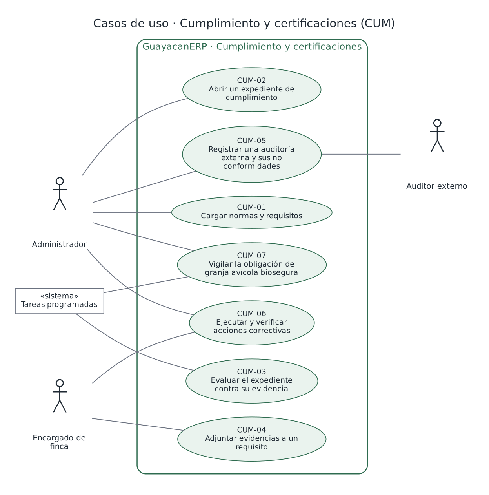
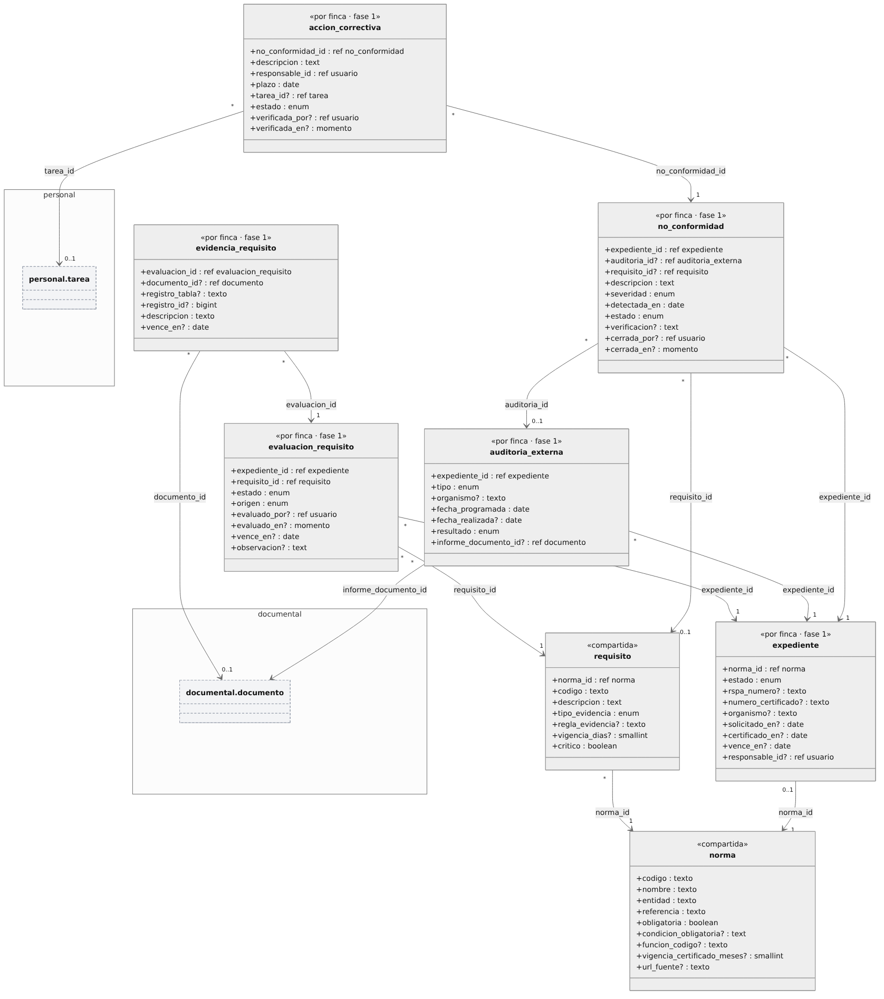
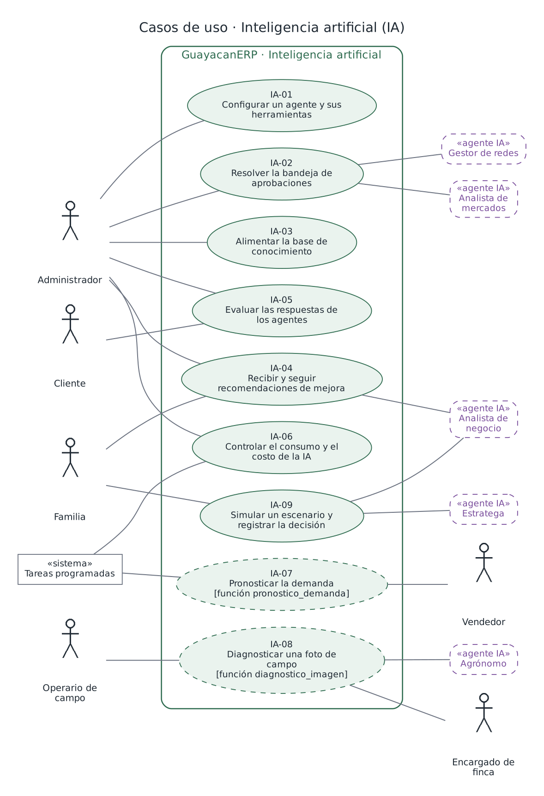
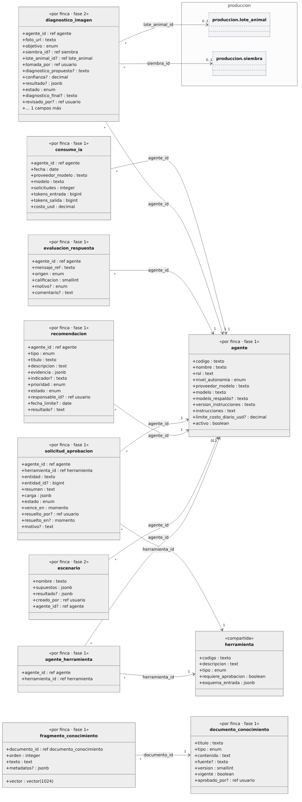
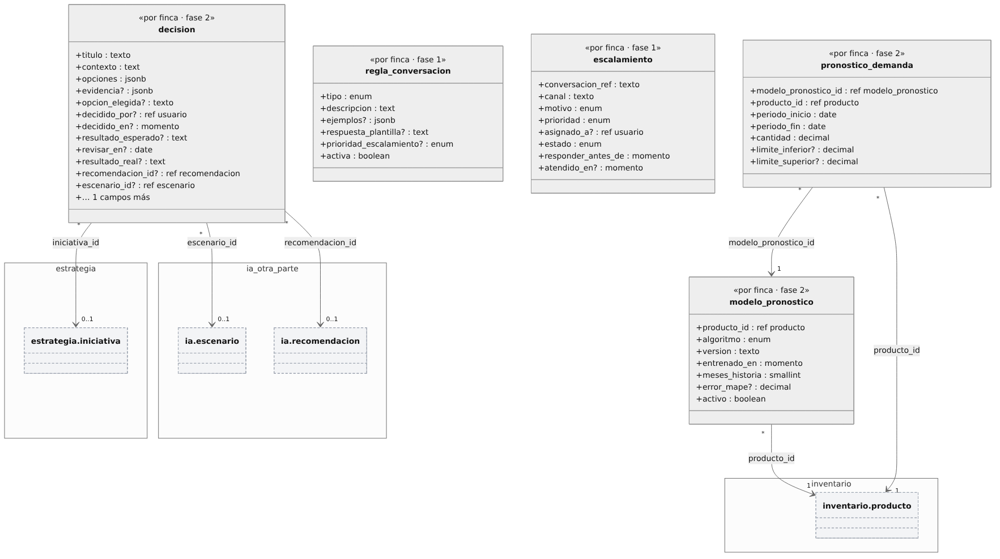

# Casos de uso 7 · Cumplimiento e inteligencia artificial

Especificación completa de los casos de uso de cumplimiento y certificaciones, e inteligencia artificial. Cada módulo trae su diagrama de casos de uso, su diagrama de clases y la ficha de cada caso.

## Cumplimiento y certificaciones (CUM)

Cada norma (ICA granja avícola biosegura, BPA, GLOBALG.A.P., ISO 21001 para la formación) se carga como lista de requisitos con una regla de evidencia. Una tarea diaria evalúa el expediente contra lo que ya existe en el sistema —habilitaciones vigentes, documentos, registros recientes— y lo vencido pasa a no cumple. Las auditorías dejan no conformidades que solo se cierran con todas sus acciones verificadas.

### CUM-01 · Cargar normas y requisitos

| Campo | Detalle |
| --- | --- |
| Objetivo | Tener cada norma como lista verificable de requisitos |
| Disparador | Instalación o norma nueva |
| Precondiciones | Administrador |
| Postcondiciones | Norma con código, entidad y función asociada; requisitos con regla de evidencia y vigencia en días |
| Actores | Primario: Administrador. Secundarios: ninguno |
| Fase y función | Fase 1 · siempre activa |
| Relaciones | ninguna |
| Reglas en la base | Validación de formato y permisos de DRF. La regla de evidencia es `competencia:<código>`, `documento:<tipo>` o `registro:<esquema.tabla>` |
| Datos | `cumplimiento.norma`, `cumplimiento.requisito` |
| API | CRUD `/api/v1/cumplimiento/normas/` y `/api/v1/cumplimiento/requisitos/` |
| Pruebas | v5 Cumplimiento |
| Requerimientos | RQ-33 cumplimiento y certificaciones (ICA, BPA, GLOBALG.A.P., ISO 21001) |

**Flujo principal**

1. Los datos iniciales traen ICA\_GAB (GAB-01..08), BPA (BPA-01..05) e ISO\_21001.
2. El administrador revisa los requisitos y ajusta la regla de evidencia y la vigencia.

**Flujos alternos y excepciones**

- 2a. Requisito sin regla: se evalúa solo con evidencias cargadas a mano (CUM-04).

### CUM-02 · Abrir un expediente de cumplimiento

| Campo | Detalle |
| --- | --- |
| Objetivo | Empezar a preparar una certificación o registro |
| Disparador | Decisión de certificarse o exigencia legal |
| Precondiciones | Norma cargada; si la norma depende de una función, encendida (ISO 21001 depende de una función apagada al instalar) |
| Postcondiciones | Expediente abierto con estado y, cuando aplique, número RSPA |
| Actores | Primario: Administrador. Secundarios: ninguno |
| Fase y función | Fase 1 · siempre activa |
| Relaciones | ninguna |
| Reglas en la base | `cumplimiento.validar_expediente()` (exige la función de la norma) |
| Datos | `cumplimiento.expediente` |
| API | CRUD `/api/v1/cumplimiento/expedientes/` |
| Pruebas | v5 Cumplimiento |
| Requerimientos | RQ-33 cumplimiento y certificaciones |

**Flujo principal**

1. El administrador elige la norma y abre el expediente.
2. Ejecuta la primera evaluación (CUM-03) para ver la brecha.

**Flujos alternos y excepciones**

- 1a. Norma con la función apagada: rechazado con el nombre de la función.

### CUM-03 · Evaluar el expediente contra su evidencia

| Campo | Detalle |
| --- | --- |
| Objetivo | Saber cada día qué requisitos se cumplen y cuáles vencieron |
| Disparador | Tarea diaria o botón Evaluar |
| Precondiciones | Expediente abierto |
| Postcondiciones | Una evaluación por requisito con estado (cumple, no cumple, no aplica, pendiente), origen automático y fecha de vencimiento; devuelve cuántos faltan |
| Actores | Primario: Tareas programadas. Secundarios: ninguno |
| Fase y función | Fase 1 · siempre activa |
| Relaciones | ninguna |
| Reglas en la base | `cumplimiento.evaluar_expediente()` |
| Datos | `cumplimiento.evaluacion_requisito` |
| API | `POST /api/v1/cumplimiento/expedientes/{id}/evaluar/`; consulta `/api/v1/cumplimiento/evaluaciones-requisito/` |
| Pruebas | v5 Cumplimiento |
| Requerimientos | RQ-33 cumplimiento y certificaciones |

**Flujo principal**

1. La tarea crea las evaluaciones que falten.
2. Para cada requisito aplica su regla: habilitación vigente, documento vigente o registro reciente.
3. Si no hay regla, mira las evidencias cargadas y su vencimiento.
4. Actualiza estados y el panel muestra el avance del expediente y lo que vence pronto.

**Flujos alternos y excepciones**

- 2a. Requisito marcado no aplica: no se toca.
- 4a. Un requisito pasó a no cumple: aviso al administrador.

### CUM-04 · Adjuntar evidencias a un requisito

| Campo | Detalle |
| --- | --- |
| Objetivo | Respaldar requisitos que el sistema no puede comprobar solo |
| Disparador | Visita, foto, certificado o acta |
| Precondiciones | Evaluación del requisito creada |
| Postcondiciones | Evidencia con archivo, fecha y vencimiento |
| Actores | Primario: Encargado de finca. Secundarios: ninguno |
| Fase y función | Fase 1 · siempre activa |
| Relaciones | ninguna |
| Reglas en la base | Validación de formato y permisos de DRF; la evaluación siguiente la tiene en cuenta |
| Datos | `cumplimiento.evidencia_requisito` |
| API | CRUD `/api/v1/cumplimiento/evidencias-requisito/` |
| Pruebas | v5 Cumplimiento |
| Requerimientos | RQ-33 cumplimiento y certificaciones |

**Flujo principal**

1. El encargado abre el requisito desde el celular.
2. Toma la foto o adjunta el archivo y pone la fecha de vencimiento si la tiene.

**Flujos alternos y excepciones**

- 2a. Sin conexión: queda en la cola y sube al volver la señal.

### CUM-05 · Registrar una auditoría externa y sus no conformidades

| Campo | Detalle |
| --- | --- |
| Objetivo | Guardar el resultado de la visita del ICA o del certificador |
| Disparador | Auditoría programada |
| Precondiciones | Expediente abierto |
| Postcondiciones | Auditoría con fecha, auditor y resultado; no conformidades mayores o menores abiertas |
| Actores | Primario: Administrador. Secundarios: Auditor externo |
| Fase y función | Fase 2 · siempre activa |
| Relaciones | ninguna |
| Reglas en la base | Validación de formato y permisos de DRF |
| Datos | `cumplimiento.auditoria_externa`, `cumplimiento.no_conformidad` |
| API | `GET /api/v1/cumplimiento/expedientes/{id}/paquete-auditor/`; CRUD `/api/v1/cumplimiento/auditorias-externas/` y `/api/v1/cumplimiento/no-conformidades/` |
| Pruebas | v5 Cumplimiento |
| Requerimientos | RQ-33 cumplimiento y certificaciones |

**Flujo principal**

1. Antes de la visita el administrador descarga el paquete del auditor (requisitos, estados y evidencias en PDF).
2. Después registra la auditoría y cada no conformidad con su requisito.

**Flujos alternos y excepciones**

- 2a. Sin no conformidades: la auditoría queda conforme.

### CUM-06 · Ejecutar y verificar acciones correctivas

| Campo | Detalle |
| --- | --- |
| Objetivo | Corregir la causa y probar que funcionó |
| Disparador | No conformidad abierta |
| Precondiciones | No conformidad registrada |
| Postcondiciones | Acciones hechas y verificadas por una persona; no conformidad cerrada con su verificación |
| Actores | Primario: Encargado de finca, Administrador. Secundarios: ninguno |
| Fase y función | Fase 2 · siempre activa |
| Relaciones | ninguna |
| Reglas en la base | `cumplimiento.verificar_accion()` (solo se verifica una acción hecha), `cumplimiento.cerrar_no_conformidad()` (todas las acciones verificadas y la verificación escrita) |
| Datos | `cumplimiento.accion_correctiva`, `cumplimiento.no_conformidad`, `personal.tarea` |
| API | CRUD `/api/v1/cumplimiento/acciones-correctivas/`; `POST /api/v1/cumplimiento/acciones-correctivas/{id}/verificar/`; `POST /api/v1/cumplimiento/no-conformidades/{id}/cerrar/` |
| Pruebas | v5 Cumplimiento |
| Requerimientos | RQ-33 cumplimiento y certificaciones, RQ-28 tareas |

**Flujo principal**

1. El administrador define la causa y las acciones; cada una genera una tarea para su responsable.
2. El responsable la ejecuta con evidencia y la marca hecha.
3. El administrador la verifica.
4. Con todas verificadas, escribe la verificación y cierra la no conformidad.

**Flujos alternos y excepciones**

- 3a. Verificar una acción pendiente: «Solo se verifica una acción hecha».
- 4a. Acciones sin verificar: «no se cierra sin todas sus acciones correctivas verificadas».
- 4b. Ya cerrada: rechazado.

### CUM-07 · Vigilar la obligación de granja avícola biosegura

| Campo | Detalle |
| --- | --- |
| Objetivo | Avisar cuando la finca llegue al tamaño que obliga a certificarse |
| Disparador | Tarea diaria y cambio de lotes de aves |
| Precondiciones | Lotes de aves de postura o cría activos |
| Postcondiciones | Situación «en regla» o alerta |
| Actores | Primario: Tareas programadas, Administrador. Secundarios: ninguno |
| Fase y función | Fase 1 · siempre activa |
| Relaciones | ninguna |
| Reglas en la base | Vista `cumplimiento.v_granja_biosegura` (Resolución ICA 3651 de 2014: desde 200 aves de postura o levante) |
| Datos | `produccion.lote_animal` |
| API | `GET /api/v1/cumplimiento/granja-biosegura/` |
| Pruebas | v5 Cumplimiento |
| Requerimientos | RQ-33 cumplimiento y certificaciones |

**Flujo principal**

1. La tarea consulta la vista.
2. Si hay 200 aves o más sin certificado, alerta al administrador y propone abrir el expediente ICA\_GAB.

**Flujos alternos y excepciones**

- 2a. Expediente certificado: en regla.

## Inteligencia artificial (IA)

Registro de los 14 agentes, sus herramientas (mínimo privilegio), la bandeja donde una persona aprueba lo que proponen, la base de conocimiento con búsqueda semántica (pgvector), las recomendaciones de mejora, el costo diario y las funciones avanzadas: pronóstico, diagnóstico por foto y simulación de escenarios.

### IA-01 · Configurar un agente y sus herramientas

| Campo | Detalle |
| --- | --- |
| Objetivo | Que cada agente tenga solo las herramientas que necesita, con su modelo, límite de costo y usuario técnico |
| Disparador | Instalación o agente nuevo |
| Precondiciones | Administrador |
| Postcondiciones | Agente activo con sus herramientas MCP autorizadas |
| Actores | Primario: Administrador. Secundarios: ninguno |
| Fase y función | Fase 1 · siempre activa |
| Relaciones | ninguna |
| Reglas en la base | Mínimo privilegio: el servidor MCP solo expone las herramientas ligadas al agente; el token del agente fija `app.agente_id` y `nucleo.exigir_persona()` lo frena en las decisiones |
| Datos | `ia.agente`, `ia.herramienta`, `ia.agente_herramienta` |
| API | CRUD `/api/v1/ia/agentes/`, `/api/v1/ia/herramientas/` y `/api/v1/ia/agentes/{id}/herramientas/` |
| Pruebas | pendiente: escribir la prueba al construir |
| Requerimientos | RQ-23 agentes de IA que proponen y una persona decide |

**Flujo principal**

1. El administrador revisa los 14 agentes cargados.
2. Ajusta modelo, límite diario y herramientas.
3. Activa o pausa el agente.

**Flujos alternos y excepciones**

- 2a. Herramienta de escritura sobre dinero o personas: el sistema advierte que la acción final siempre irá a la bandeja.

### IA-02 · Resolver la bandeja de aprobaciones

| Campo | Detalle |
| --- | --- |
| Objetivo | Que una persona decida todo lo que un agente propone: precios, publicaciones, compras, respuestas sensibles |
| Disparador | Un agente crea una solicitud |
| Precondiciones | Solicitud pendiente |
| Postcondiciones | Solicitud aprobada (y la acción ejecutada) o rechazada con motivo |
| Actores | Primario: Administrador. Secundarios: Analista de mercados (IA), Gestor de redes (IA) |
| Fase y función | Fase 1 · siempre activa |
| Relaciones | ninguna |
| Reglas en la base | `nucleo.exigir_persona()` |
| Datos | `ia.solicitud_aprobacion` |
| API | `GET /api/v1/ia/solicitudes-aprobacion/?estado=pendiente`; `POST /api/v1/ia/solicitudes-aprobacion/{id}/aprobar/` y `/rechazar/` |
| Pruebas | v5 IA |
| Requerimientos | RQ-23 agentes de IA que proponen y una persona decide |

**Flujo principal**

1. El administrador abre la bandeja (con aviso push).
2. Ve la propuesta, el razonamiento del agente y los datos usados.
3. Aprueba, edita y aprueba, o rechaza.
4. Al aprobar, el servicio ejecuta la acción en nombre de la persona y publica el evento.

**Flujos alternos y excepciones**

- 3a. Un agente intenta aprobar: «requiere una persona».
- 3b. La solicitud venció: queda expirada y el agente lo sabe.

### IA-03 · Alimentar la base de conocimiento

| Campo | Detalle |
| --- | --- |
| Objetivo | Que los agentes respondan con los documentos de la finca y no inventen |
| Disparador | Documento nuevo (guía técnica, política, menú, reglamento) |
| Precondiciones | Documento aprobado |
| Postcondiciones | Fragmentos con su vector; búsqueda semántica por similitud de coseno |
| Actores | Primario: Administrador. Secundarios: ninguno |
| Fase y función | Fase 1 · siempre activa |
| Relaciones | ninguna |
| Reglas en la base | Índice HNSW sobre `ia.fragmento_conocimiento.vector`; la búsqueda respeta la seguridad por finca |
| Datos | `ia.documento_conocimiento`, `ia.fragmento_conocimiento` |
| API | `POST /api/v1/ia/documentos-conocimiento/{id}/indexar/`; `POST /api/v1/ia/buscar/` |
| Pruebas | pendiente: escribir la prueba al construir |
| Requerimientos | RQ-23 agentes de IA que proponen y una persona decide |

**Flujo principal**

1. El administrador sube el documento.
2. Celery lo parte en fragmentos, calcula los vectores y los guarda.
3. Los agentes consultan con `buscar` y citan el fragmento en su respuesta.

**Flujos alternos y excepciones**

- 2a. Documento reemplazado: se borran los fragmentos viejos y se reindexa.

### IA-04 · Recibir y seguir recomendaciones de mejora

| Campo | Detalle |
| --- | --- |
| Objetivo | Mejorar cada semana con el ciclo PHVA a partir de los datos |
| Disparador | Ciclo semanal o indicador en rojo |
| Precondiciones | Datos del periodo |
| Postcondiciones | Recomendación con evidencia, acción propuesta y estado (nueva, aceptada, descartada, hecha, evaluada) |
| Actores | Primario: Administrador, Familia. Secundarios: Analista de negocio (IA) |
| Fase y función | Fase 1 · siempre activa |
| Relaciones | ninguna |
| Reglas en la base | Ciclo PHVA semanal: el agente propone; aceptar o descartar es de una persona |
| Datos | `ia.recomendacion` |
| API | CRUD `/api/v1/ia/recomendaciones/` |
| Pruebas | pendiente: escribir la prueba al construir |
| Requerimientos | RQ-23 agentes de IA que proponen y una persona decide |

**Flujo principal**

1. El Analista de negocio revisa indicadores, mortalidad, ventas y quejas y redacta recomendaciones.
2. La familia acepta o descarta cada una.
3. Las aceptadas se vuelven tareas; al cerrar, se registra si dieron resultado.

**Flujos alternos y excepciones**

- 2a. Descartada: con motivo, para que el agente no la repita.

### IA-05 · Evaluar las respuestas de los agentes

| Campo | Detalle |
| --- | --- |
| Objetivo | Medir la calidad de lo que responden los agentes y corregirlos |
| Disparador | Fin de una conversación o revisión de muestras |
| Precondiciones | Conversación registrada en MongoDB |
| Postcondiciones | Calificación con comentario ligada a la conversación |
| Actores | Primario: Cliente, Administrador. Secundarios: ninguno |
| Fase y función | Fase 1 · siempre activa |
| Relaciones | ninguna |
| Reglas en la base | Validación de formato y permisos de DRF |
| Datos | `ia.evaluacion_respuesta` |
| API | CRUD `/api/v1/ia/evaluaciones-respuesta/` |
| Pruebas | pendiente: escribir la prueba al construir |
| Requerimientos | RQ-23 agentes de IA que proponen y una persona decide |

**Flujo principal**

1. Al cerrar la atención, el cliente califica con 1 a 5 estrellas.
2. El administrador revisa una muestra semanal y anota correcciones.
3. Las correcciones alimentan la base de conocimiento o el prompt del agente.

**Flujos alternos y excepciones**

- 1a. El cliente no califica: queda sin nota.

### IA-06 · Controlar el consumo y el costo de la IA

| Campo | Detalle |
| --- | --- |
| Objetivo | Que la IA no gaste más de lo previsto |
| Disparador | Cada llamada al modelo y cierre diario |
| Precondiciones | Agente con límite diario |
| Postcondiciones | Consumo por llamada (tokens, costo); agente pausado al pasar el límite |
| Actores | Primario: Administrador. Secundarios: Tareas programadas |
| Fase y función | Fase 1 · siempre activa |
| Relaciones | ninguna |
| Reglas en la base | Límite de costo diario por agente |
| Datos | `ia.consumo_ia`, `ia.agente` |
| API | `GET /api/v1/ia/consumos/?desde=&hasta=&agente=` |
| Pruebas | pendiente: escribir la prueba al construir |
| Requerimientos | RQ-23 agentes de IA, RNF-12 bajo costo |

**Flujo principal**

1. El orquestador registra cada llamada con tokens y costo (LiteLLM).
2. Antes de llamar, compara lo gastado hoy con el límite.
3. El panel muestra el costo por agente y por mes.

**Flujos alternos y excepciones**

- 2a. Límite alcanzado: el agente responde con un mensaje fijo y pasa la conversación a una persona.

### IA-07 · Pronosticar la demanda

| Campo | Detalle |
| --- | --- |
| Objetivo | Planear producción y compras con la demanda esperada |
| Disparador | Tarea semanal |
| Precondiciones | Función `pronostico_demanda` encendida; al menos 12 meses de ventas del producto |
| Postcondiciones | Pronóstico por producto y semana con intervalo, ligado a la versión del modelo |
| Actores | Primario: Tareas programadas. Secundarios: Vendedor |
| Fase y función | Fase 3 · función `pronostico_demanda` (apagada al instalar) |
| Relaciones | ninguna |
| Reglas en la base | Mínimo 12 meses de ventas |
| Datos | `ia.modelo_pronostico`, `ia.pronostico_demanda` |
| API | `GET /api/v1/ia/pronosticos-demanda/?producto=`; CRUD `/api/v1/ia/modelos-pronostico/` |
| Pruebas | pendiente: escribir la prueba al construir |
| Requerimientos | RQ-23 agentes de IA |

**Flujo principal**

1. La tarea entrena o actualiza el modelo por producto.
2. Guarda el pronóstico de las próximas semanas.
3. El vendedor y el encargado lo ven junto a la producción planeada.

**Flujos alternos y excepciones**

- 1a. Menos de 12 meses: el producto se omite y se explica por qué.

### IA-08 · Diagnosticar una foto de campo

| Campo | Detalle |
| --- | --- |
| Objetivo | Identificar plagas, enfermedades o deficiencias desde una foto, siempre confirmado por una persona |
| Disparador | El operario ve algo raro en un cultivo o un animal |
| Precondiciones | Función `diagnostico_imagen` encendida |
| Postcondiciones | Diagnóstico propuesto con confianza; revisado como confirmado, corregido o descartado |
| Actores | Primario: Operario de campo. Secundarios: Agrónomo (IA), Encargado de finca |
| Fase y función | Fase 2 · función `diagnostico_imagen` (apagada al instalar) |
| Relaciones | ninguna |
| Reglas en la base | `ia.validar_diagnostico()`: revisar exige persona; al corregir se escribe el diagnóstico final; uno revisado no cambia |
| Datos | `ia.diagnostico_imagen` |
| API | CRUD `/api/v1/ia/diagnosticos-imagen/`; `POST /api/v1/ia/diagnosticos-imagen/{id}/revisar/` |
| Pruebas | v5 IA |
| Requerimientos | RQ-23 agentes de IA |

**Flujo principal**

1. El operario toma la foto en la PWA, ligada al lote.
2. El Agrónomo propone el diagnóstico y el manejo, citando la base de conocimiento.
3. El encargado lo confirma, corrige o descarta.
4. Si se confirma, puede crear la tarea de manejo.

**Flujos alternos y excepciones**

- 1a. Sin conexión: la foto se guarda en la cola y el diagnóstico llega después.
- 3a. Corregido sin diagnóstico final: «indique el diagnóstico final».
- 3b. Ya revisado: rechazado.

### IA-09 · Simular un escenario y registrar la decisión

| Campo | Detalle |
| --- | --- |
| Objetivo | Comparar opciones (¿más aves o más cabañas?) y dejar escrita la decisión |
| Disparador | Decisión importante |
| Precondiciones | Supuestos del escenario |
| Postcondiciones | Escenarios con resultados; decisión con opción elegida, quién y cuándo, inmutable |
| Actores | Primario: Familia. Secundarios: Analista de negocio (IA), Estratega (IA) |
| Fase y función | Fase 2 · siempre activa |
| Relaciones | ninguna |
| Reglas en la base | `ia.validar_decision()`: tomar la decisión exige persona; una decisión tomada no se cambia |
| Datos | `ia.escenario`, `ia.decision` |
| API | CRUD `/api/v1/ia/escenarios/` y `/api/v1/ia/decisiones/` |
| Pruebas | v5 IA |
| Requerimientos | RQ-23 agentes de IA, RQ-37 estrategia de negocio |

**Flujo principal**

1. La familia plantea la pregunta y las opciones.
2. Los agentes arman un escenario por opción con las fórmulas de finanzas y estrategia.
3. La familia elige y la base registra la decisión.

**Flujos alternos y excepciones**

- 3a. Cambiar una decisión tomada: «registre una decisión nueva».
